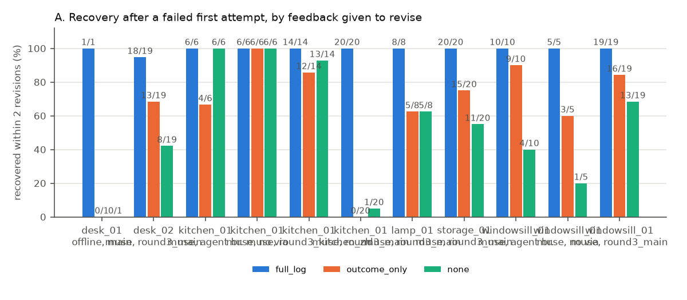
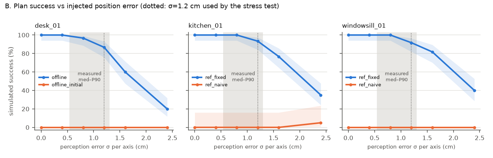
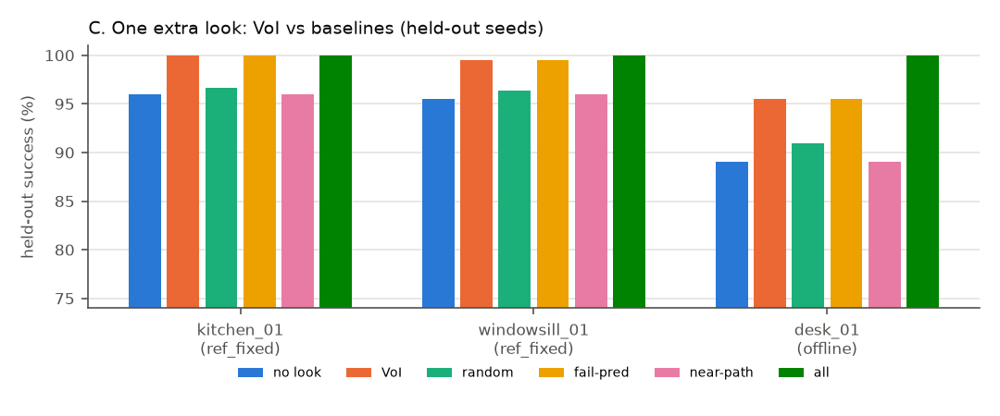

# Rehearsal — evaluation

_Generated by `eval/render_eval.py` from `eval/results/`. Re-run everything: `eval/run_all.sh` (offline parts $0; Muse Spark calls are served from the shared response cache when unchanged)._

## Evaluation v3 (definitive) — supersedes every earlier headline number

Run on 2026-10-31 (16:43–17:31 ET) with the current `main` code (`58a842f`, `code#189b1a39c1`), the shipped
English `demo_instruction` of each scene, Muse Spark 1.3 in Contributor mode (all five scenes are public,
hand-designed), default reasoning effort, one harness (`eval/run_eval.py --demo-only`) and one analysis
(`eval/round3_analyze.py`). Results: `eval/results/eval_20261031_173045_round3_main.json` (main),
`eval_20261031_170047_round3_kitchen_zh.json` and `round3_kitchen_refgoals.json` (kitchen factor arms; the reference-goals arm was stopped at 14 of 20 repeats for budget),
summary with CIs in `eval/results/round3_summary.json`. Cost of all v3 runs: **$1.12** (ledger, `eval.*`).

**Protocol.** Each repeat is the product pipeline: Muse compiles goals from the instruction, writes a plan, and
the plan is simulated once (attempt 1). Scoring is always against the scene's hand-verified `reference.goals`
plus implicit `undisturbed` (the model never sees them). If attempt 1 fails, the *same* failed attempt is revised
under three feedback conditions (paired; only the revise input differs): **full log** (product: failed goals with
numbers, IK/reach error, evidence sentences), **failed predicates only** (names + "aborted" flag), **"it failed"
only** (plan + success=false). Up to 2 revisions, stopping when the agent's own goals pass. Repeats are made
independent by an inert `[eval trial k]` line (repeat 0 is the product's exact prompt). Intervals are Wilson 95%;
the paired test is exact McNemar (two-sided binomial on discordant pairs). In no case did the agent's own goals
pass while the reference goals failed, so the two scorings agree everywhere.

### 1. First try (n = 20 per scene)

| scene | first plan succeeded | first plan failed | how it failed (first attempts) |
|---|---|---|---|
| desk_02 | 1/20 (1–24%) | 19/20 | out of reach at the carry height (IK) 19 |
| kitchen_01 | 0/20 (0–16%) | 20/20 | gripper body pressed on the kettle (protective stop) 19, IK 1 |
| lamp_01 | 12/20 (39–78%) | 8/20 | hit the lamp / disturbed it, IK, protective stop (mixed) |
| storage_01 | 0/20 (0–16%) | 20/20 | out of reach at the carry height (IK) 20 |
| windowsill_01 | 1/20 (1–24%) | 19/20 | out of reach at the carry height (IK) 19 |
| **all five** | **14/100 (8–22%)** | **86/100 (78–91%)** | |

### 2. Log ablation on the 86 failed first plans (paired, recovered within 2 revisions)

| scene | failed first plans | full log | failed predicates only | "it failed" only | full vs none: discordant (exact p) |
|---|---|---|---|---|---|
| desk_02 | 19 | 18/19 (75–99%) | 13/19 (46–85%) | 8/19 (23–64%) | 10:0 (p = 0.002) |
| kitchen_01 | 20 | **20/20 (84–100%)** | **0/20 (0–16%)** | **1/20 (1–24%)** | 19:0 (p = 4×10⁻⁶) |
| lamp_01 | 8 | 8/8 (68–100%) | 5/8 (31–86%) | 5/8 (31–86%) | 3:0 (p = 0.25) |
| storage_01 | 20 | 20/20 (84–100%) | 15/20 (53–89%) | 11/20 (34–74%) | 9:0 (p = 0.004) |
| windowsill_01 | 19 | 19/19 (83–100%) | 16/19 (62–94%) | 13/19 (46–85%) | 6:0 (p = 0.03) |
| **pooled** | **86** | **85/86 (94–100%)** | **49/86 (46–67%)** | **38/86 (34–55%)** | **47:0 (p = 1.4×10⁻¹⁴)** |

With only **one** revision the gap is larger: full log 70/86 (72–88%), failed predicates 22/86 (18–36%), "it
failed" 11/86 (7–21%). Full log vs failed-predicates-only: 36:0 discordant (p = 3×10⁻¹¹). There is not a single
failed plan that a blind or predicates-only retry fixed and the full log did not. lamp_01 is the one scene where
the effect is not significant (only 8 failures; blind retries fix 5 of 8).

### 3. Conflict (a), kitchen "0/5 without the log" vs "20/20 without the log": explained

The two numbers were measured with **different instruction languages**, and the difference is real and reproducible:

| arm (same harness, same code, same scene) | instruction | goals given to Muse | first try OK | blind ("it failed") recovered | full log recovered |
|---|---|---|---|---|---|
| v3 main | English "Put the cup on the coaster, then put the kettle on the trivet." | compiled by Muse (product) | 0/20 (0–16%) | **1/20** (1–24%) | 20/20 |
| v3 kitchen_en_refgoals (run-2 setup) | English | reference goals handed in | 0/14 (0–22%) | **1/14** (1–32%) | 14/14 |
| v3 kitchen_zh (EVAL v1 setup) | Chinese "把杯子放到杯垫上，再把水壶放到隔热垫上" | compiled by Muse | 6/20 (14–52%) | **13/14** (68–99%) | 14/14 |

- **Language is the factor.** With the English instruction Muse never moved the kettle first on its own (0 of 20
  first plans) and, told only "it failed", reordered in 2 of 20 revisions; instead it kept the instructed order
  and tried `via` detours and other carry heights, which cannot clear the gripper body. With the Chinese
  instruction it put the kettle first in 6 of 20 *first* plans (exactly the 6 first-try successes) and reordered
  blind in 13 of 14 failed cases. English "then" is read as a hard ordering constraint; Chinese 再 ("and also /
  then") apparently is not.
- **Not the cause:** the harness (both arms above use `run_eval.py`, and `experiments/agent/ablation.py` run 2
  matches the English arms), how goals reach the model (compiled vs reference: 1/20 vs 1/14), the scene version
  or executor (the Chinese arm runs on current main and reproduces EVAL v1), the system prompt (identical in all
  v3 arms), reasoning effort (default everywhere).
- **Denominator, too.** EVAL v1's "full log 20/20, none 20/20" counted all 20 repeats, including the 8 whose first
  plan already succeeded; among its failed first plans, blind recovery was 12/12. Run 2's "0/5" was over failed
  first plans only. v3 reports failed first plans only.
- So both old numbers were measured correctly, but neither was a general claim. The shipped product prompt is
  English; on it, the kitchen effect is the strongest in the evaluation (20/20 vs 1/20, p = 4×10⁻⁶).

### 4. Old claims, replaced

| old claim | status | v3 replacement |
|---|---|---|
| "5 of 5 hard scenes failed first try" (n = 1 per scene, from the shipped runs) | true but anecdotal | 86 of 100 first tries failed across the five hard scenes (lamp_01 is the easy one: 8/20) |
| "17/17 vs 8/17 vs 7/17" (run 2, 4 scenes × 5 repeats) | direction confirmed, n too small | 85/86 vs 49/86 vs 38/86 |
| kitchen "0/5 without the log" (run 2) | confirmed for English | 1/20 blind, 0/20 predicates-only, 20/20 full log |
| kitchen "every condition recovered, none 20/20" (EVAL v1) | true for the Chinese instruction only; denominator included first-try successes | Chinese: 13/14 blind; English (shipped): 1/20 |
| windowsill "15/15, 12/15, 5/15" (EVAL v1, Chinese) | superseded | English, n = 19 failed: 19/19, 16/19, 13/19 (p = 0.03); the gap is mostly at one revision: 17/19 vs 6/19 vs 2/19 |

### 5. Recommended headline sentences (true and defensible; use these verbatim)

1. **First try:** "Across five hard tabletop scenes, Muse Spark's first plan failed in simulation in 86 of 100
   tries (20 per scene)."
2. **The log matters:** "Given the physics log, it repaired 85 of the 86 failed plans within two revisions. Told
   only which goals failed, it repaired 49; told only that the plan failed, 38 (paired, p < 10⁻¹³)."
3. **Kitchen, with its condition:** "On the kitchen counter, where the fix is to move the kettle first, the log
   was the difference: 20 of 20 repaired with it, 1 of 20 without (English instruction). Asked in Chinese, the
   model often reorders on its own, so this scene's gap depends on the prompt language."
4. Short forms for tight surfaces: "86/100 first plans failed · 85/86 repaired with the physics log vs 38/86
   without". Always say "in simulation" and "within two revisions". Do not use "5 of 5", "17/17" or "0/5" any more.

**Caveats that travel with these numbers.** Everything is simulated (MuJoCo, hand-designed scenes, suction grasp);
the five scenes were designed to be hard, so 86/100 is a property of these scenes, not of everyday tables; one
model (Muse Spark 1.3 Contributor), default effort; lamp_01 contributes only 8 failed plans and its effect is not
significant on its own; the kitchen result depends on instruction language (section 3).

## Earlier headline (v1, superseded by Evaluation v3 above; kept for the record)

_v1 ran mostly on Chinese instructions and pre-merge snapshots. Where it differs from v3, v3 wins: the windowsill
and kitchen bullets below are replaced by v3 sections 2–3 (kitchen's "none 20/20" holds for the Chinese
instruction only, and its denominator included the 8 first-try successes)._

- **Reading the log matters where the fix is not guessable.** windowsill_01 (tray at the edge of reach, tall
  vase in the straight path): Muse Spark failed the first try in 15/15 runs. Recovery within 2 revisions,
  pooled over two code snapshots (n = 15 per condition, paired first attempts): **full log 15/15, failed
  predicates only 12/15, "attempt failed" only 5/15** (full vs none: Fisher exact p = 0.0002). On the
  agent-branch snapshot alone (via in the schema, n = 10): 10/10, 9/10, 4/10.
- **…and does not matter where it is.** kitchen_01 (the cup must wait until the kettle has moved): Muse first
  try 8/20, and every feedback condition recovered (full log 20/20, none 20/20, outcome-only 18/20). Reordering
  is a fix the model guesses without evidence. desk_01: Muse solved all 4 instructions first try (20/20), so
  there is nothing to revise.
- **Muse beat the action schema it was given.** Without a `via` field (pre-merge snapshot) it still solved
  windowsill_01 with the full log in 5/5 runs by relaying the mug through an intermediate reachable spot,
  using the reach limits quoted in the IK evidence.
- **Robustness is a curve, not a number.** Final plans succeed 100% at σ ≤ 0.4 cm and fall to 20–40% at
  σ = 2.4 cm (held-out seeds, n = 60). At the stress test's σ = 1.2 cm: desk 87%, kitchen 93%, windowsill 92%.
  The measured synthetic-render error (median 0.54, P90 1.30 cm) sits on the shoulder of the curve.
- **One extra look (held-out seeds 1000–1199, n = 200):** the VoI pick raises success desk 178→191
  (+13 fixed / −0 broken, p = 0.0002), kitchen 192→200, windowsill 191→199 (each +8/−0, p = 0.008), vs.
  ~182/193/193 expected for a random object. The old "35/40 → 40/40" was selected and scored on the same
  seeds; held out it is 89% → 95.5%. **Honest caveat:** a simple heuristic (re-observe the object that appears
  most often in failed predicates) picked the same object in all three scenes; "nearest the carry path" did not.
- **Cost:** the whole Muse Spark matrix (226 paid calls, Contributor mode) cost **$0.23**.

## A. Closed loop: plan → simulate → read the log → revise

Each row aggregates n independent (task, repeat) runs. *First try* and *≤2 revisions* are judged by the agent's own compiled goals (what the product stops on); *ref* re-judges the same simulation against hand-written reference goals the agent never sees. *Robust* = mean stress-test success of the final plan (σ = 1.2 cm per axis, friction/mass randomised, seeds 0–39). Conditions only differ in what the revise step sees: **full_log** (product history: failed predicates with numbers, contact events, IK/reach diagnostics, protective stops), **outcome_only** (names of failed predicates + an aborted flag), **none** ("attempt failed", plan only). Attempt 1 is shared across conditions (paired).

### `muse_agentsnap` — snapshot:agent ad6beac code#3561dea43d

eval_20261031_011905_muse_agentsnap.json · 2026-10-31 01:19:05 · wall 2024.1 s · Meta spend of these cells $0.0677 (61 paid calls, 387,163 tokens)

| scene | instruction | agent | feedback | n | first try | ≤2 rev | ≤2 rev (ref) | mean attempts | robust | failure types seen | $ |
|---|---|---|---|---|---|---|---|---|---|---|---|
| kitchen_01 | 把杯子放到杯垫上，再把水壶放到隔热垫上 | muse | full_log | 10 | 4/10 | 10/10 | 10/10 | 1.6 | 90% | pred:on×6, protective_stop×6 | 0.0000 |
| kitchen_01 | 把杯子放到杯垫上，再把水壶放到隔热垫上 | muse | outcome_only | 10 | 4/10 | 8/10 | 8/10 | 2.1 | 90% | ik_reach×3, pred:on×6, protective_stop×6 | 0.0000 |
| kitchen_01 | 把杯子放到杯垫上，再把水壶放到隔热垫上 | muse | none | 10 | 4/10 | 10/10 | 10/10 | 1.9 | 90% | ik_reach×2, pred:on×6, protective_stop×6 | 0.0155 |
| windowsill_01 | 把马克杯放到托盘上 | muse | full_log | 10 | 0/10 | 10/10 | 10/10 | 2.2 | 89% | collision×3, ik_reach×10, pred:on×1 | 0.0178 |
| windowsill_01 | 把马克杯放到托盘上 | muse | outcome_only | 10 | 0/10 | 9/10 | 9/10 | 2.5 | 91% | collision×1, ik_reach×10, pred:on×1 | 0.0125 |
| windowsill_01 | 把马克杯放到托盘上 | muse | none | 10 | 0/10 | 4/10 | 4/10 | 2.9 | 92% | ik_reach×10, pred:on×4 | 0.0218 |

Not applicable: kitchen_01 / 把杯子放到杯垫上，再把水壶放到隔热垫上 / offline; windowsill_01 / 把马克杯放到托盘上 / offline (OfflineAgent only understands the desk_01 Chinese vocabulary).

### `muse_desk_windowsill` — snapshot:robotics 979d772 code#924b3199c8

eval_20261031_004401_muse_desk_windowsill.json · 2026-10-31 00:44:01 · wall 1143.0 s · Meta spend of these cells $0.0666 (75 paid calls, 382,084 tokens)

| scene | instruction | agent | feedback | n | first try | ≤2 rev | ≤2 rev (ref) | mean attempts | robust | failure types seen | $ |
|---|---|---|---|---|---|---|---|---|---|---|---|
| desk_01 | 把杯子放进碗里，然后把书摞整齐 | muse | full_log | 5 | 5/5 | 5/5 | 5/5 | 1.0 | 88% | – | 0.0067 |
| desk_01 | 把杯子放进碗里，然后把书摞整齐 | muse | outcome_only | 5 | 5/5 | 5/5 | 5/5 | 1.0 | 88% | – | 0.0000 |
| desk_01 | 把杯子放进碗里，然后把书摞整齐 | muse | none | 5 | 5/5 | 5/5 | 5/5 | 1.0 | 88% | – | 0.0000 |
| desk_01 | 把杯子放进碗里 | muse | full_log | 5 | 5/5 | 5/5 | 5/5 | 1.0 | 88% | – | 0.0033 |
| desk_01 | 把杯子放进碗里 | muse | outcome_only | 5 | 5/5 | 5/5 | 5/5 | 1.0 | 88% | – | 0.0000 |
| desk_01 | 把杯子放进碗里 | muse | none | 5 | 5/5 | 5/5 | 5/5 | 1.0 | 88% | – | 0.0000 |
| desk_01 | 把书摞整齐 | muse | full_log | 5 | 5/5 | 5/5 | 5/5 | 1.0 | 100% | – | 0.0045 |
| desk_01 | 把书摞整齐 | muse | outcome_only | 5 | 5/5 | 5/5 | 5/5 | 1.0 | 100% | – | 0.0000 |
| desk_01 | 把书摞整齐 | muse | none | 5 | 5/5 | 5/5 | 5/5 | 1.0 | 100% | – | 0.0000 |
| desk_01 | Put the mug in the bowl, t… | muse | full_log | 5 | 5/5 | 5/5 | 5/5 | 1.0 | 88% | – | 0.0053 |
| desk_01 | Put the mug in the bowl, t… | muse | outcome_only | 5 | 5/5 | 5/5 | 5/5 | 1.0 | 88% | – | 0.0000 |
| desk_01 | Put the mug in the bowl, t… | muse | none | 5 | 5/5 | 5/5 | 5/5 | 1.0 | 88% | – | 0.0000 |
| windowsill_01 | 把马克杯放到托盘上 | muse | full_log | 5 | 0/5 | 5/5 | 5/5 | 2.0 | 95% | ik_reach×5 | 0.0124 |
| windowsill_01 | 把马克杯放到托盘上 | muse | outcome_only | 5 | 0/5 | 3/5 | 3/5 | 3.0 | 95% | collision×2, ik_reach×5, pred:on×5, pred:undisturbed×2 | 0.0180 |
| windowsill_01 | 把马克杯放到托盘上 | muse | none | 5 | 0/5 | 1/5 | 1/5 | 3.0 | 95% | ik_reach×5, pred:on×4 | 0.0163 |

### `muse_kitchen` — snapshot:robotics 979d772 code#924b3199c8

eval_20261031_003536_muse_kitchen.json · 2026-10-31 00:35:36 · wall 640.3 s · Meta spend of these cells $0.0357 (37 paid calls, 210,224 tokens)

| scene | instruction | agent | feedback | n | first try | ≤2 rev | ≤2 rev (ref) | mean attempts | robust | failure types seen | $ |
|---|---|---|---|---|---|---|---|---|---|---|---|
| kitchen_01 | 把杯子放到杯垫上，再把水壶放到隔热垫上 | muse | full_log | 10 | 4/10 | 10/10 | 10/10 | 1.7 | 90% | ik_reach×1, pred:on×6, protective_stop×6 | 0.0140 |
| kitchen_01 | 把杯子放到杯垫上，再把水壶放到隔热垫上 | muse | outcome_only | 10 | 4/10 | 10/10 | 10/10 | 2.0 | 90% | pred:on×6, protective_stop×6 | 0.0148 |
| kitchen_01 | 把杯子放到杯垫上，再把水壶放到隔热垫上 | muse | none | 10 | 4/10 | 10/10 | 10/10 | 1.6 | 90% | pred:on×6, protective_stop×6 | 0.0070 |

### `offline_main` — worktree:eval@1dec34a code#6d24342e78

eval_20261031_002736_offline_main.json · 2026-10-31 00:27:35 · wall 97.4 s · Meta spend of these cells $0.0000 (0 paid calls, 0 tokens)

| scene | instruction | agent | feedback | n | first try | ≤2 rev | ≤2 rev (ref) | mean attempts | robust | failure types seen | $ |
|---|---|---|---|---|---|---|---|---|---|---|---|
| desk_01 | 把杯子放进碗里，然后把书摞整齐 | offline | full_log | 1 | 0/1 | 1/1 | 1/1 | 2.0 | 88% | collision×1, pred:inside×1, pred:undisturbed×1 | 0.0000 |
| desk_01 | 把杯子放进碗里，然后把书摞整齐 | offline | outcome_only | 1 | 0/1 | 0/1 | 0/1 | 3.0 | – | collision×1, pred:inside×1, pred:undisturbed×1 | 0.0000 |
| desk_01 | 把杯子放进碗里，然后把书摞整齐 | offline | none | 1 | 0/1 | 0/1 | 0/1 | 3.0 | – | collision×1, pred:inside×1, pred:undisturbed×1 | 0.0000 |
| desk_01 | 把杯子放进碗里 | offline | full_log | 1 | 0/1 | 1/1 | 1/1 | 2.0 | 88% | collision×1, pred:inside×1, pred:undisturbed×1 | 0.0000 |
| desk_01 | 把杯子放进碗里 | offline | outcome_only | 1 | 0/1 | 0/1 | 0/1 | 3.0 | – | collision×1, pred:inside×1, pred:undisturbed×1 | 0.0000 |
| desk_01 | 把杯子放进碗里 | offline | none | 1 | 0/1 | 0/1 | 0/1 | 3.0 | – | collision×1, pred:inside×1, pred:undisturbed×1 | 0.0000 |
| desk_01 | 把书摞整齐 | offline | full_log | 1 | 1/1 | 1/1 | 1/1 | 1.0 | 100% | – | 0.0000 |
| desk_01 | 把书摞整齐 | offline | outcome_only | 1 | 1/1 | 1/1 | 1/1 | 1.0 | 100% | – | 0.0000 |
| desk_01 | 把书摞整齐 | offline | none | 1 | 1/1 | 1/1 | 1/1 | 1.0 | 100% | – | 0.0000 |

Not applicable: desk_01 / Put the mug in the bowl, then stack the books neatly, largest at the bottom. / offline; kitchen_01 / 把杯子放到杯垫上，再把水壶放到隔热垫上 / offline; windowsill_01 / 把马克杯放到托盘上 / offline (OfflineAgent only understands the desk_01 Chinese vocabulary).

### `round3_kitchen_zh` — worktree:eval2@89af8e2 code#189b1a39c1

eval_20261031_170047_round3_kitchen_zh.json · 2026-10-31 17:00:47 · wall 1049.2 s · Meta spend of these cells $0.1269 (102 paid calls, 721,780 tokens)

| scene | instruction | agent | feedback | n | first try | ≤2 rev | ≤2 rev (ref) | mean attempts | robust | failure types seen | $ |
|---|---|---|---|---|---|---|---|---|---|---|---|
| kitchen_01 | 把杯子放到杯垫上，再把水壶放到隔热垫上 | muse | full_log | 20 | 6/20 | 20/20 | 20/20 | 1.75 | – | ik_reach×1, pred:on×14, protective_stop×14 | 0.0385 |
| kitchen_01 | 把杯子放到杯垫上，再把水壶放到隔热垫上 | muse | outcome_only | 20 | 6/20 | 18/20 | 18/20 | 2.2 | – | ik_reach×8, pred:on×14, protective_stop×14 | 0.0496 |
| kitchen_01 | 把杯子放到杯垫上，再把水壶放到隔热垫上 | muse | none | 20 | 6/20 | 19/20 | 19/20 | 2.15 | – | ik_reach×7, pred:on×14, protective_stop×14 | 0.0388 |

### `round3_main` — worktree:eval2@89af8e2 code#189b1a39c1

eval_20261031_173045_round3_main.json · 2026-10-31 17:30:45 · wall 2846.7 s · Meta spend of these cells $0.8102 (593 paid calls, 4,536,483 tokens)

| scene | instruction | agent | feedback | n | first try | ≤2 rev | ≤2 rev (ref) | mean attempts | robust | failure types seen | $ |
|---|---|---|---|---|---|---|---|---|---|---|---|
| desk_02 | Put the pen cup on the org… | muse | full_log | 20 | 1/20 | 19/20 | 19/20 | 2.15 | – | collision×5, ik_reach×19, pred:on×19, pred:undisturbed×4, protective_stop×1 | 0.0642 |
| desk_02 | Put the pen cup on the org… | muse | outcome_only | 20 | 1/20 | 14/20 | 14/20 | 2.85 | – | collision×5, ik_reach×19, pred:on×19, pred:undisturbed×1 | 0.0756 |
| desk_02 | Put the pen cup on the org… | muse | none | 20 | 1/20 | 9/20 | 9/20 | 2.85 | – | ik_reach×19, pred:on×19 | 0.0747 |
| kitchen_01 | Put the cup on the coaster… | muse | full_log | 20 | 0/20 | 20/20 | 20/20 | 2.3 | – | ik_reach×6, pred:on×20, protective_stop×20 | 0.0510 |
| kitchen_01 | Put the cup on the coaster… | muse | outcome_only | 20 | 0/20 | 0/20 | 0/20 | 3.0 | – | ik_reach×16, pred:on×20, protective_stop×19 | 0.0964 |
| kitchen_01 | Put the cup on the coaster… | muse | none | 20 | 0/20 | 1/20 | 1/20 | 2.95 | – | ik_reach×10, pred:on×20, protective_stop×20 | 0.0823 |
| lamp_01 | Put the tea tin on the pla… | muse | full_log | 20 | 12/20 | 20/20 | 20/20 | 1.6 | – | collision×8, ik_reach×6, pred:on×6, pred:undisturbed×5, protective_stop×2 | 0.0373 |
| lamp_01 | Put the tea tin on the pla… | muse | outcome_only | 20 | 12/20 | 17/20 | 17/20 | 1.6 | – | collision×10, ik_reach×7, pred:on×7, pred:undisturbed×5, protective_stop×2 | 0.0184 |
| lamp_01 | Put the tea tin on the pla… | muse | none | 20 | 12/20 | 17/20 | 17/20 | 1.6 | – | collision×9, ik_reach×6, pred:on×7, pred:undisturbed×5, protective_stop×2 | 0.0179 |
| storage_01 | First stack the three stor… | muse | full_log | 20 | 0/20 | 20/20 | 20/20 | 2.0 | – | ik_reach×20, pred:on×7 | 0.0518 |
| storage_01 | First stack the three stor… | muse | outcome_only | 20 | 0/20 | 15/20 | 15/20 | 2.45 | – | ik_reach×20, pred:on×14, pred:stacked×8, protective_stop×1 | 0.0466 |
| storage_01 | First stack the three stor… | muse | none | 20 | 0/20 | 11/20 | 11/20 | 2.85 | – | ik_reach×20, pred:on×17, pred:stacked×15, protective_stop×2 | 0.0672 |
| windowsill_01 | Put the mug on the tray. | muse | full_log | 20 | 1/20 | 20/20 | 20/20 | 2.05 | – | collision×6, ik_reach×19, pred:on×3, pred:undisturbed×2 | 0.0385 |
| windowsill_01 | Put the mug on the tray. | muse | outcome_only | 20 | 1/20 | 17/20 | 17/20 | 2.6 | – | collision×2, ik_reach×19, pred:on×3 | 0.0356 |
| windowsill_01 | Put the mug on the tray. | muse | none | 20 | 1/20 | 14/20 | 14/20 | 2.8 | – | ik_reach×19, pred:on×6 | 0.0528 |

## B. Why 2 cm matters: success vs perception error

pc_20261031_005152.json · worktree:eval@b7296e1 code#6d24342e78 · held-out seeds starting at 1000 · common random numbers across σ (each seed's error direction is fixed and scaled). Cells: successes/n.

| scene | plan | σ=0 cm | σ=0.4 cm | σ=0.8 cm | σ=1.2 cm | σ=1.6 cm | σ=2.4 cm |
|---|---|---|---|---|---|---|---|
| kitchen_01 | ref_fixed `57cf32` | 60/60 | 60/60 | 60/60 | 56/60 | 46/60 | 21/60 |
| kitchen_01 | ref_naive `12e782` | 0/20 | 0/20 | 0/20 | 0/20 | 0/20 | 1/20 |
| windowsill_01 | ref_fixed `35606a` | 60/60 | 60/60 | 60/60 | 55/60 | 49/60 | 24/60 |
| windowsill_01 | ref_naive `f2a730` | 0/20 | 0/20 | 0/20 | 0/20 | 0/20 | 0/20 |
| desk_01 | offline `e5eeb6` | 60/60 | 60/60 | 58/60 | 52/60 | 36/60 | 12/60 |
| desk_01 | offline_initial `d82312` | 0/20 | 0/20 | 0/20 | 0/20 | 0/20 | 0/20 |

Plan labels: `ref_naive`/`ref_fixed` are the robotics engineer's hand-verified failing/fixed plans from the scene's `reference` block; `offline`/`muse` are the agents' final plans and `*_initial` their first attempts.

Grey band: perception placement error measured on synthetic renders (box_fit, exact A4 corners: median 0.54 cm, P90 1.3 cm, radial). Note the band is a *radial* error drawn on a *per-axis σ* axis; for a 2-D Gaussian the median radial error is 1.18σ, so the band sits to the right of the matching σ (conservative).

## C. Active perception: which object to look at again

ap_20261031_004449.json · worktree:eval@495806e code#6d24342e78 · σ 1.2 → 0.4 cm for the re-observed object · select on seeds 0–39, **score on held-out seeds 1000–1199**. +fixed/−broken = paired discordant seeds vs. no second look; p = exact two-sided sign test.

| scene | plan | no look | VoI pick | random (expected) | heuristic: most in failed predicates | heuristic: nearest carry path | oracle (best on held-out) | look at all |
|---|---|---|---|---|---|---|---|---|
| kitchen_01 | ref_fixed | 192/200 | 200/200 **cup_1** (+8/−0, p=0.0078) | 193.3/200 | 200/200 **cup_1** (+8/−0, p=0.0078) | 192/200 **apple_1** | 200/200 **cup_1** (+8/−0, p=0.0078) | 200/200 (+8/−0, p=0.0078) |
| windowsill_01 | ref_fixed | 191/200 | 199/200 **mug_1** (+8/−0, p=0.0078) | 192.8/200 | 199/200 **mug_1** (+8/−0, p=0.0078) | 192/200 **vase_1** (+1/−0, p=1) | 199/200 **mug_1** (+8/−0, p=0.0078) | 200/200 (+9/−0, p=0.0039) |
| desk_01 | offline | 178/200 | 191/200 **mug_1** (+13/−0, p=0.00024) | 181.9/200 | 191/200 **mug_1** (+13/−0, p=0.00024) | 178/200 **bottle_1** | 191/200 **mug_1** (+13/−0, p=0.00024) | 200/200 (+22/−0, p=0) |

Selection-set view (what the product shows at run time, seeds 0–39; optimistic because the pick is scored on the same draws it was chosen on):

- kitchen_01: base 36/40; best cup_1 40/40, coaster_1 38/40, kettle_1 36/40
- windowsill_01: base 37/40; best mug_1 39/40, vase_1 38/40, tray_1 37/40
- desk_01: base 35/40; best mug_1 40/40, bowl_1 38/40, bottle_1 35/40

(Note the y-axis starts above 0 so the few-point differences are visible; read the table for counts.)

## D. Perception accuracy (from the perception branch, now in main)

From `docs/perception.md` (synthetic renders with known ground truth: 12 images × 4 camera poses, 76 objects; real photos are expected to be worse):

| placement method | exact A4 corners (median / P90 cm) | auto-detected corners |
|---|---|---|
| `bottom_center` (original MVP) | 4.95 / 11.81 | 5.21 / 11.88 |
| **`box_fit`** (default) | **0.54 / 1.30** | **0.79 / 2.80** |

These are the numbers drawn as the grey band in B. They are *not* re-measured by eval.

## Method & caveats (read before quoting any number)

- **Everything here is simulated.** Scenes are hand-designed tabletop layouts (desk_01, kitchen_01,
  windowsill_01) built as MuJoCo primitives (cylinders, boxes, a segmented bowl) with a Franka Panda from
  MuJoCo Menagerie. No result in A–C involves a real robot or a real photo. Grasping is a suction weld
  (always succeeds once the cup is on the top face); real grasp physics is out of scope.
- **The noise model is assumed, not measured.** Stress tests draw friction ×U(0.6, 1.4), mass ×U(0.7, 1.3)
  and per-object xy position error N(0, σ) per axis with σ = 1.2 cm (the product's default), independent
  across objects. Real perception error is neither Gaussian nor independent (a bad A4 corner shifts every
  object together). Section B shows how strongly every robustness number depends on σ: treat "x/40" as
  "at σ = 1.2 cm", not as a real-world success rate. The only measured perception numbers (D) come from
  synthetic renders.
- **Seeds.** Seed s fixes friction, mass and the unit error direction (common random numbers), so two plans
  or two σ settings are compared on identical draws (paired). Section A robustness uses seeds 0–39 (as the
  product). Sections B and C score on **held-out seeds from 1000** that were never used to select a plan or a
  re-observation. Selecting and scoring on the same 40 seeds inflated the old desk_01 claim (35/40 → 40/40);
  on held-out seeds it is ~89% → ~96% (research docs/claims.md §4; reproduced in C).
- **Small n.** Muse Spark matrix: n = 5–10 repeats per (task, condition); offline agent is deterministic
  (n = 1 per task). Quote counts with their n; Wilson 95% intervals are given in B. With n = 10 a difference
  of 2–3 successes is not significant.
- **Repeats and caching.** Muse responses are cached by exact request; repeat k > 0 appends an inert
  "[eval trial k]" line to each prompt to obtain an independent sample (repeat 0 is the product's prompt).
  Re-running the matrix is free and returns identical results; it does not re-sample the model.
- **Paired ablation.** Within one repeat, goal compilation, the first plan and attempt 1 are shared by all
  three feedback conditions; only the revise input differs. When attempt 1 succeeds the conditions are
  identical by construction (counted once per condition).
- **Two success criteria.** "≤2 rev" stops on the agent's own compiled goals (what the product does);
  "ref" re-checks the same simulation against hand-written reference goals (eval/tasks.json or the
  scene's `reference.goals`), which guards against an agent compiling easy goals.
- **Data mode / cost.** All three scenes are `"privacy": "public"` (hand-designed, no user data), so Muse
  Spark ran in Contributor mode (muse-spark-1.3-contributor, ~20× cheaper). Costs come from the shared
  ledger entries tagged `eval.*`.
- **Per-cell cost column** counts ledger entries made during that cell; responses already paid by an
  aborted earlier run come from the cache and show $0. The authoritative total is the sum of all
  `eval.*` ledger entries ($0.23 for everything in this document).
- **Code under test.** Each result file records the code it ran on (`code#<hash of rehearsal/*.py>`).
  The `muse_kitchen` / `muse_desk_windowsill` runs used a read-only snapshot of the robotics branch
  (979d772, pre-merge; same scenes/executor as main after the merge). Its ACTION_SCHEMA has no `via`
  field, so on windowsill_01 Muse could not express the reference detour; it instead found a two-hop relay
  (set the mug down on an intermediate reachable spot, then carry it to the tray at a lower height) using the
  reach limits quoted in the IK evidence. `muse_agentsnap` runs on a snapshot of the agent branch (via in the
  schema, compact revise history) and is the closest to what will ship.
- **Compute budget.** Run on a shared, heavily loaded laptop: Experiment B uses n = 60 held-out seeds for
  plans that pass at σ = 0 (n = 20 for plans that already fail at σ = 0) and six σ levels; Experiment C uses
  200 held-out seeds (1000–1199). Scripts take `--n` / `--n-heldout` to rerun larger.
- **Not measured yet:** diagnosis correctness (does the written diagnosis name the true colliding pair /
  limit), and the agent engineer's tool-loop agent (`--agent-loop`), which is evaluated on their side.
