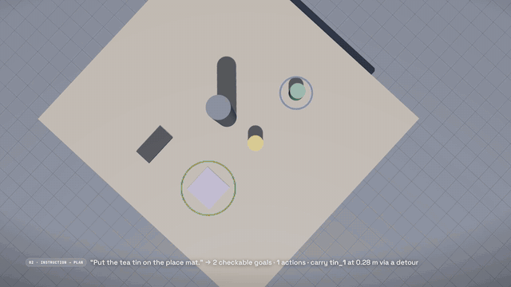
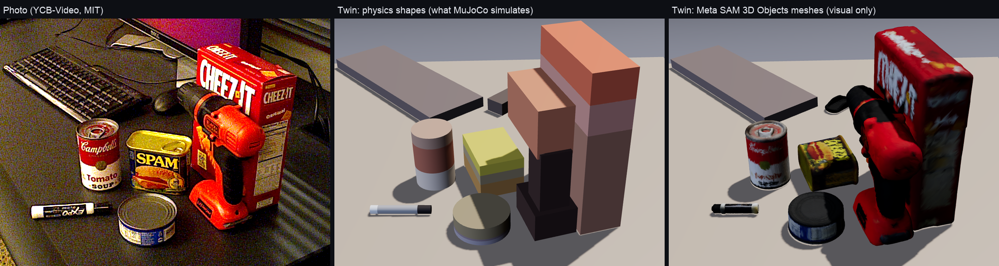
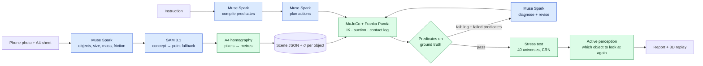

# Rehearsal

**A flight simulator for robot AI, open to everyone.** Photograph your table, say what a robot should do, and
watch it rehearse on a physics copy: what it would hit, why it fails, how it fixes itself, and whether it is
reliable. Every table you choose to share becomes a scored test case. **Every home becomes a test track.**



<sub>Live `muse-spark-1.3-contributor` run of `lamp_01` (simulation, 1.6×): attempt 1 knocks the lamp over; after reading the physics log, the corrected plan succeeds. More in [`docs/demo.gif`](docs/demo.gif) (kitchen).</sub>

**Live demo:** TODO(user): Hugging Face Spaces URL · **Video (3 min):** TODO(user): video URL ·
Meta Global AI Developer Hackathon 2026, Indie track, theme *Push the Frontier*.

## The story, in four acts

**1. The villain is a confident plan.** Muse Spark, Meta's frontier model, plans "put the tea tin on the
place mat". On paper the plan is perfect. In physics, the wrist sweeps a 48 cm lamp off the desk.
Words don't collide. The real world does.

**2. Seeing physics fixes it.** Across five hard tabletop scenes, Muse Spark's first plan failed in simulation
in 86 of 100 tries (20 per scene). Telling it "that failed" barely helps; showing it what physics saw fixes it:
given the physics log it repaired 85 of the 86 failed plans within two revisions, told only that the plan
failed, 38. On the kitchen counter, where the fix is to move the kettle first, 20 of 20 with the log and 1 of
20 without (English instruction; asked in Chinese the model often reorders on its own).

**3. Passing once isn't safe.** On a real photo the plan passed the simulation, then succeeded in only 2 of
20 runs of the model's own stress test. Rehearsal named the object worth a second look, the box; on held-out
runs that took success from 7/40 to 21/40, still only about half. So Rehearsal's verdict is a first-class
answer: **not safe yet**.

**4. A rehearsal ground for everyone.** Pilots rehearse in simulators. One day many homes may have a robot
arm, and its first touch of your things should not be its first try. Rehearsal lets anyone get familiar with
robot work before a robot arrives: photograph the table, say the task, watch the rehearsal. And every table
people choose to share becomes a scored test case with its recorded failures, the long tail of real household
clutter that no lab can stage. That part already works: [Rehearsal Bench v0](bench/README.md) has 10 tables
and 84 recorded failures, and scores any planner on identical random runs. **Every home becomes a test track.
Models propose, physics decides.**

## What we found

| **86 / 100** | **85 / 86 vs 38 / 86** | **2 / 20** |
|:---:|:---:|:---:|
| first plans that failed in simulation, five hard scenes × 20 tries (desk_02 19, kitchen 20, storage 20, windowsill 19, lamp 8; [EVAL.md](EVAL.md), Evaluation v3) | failed plans repaired within two revisions given the physics log, vs told only "it failed" (told only which goals failed: 49 / 86; paired, p < 10⁻¹³; Wilson CIs in [EVAL.md](EVAL.md)). Kitchen: 20 / 20 vs 1 / 20 with the English instruction; asked in Chinese the model often reorders on its own, so that scene's gap depends on the prompt language | real photo: the plan passed once, then 2 / 20 in the model's own 20-seed stress test. Held-out (n = 40): 7 → 21 after a closer look at the box (modelled as a sharper position estimate; a real second photo is future work). 21 / 40 is still a coin flip, so Rehearsal says not yet ([docs/real_photo_demo.md](docs/real_photo_demo.md)) |



<sub>Left: a real camera photo (YCB-Video scene 59, MIT). Middle: the shapes physics uses. Right: how each object looks, rebuilt by Meta SAM 3D Objects (7 of 8 objects; the keyboard falls back to a box). Same camera for all three.</sub>

## What's new vs prior work

Photo-to-simulation planning with a language model already exists. **SIMPACT** (Liu et al., CVPR 2026) is the
closest: one RGB-D image becomes a MuJoCo scene, a VLM proposes actions, reads the simulated rollouts and
refines them, then runs the plan on a real Franka. **VLM-TAMP** (Yang et al., ICRA 2025) re-prompts a VLM with
the failed action and the objects it collided with. ACDC, RialTo, GRS, PRoC3S and LLM³ close similar loops.
We build on that line; what Rehearsal adds is what those systems leave out, which is uncertainty:

- **"Look again."** Physics picks which object's measurement error most drives task failure, by re-running the
  whole plan under perception noise and asking, object by object, how much a sharper measurement would raise
  success. Chosen on one set of seeds, confirmed on held-out seeds (desk: 178/200 → 191/200, +13 fixed, −0 broken).
- **"Not safe yet" as a first-class verdict.** A plan that passes once is stress-tested in 40 slightly different
  worlds (perception, mass, friction), and the answer is a count, not a tick. 21/40 means "take a second photo
  of the box before the robot moves".
- **Public photos become scored test cases.** Each table someone shares (opt-in) is exported with its physics
  copy, checkable goals, every plan that failed on it and the contact log that shows why; any planner is scored
  on the same tables under identical random noise ([Rehearsal Bench v0](bench/README.md)). No prior work we found
  turns members of the public's photos into scored failure cases.

We also measured a question those systems answered by design: how much feedback detail a planner needs
(full log 85/86 vs failed goals 49/86 vs "it failed" 38/86, paired). Full table and a longer comparison:
[Related work](#related-work), [docs/novelty_scout.md](docs/novelty_scout.md).

## How it works, in plain English

1. **See.** [SAM 3.1](https://dev.meta.ai) finds every object in your photo. **SAM 3D Objects** rebuilds
   how each one looks. **Muse Spark** names them and guesses size, weight and grip.
2. **Rehearse.** The table becomes a physics scene (MuJoCo, Franka Panda arm). Muse Spark plans your task
   and the arm tries it. Code, not the model, checks whether it worked.
3. **Learn from the crash.** If it fails, Muse Spark reads the physics log (what touched what, when, how
   hard, how far the arm could reach) and fixes its own plan. It can also drive its own tools:
   *simulate*, *stress test*, *look again*, *submit*. Submit re-runs physics and rejects a failing plan.
4. **Doubt the pass.** The plan is replayed in 40 slightly different worlds. Rehearsal tells you which
   object is worth a second photo (modelled as a sharper position estimate; a real second photo is future work).
5. **Share it, if you want.** Your photo stays private by default. If you choose to, the table is exported as a
   test case: photo, physics copy, goals, and every failed plan with its log. Anyone's planner can then be
   scored on your table ([Rehearsal Bench](#rehearsal-bench-every-home-becomes-a-test-track)).

Everything below is the long version. Simulation only, no real robot. The six designed scenes are
hand-designed; `real_ycbv59` is a public dataset photo; the three `aigen_*` tables are **AI-generated test
photos** (made with an image model, not real captures), and are labelled as such everywhere they appear.

---

## What it does

1. **Photo → twin.** Muse Spark lists the objects on the table and estimates each one's size, mass range
   and friction range. SAM 3.1 segments each object from a short noun phrase (with a point-prompt fallback
   for anything the concept prompt misses). An A4 sheet in the photo fixes metric scale through a
   homography; SAM's mask is then fitted by a 3D primitive's silhouette. The result is a MuJoCo scene with
   a Franka Panda and a per-object position uncertainty `sigma_m`.
2. **Instruction → checkable goals.** "Put the mug in the bowl, then stack the books" becomes
   `inside(mug, bowl) ∧ upright(mug) ∧ stacked(large, medium, small) ∧ stable(small)`. Rehearsal's code
   (`predicates.with_implicit_goals`) then adds `undisturbed(...)` for every object the instruction did not
   mention, so the model cannot forget it. All predicates are evaluated by code on simulator ground truth.
   The model never grades itself.
3. **Plan → physics → revise.** Muse Spark plans transport actions. The arm executes them in MuJoCo. If a
   predicate fails, Muse Spark gets the simulation log (timestamped contact events with link roles, IK reach
   limits found by bisection, protective stops with forces, failed predicates with measurements) and writes
   a diagnosis and a new plan. Up to three attempts.
4. **Or let the model drive (agent loop).** With `--agent-loop`, Muse Spark gets four function tools,
   `simulate`, `stress_test`, `look_again` and `submit`, and decides the next step itself. `submit`
   re-simulates the plan and *rejects* a failing one, so the only way out is through physics.
5. **40 parallel universes.** The final plan is replayed 40 times with perception noise (σ = 1.2 cm per
   object, or the photo pipeline's per-object `sigma_m`), friction ×0.6–1.4 and mass ×0.7–1.3, using common
   random numbers so variants are comparable.
6. **"Look again" (active perception).** For each object, Rehearsal asks: if I re-observed only this one
   (σ 1.2 cm → 0.4 cm), how many universes would succeed? It tells you which object is worth a second photo.
7. **Report.** What was verified by physics, what was estimated under uncertainty, and what was assumed.

### What a real Muse Spark repair looks like

`kitchen_01`, "Put the cup on the coaster, then put the kettle on the trivet." This is a live single-shot
run, committed as `experiments/live/kitchen_01_singleshot_report.json` (`agent: muse-spark-1.3-contributor`);
the demo's `out/kitchen_01` is a separate live agent-loop run of the same scene (82 N stop at t = 6.04 s, then
Muse Spark reorders, stress-tests, looks again at the cup and submits). Muse Spark's first plan carries the cup
straight to the coaster. In MuJoCo the gripper body presses on the kettle while lowering the cup (119 N,
protective stop at t = 5.76 s); `on(kettle_1, trivet_1)` fails. With the log, Muse Spark 1.3 wrote
(verbatim, `attempts[1].plan.diagnosis`):

> "Attempt 1 failed during vertical lower of cup onto coaster, not transit. Kettle is 0.25m tall and centered
> at [0.565,0.06] only 15.5cm west of coaster center [0.72,0.06], leaving ~8cm from coaster center to kettle
> side. Gripper body extends ~7.5cm laterally, evidenced by TCP at [0.715,0.061,0.211] while hand pressed
> kettle top at [0.64,0.06,0.25] with 119N. To place 0.1m cup on 0.01m coaster the tip must descend to ~0.11m,
> so the hand must descend into the kettle volume when centered over coaster. No via or transit_height can
> avoid this vertical descent collision. Correction is to clear the obstruction first: move kettle to trivet
> first, then place cup on now-isolated coaster. Final state still satisfies both on-goals."

The revised plan (kettle first) passes every predicate. In Evaluation v3 (English instruction, 20 failed first
plans) the log was the difference on this scene: 20 of 20 repaired with it, 1 of 20 when told only "it failed".
Asked in Chinese, the model often reorders on its own (13 of 14 blind), so this scene's gap depends on the prompt
language ([EVAL.md](EVAL.md) §3).

`lamp_01` took three attempts: the first plan routed west of a 0.48 m lamp and the wrist flange knocked it
over (118 cm); the second routed east at 0.45 m, which the arm cannot reach that far out ("max is z=0.37 m");
the third kept the eastern detour and lowered the carry to 0.32 m. Each diagnosis quotes the reach limits and
contact evidence from the log; all are in `out/lamp_01/report.json`.

### What the agent loop looks like

`windowsill_01`, "Put the mug on the tray" (the tray sits at the edge of reach; a 0.32 m vase blocks the
straight path). One run, Muse Spark 1.3 driving the tools, $0.0028, 7 tool calls, 79% of prompt tokens served
from cache (`experiments/agent/loop_windowsill_01.json`; the model's own narration in brackets):

```
[model] Trying a southern detour to avoid the tall vase, will simulate it first.
simulate(mug_1->tray_1@0.45 via [[0.5,-0.1]]) -> FAILED (aborted) | IK failed during 'carry mug_1 to tray_1':
    at xy [0.748,-0.082] the tool tip can reach at most z=0.40 m ...
[model] That height can't reach the far tray, so I'm lowering the carry and routing around the vase.
simulate(mug_1->tray_1@0.24 via [[0.5,-0.15]]) -> SUCCESS
simulate(mug_1->tray_1@0.2  via [[0.5,-0.15]]) -> SUCCESS
stress_test(mug_1->tray_1@0.2 via [[0.5,-0.15]], n=20) -> 18/20
simulate(mug_1->tray_1@0.16 via [[0.5,-0.15]]) -> SUCCESS
stress_test(mug_1->tray_1@0.16 via [[0.5,-0.15]], n=20) -> 17/20
submit(mug_1->tray_1@0.2 via [[0.5,-0.15]]) -> ACCEPTED
```

### From a real photo, end to end

`real_ycbv59` starts from a **real camera photo** (YCB-Video test 000059/001152, MIT) rather than a designed
scene: Muse Spark lists 8 objects, SAM 3.1 segments all 8 (all 6 ground-truth objects found), and the twin
places them within **1.5 cm median** of the dataset ground truth (max 3.8 cm), with colours, label bands,
orientation (the marker lies flat) and compound shapes (the drill) fitted to the photo. Measured from the
photo's own camera: mean silhouette IoU 0.55 → 0.64 and colour error ΔE 21.7 → 16.3 after the fidelity pass
(`scripts/fidelity_eval.py`). Physics still runs on primitives; for looks, **Meta SAM 3D Objects** rebuilds a
mesh of each object from the same photo and mask (7 of 8 objects; the keyboard, cut by the photo edge, falls
back to its box). We ran SAM 3D Objects locally through the community MLX port
[mlx-spatial](https://github.com/appautomaton/mlx-spatial) with third-party 8-bit weights redistributed under
the SAM License, not Meta's official code or checkpoints. Muse Spark's first plan for "Put the tomato soup
can on top of the Cheez-It box." passes the nominal simulation, but its own stress test (20 seeds of its
choosing) succeeds in only **2 of 20** runs on the narrow box top. On held-out seeds 1000–1039 (n = 40) the
submitted plan succeeds **7/40**; after a closer look at the box and the drill (chosen on separate seeds, and
modelled as a sharper position estimate, not a new photo) it is **21/40**. That is still about half, and the
product's answer is "not safe yet: take a second photo of the box before the robot moves". About half a cent in
model calls. Details: [docs/real_photo_demo.md](docs/real_photo_demo.md).

### The six designed scenes

The six scenes below are **hand-designed** hard scenarios (no photo), built so that a plan that reads well
fails in physics. Their reports in `out/` are **live Muse Spark 1.3 runs** (Contributor mode, $0.015 for all
six), with the model's own diagnoses. Stress and look-again counts are on held-out seeds 1000–1039 (n = 40):

| Scene | Muse Spark attempts | What physics caught first | Stress | Look again (held-out) |
|---|---|---|---|---|
| `desk_01` | 1 (first try) | nothing to fix | 34/40 | mug_1: 34 → 37 |
| `desk_02` | 2 | reach: 0.41 m asked above the far stapler, max 0.24 m there | 24/40 | 24 → 40 |
| `kitchen_01` | 2 (+ the `submit` re-check) | gripper body on the kettle, protective stop (119 N single-shot · 82 N agent loop) | 37/40 | cup_1: 37 → 40 |
| `lamp_01` | 3 | wrist flange knocks over the 0.48 m lamp; then reach | 34/40 | 34 → 40 |
| `storage_01` | 2 | reach: 0.45 m asked on the far detour, max 0.33 m there | 37/40 | 37 → 40 |
| `windowsill_01` | 2 | reach: 0.50 m asked above the tray, max 0.26 m there | 36/40 | 36 → 40 |

The rule-based `OfflineAgent` (what `scripts/precompute.sh` and `REHEARSAL_OFFLINE=1` produce, $0, no key)
replays each scene's verified naive → fixed plan; those reports carry `agent: offline-stand-in` and the UI
labels them "offline reference replay". The UI badge always reads the report's `agent` field.

## Rehearsal Bench: every home becomes a test track

Every table someone rehearses can become a shareable, scored test case: the photo, its physics copy, the task,
the goals as checks the simulator runs, and every plan that already failed on it, with the contact log that
shows why. Any planner is then scored on the same tables under the same random noise. The unit is the
**failure case**, not just the scene. Format, licences and how to add your own table: [bench/README.md](bench/README.md);
results: [bench/LEADERBOARD.md](bench/LEADERBOARD.md).

**v0, shipped:** 10 cases (6 hand-designed, 1 real dataset photo, 3 AI-generated test photos), 84 recorded
failures (121 failed runs), built from cached outputs for **$0** in Meta API calls. Scoring is three commands and
needs no model: nominal run plus 40 noisy runs on fixed seeds 1000–1039 (friction ×0.6–1.4, mass ×0.7–1.3,
per-object position error from the case's σ), common random numbers so every planner faces identical noise.

| planner | nominal pass | robust (noisy runs that pass) | mean score |
|---|:---:|:---:|:---:|
| Muse Spark, first plan | **4/10** | **58/400** | 0.140 |
| Muse Spark, after reading the physics log | **10/10** | **233/400** | 0.583 |
| Scripted baseline (straight lines, 0.15 m carry) | **0/10** | **2/400** | 0.000 |

The same story as the findings, now on a shared yardstick: the first plan is right on 4 of 10 tables and survives
about 14% of noisy runs; after the log, 10 of 10 and about 58%. On the five tables with 20 cached Evaluation v3
tries each, the first plan passes 14/100 and the after-log plan 99/100. Each per-case cell scores one cached
plan, so read the cells as anecdotes and the pooled numbers as a first look.

**Sharing is opt-in.** Uploads are private (Standard mode) by default. Export refuses a user photo without
`--owner-consent`, refuses private uploads even with it unless `--allow-private` is added, strips EXIF, and
writes a local folder that the web page offers as a download. Nothing is uploaded anywhere by Rehearsal. No
member of the public has contributed a case yet; the ten tables are ours.

## Why it matters: a rehearsal ground for everyone

Pilots rehearse in simulators before they fly. Home robots are judged in labs and deployed in homes, and
every home is different. Today, bringing a real room into simulation takes scanners, CAD and a robotics
engineer. Rehearsal gets a usable approximation from one photo and a sheet of paper, so anyone can see what a
robot would do on *their* table, what it would hit, why it fails, how it fixes itself, and whether it is
reliable, before trusting a robot with it, and before a robot arrives at all.

The other half is for the people building the robots. Labs stage a few hundred tables; homes have millions,
and the clutter is the hard part. Each shared rehearsal is a (photo, scene, instruction, plan, failure, fix)
case with a free, checkable score from the simulator. Rehearsal Bench is the first ten.

The sim-to-real gap is the frontier, and we treat it as a quantity, not a footnote: perception error is
modelled per object, physics parameters are ranges, and the report says how robust the plan is and which
measurement would improve it most. Language models are good at proposing plans and bad at knowing whether
they are physically valid. A simulator is the opposite. Rehearsal puts each where it is strong.

## How Meta models are used

| Model | Role | Where in code |
|---|---|---|
| **Muse Spark 1.3** (`muse-spark-1.3`) | Perception: list movable objects, pick a SAM noun phrase per object, estimate dimensions, mass range, friction range | `rehearsal/perception.py` → `list_objects()` |
| **SAM 3.1** (`sam-3.1`) | Concept segmentation per noun phrase; point-prompt fallback for unmatched objects (marked low confidence). Lossless masks (decoded with `meta_sam_parser`) are fitted by the silhouette of a 3D primitive, which cuts median placement error on renders from 0.54 to 0.41 cm vs a box fit | `rehearsal/perception.py` → `sam_boxes()`, `sam_points()`, `segment_objects()`; `rehearsal/calib.py` |
| **Muse Spark 1.3** | Compile the instruction into predicates (structured output, fixed predicate vocabulary) | `rehearsal/agents.py` → `MuseAgent.compile_goals()` |
| **Muse Spark 1.3** | Plan `transport(obj, dest, in/on, transit_height, via)` actions | `rehearsal/agents.py` → `MuseAgent.plan()` |
| **Muse Spark 1.3** | Read the simulator log, diagnose, revise the plan | `rehearsal/agents.py` → `MuseAgent.revise()` |
| **Muse Spark 1.3**, function tools | **Agent loop:** the model drives `simulate` / `stress_test` / `look_again` / `submit` (strict JSON schemas, `tool_choice=auto`); `submit` is physically gated. Caps: 8 tool calls, $0.10. Measured: $0.0014–0.0028 per run, 70–80% of prompt tokens served from the prompt cache (`prompt_cache_key` per scene) | `rehearsal/agent_loop.py`; `rehearsal.rehearse --agent-loop` |
| **SAM 3.1 video** | Reality check: after the plan is executed for real, a short phone clip is tracked from the twin's boxes and each object's final position is compared with the simulation's prediction (synthetic test: median 0.87 cm, a 5 cm nudge is flagged) | `rehearsal/reality.py` |
| **SAM 3D Objects** (local, community MLX port `mlx-spatial`, 8-bit SAM-License weights) | Look-alike mesh per object from the photo and its SAM 3.1 mask, oriented and scaled to the physics primitive through the photo's calibrated camera; visual only, physics unchanged (7 of 8 objects on `real_ycbv59`) | `scripts/sam3d_assets.py`, `rehearsal/export3d.py`, `web/replay.js` mesh toggle |

All calls go through one client, `rehearsal/meta_client.py` (`chat_json`, `chat_tools`, `sam`, `sam_video`),
which caches identical requests on disk, enforces a hard budget, and logs every call's real token usage.
Synthetic renders and public Wikimedia photos use Muse Spark's Contributor mode; user uploads always use
Standard mode. The whole project, all roles and all experiments including Evaluation v3 ($1.12), spent
$3.55 on the Meta API as of Oct 31 (`budget/ledger.jsonl`).

What the models are **not** asked to do: decide success (predicates on simulator state do that), output
joint trajectories (IK does that), or invent the scale of the scene (the A4 homography does that).

## Architecture



Blue boxes propose; green boxes decide. A fuller diagram is in [submission/architecture.mmd](submission/architecture.mmd).

| File | Role |
|---|---|
| `rehearsal/perception.py` | Photo → scene JSON (Muse Spark + SAM 3.1 + A4 homography) |
| `rehearsal/scene.py` | Scene JSON → MuJoCo model (MjSpec), Panda from MuJoCo Menagerie, one suction weld per object |
| `rehearsal/sim.py` | Damped-least-squares IK, Cartesian moves, suction grasp, contact event log, rendering |
| `rehearsal/executor.py` | `transport` action, perception error as belief-vs-reality offset, run a plan |
| `rehearsal/predicates.py` | `inside / on / stacked / upright / stable / undisturbed` on simulator ground truth |
| `rehearsal/agents.py` | `MuseAgent` (Muse Spark, structured output) and `OfflineAgent` (rule-based stand-in) |
| `rehearsal/rehearse.py` | Attempt loop, parallel stress test, active perception, report |
| `rehearsal/agent_loop.py` | Muse Spark drives `simulate` / `stress_test` / `look_again` / `submit` as function tools; `agent_trace` in the report |
| `rehearsal/calib.py` | A4 sheet detection, corner ordering, pixel → table homography and full pinhole camera recovery |
| `rehearsal/synth.py` | Synthetic renders with known ground truth, and the real-photo (YCB-Video, HOPE) evaluation of perception |
| `rehearsal/reality.py` | SAM 3.1 video reality check: tracked final positions vs the simulation's prediction |
| `rehearsal/pipeline.py` | Photo → scene → rehearse jobs for the web app |
| `rehearsal/meta_client.py` | The only path to the Meta API: cache, budget cap, ledger |
| `rehearsal/server.py`, `web/` | Local web app; photo upload, three.js replay of recorded 50 Hz body poses, collision highlights, stress-test trails |
| `eval/`, `experiments/agent/` | Evaluation harness, raw results and figures ([EVAL.md](EVAL.md)); log-feedback ablation and agent-loop traces ([docs/agent.md](docs/agent.md)) |

## Quickstart

Requires git, Python 3.12 and [uv](https://docs.astral.sh/uv/) (or plain `python3.12 -m venv` + `pip`; the
script falls back to it). Tested on macOS (arm64) and in the Linux Docker image.

```bash
git clone <TODO(user): GitHub URL> rehearsal && cd rehearsal
scripts/setup.sh        # .venv (Python 3.12) + pinned deps, Franka Panda from MuJoCo Menagerie (pinned commit), .env from .env.example
scripts/precompute.sh   # (optional) regenerate the 6 scenes offline with the rule-based agent: no API key, $0 (~4 min on 14 cores). The shipped out/ are live Muse Spark runs.
.venv/bin/python -m rehearsal.server          # http://localhost:8765  (REHEARSAL_PORT to change)
```

The app opens with the six shipped Muse Spark runs and needs no API key to browse them. For new live runs and photo
upload, put your Meta Model API key ([dev.meta.ai](https://dev.meta.ai)) in `.env` as `MODEL_API_KEY=...`;
every live call is logged to `budget/ledger.jsonl` and hard-stops at `REHEARSAL_BUDGET_CAP` (default $15).

```bash
# Command line, with a key (offline, use scripts/precompute.sh: the offline stand-in only knows the demo instructions)
.venv/bin/python -m rehearsal.rehearse scenes/desk_01.json \
  "Put the mug in the bowl, then stack the books neatly" --stress 40 --look 2

# Tests (offline, ~45 s)
REHEARSAL_OFFLINE=1 .venv/bin/python -m pytest -q
```

Output goes to `out/<scene>/`: `report.md`, `report.json`, a GIF and a trajectory per attempt, and the
stress-test trails used by the 3D replay. Headless Linux: set `MUJOCO_GL=egl` (or `osmesa`) and install
Mesa (`libegl1 libgl1-mesa-dri` or `libosmesa6`); `scripts/gl_check.sh` finds a backend that works.
Manual setup, if you prefer: `uv venv -p 3.12 .venv && uv pip install --python .venv/bin/python -r requirements-dev.txt`,
then the Menagerie commands in `scripts/setup.sh`.

### Photo → scene

```bash
.venv/bin/python -m rehearsal.perception my_desk.jpg \
  --paper-corners "u1,v1 u2,v2 u3,v3 u4,v4" -o scenes/my_desk.json
```

Corners are the A4 sheet's pixel corners: near-left, near-right, far-right, far-left as seen from the robot.
Without `--paper-corners` the sheet is detected automatically. The web app's upload panel does the same
(`POST /api/perceive`): it shows SAM's boxes on the photo, the resulting scene can be edited, and then
rehearsed. How to take the photo (height, angle, where the sheet goes): [docs/perception.md](docs/perception.md).

```bash
# Let Muse Spark drive the tools instead of the fixed pipeline (one run ≈ $0.002 in Contributor mode)
.venv/bin/python -m rehearsal.rehearse scenes/windowsill_01.json "Put the mug on the tray" --agent-loop
```

### Offline mode (no API key, zero cost)

```bash
REHEARSAL_OFFLINE=1 .venv/bin/python -m rehearsal.server
```

Without `MODEL_API_KEY`, or with `REHEARSAL_OFFLINE=1`, Rehearsal uses `OfflineAgent`, a deterministic
rule-based stand-in with the same interface. It only understands the bundled demo instructions, and its
first plan is deliberately naive so the physics → diagnose → revise loop can be seen without the API.
Precomputed scenes and cached Muse Spark responses replay for free.

### Deploy (Docker / Hugging Face Space)

The `Dockerfile` builds the app for a Hugging Face Docker Space (port 7860): it fetches the Panda model,
picks a headless GL backend, and runs the offline precompute during the build, so the Space shows every
demo scene immediately with no API key. It defaults to `REHEARSAL_OFFLINE=1`. Step-by-step instructions,
including the optional (paid) live mode: [deploy/DEPLOY.md](deploy/DEPLOY.md).

```bash
docker build -t rehearsal . && docker run --rm -p 7860:7860 rehearsal   # http://localhost:7860
```

## Evaluation

Everything below is simulated; no real robot. Full tables, scripts, raw logs and caveats: [EVAL.md](EVAL.md)
(closed loop, σ-curve, active perception), [docs/agent.md](docs/agent.md) (ablation, agent loop),
[docs/perception.md](docs/perception.md) (perception accuracy).

| Metric | Value | How measured |
|---|---|---|
| Perception position error, synthetic | median **0.41 cm**, P90 1.05 cm (exact A4 corners); 0.66 / 2.70 cm with auto-detected corners | 12 MuJoCo renders from known cameras, 76 objects → Muse Spark + SAM 3.1 + homography + mask fit → vs ground truth; the suction grasp tolerates ~2 cm |
| Perception position error, real photos | median **1.71 cm**, P90 6.18 cm | 9 YCB-Video + HOPE frames, 83 objects with 6-DoF ground truth, known camera (no A4 sheet), low grazing viewpoints |
| Object recall | synthetic 76/76; real 83/84 on-table objects | concept prompt, then point-prompt fallback (flagged low confidence) |
| First plan failed in simulation (Muse Spark) | **86/100** over five hard scenes: desk_02 19/20 · kitchen_01 20/20 · storage_01 20/20 · windowsill_01 19/20 · lamp_01 8/20 (the easy control desk_01: 20/20 succeeded, EVAL v1) | EVAL.md Evaluation v3: n = 20 per scene, shipped English instruction, scored on hand-verified reference goals |
| Repaired within ≤ 2 revisions, full log | **85/86** failed first plans (70/86 with one revision) | EVAL v3 §2: the same failed attempt, revised under each condition |
| Log ablation | full log **85/86** · failed-goal names only 49/86 · "it failed" only 38/86 (47:0 discordant pairs, exact McNemar p = 1.4×10⁻¹⁴); kitchen_01 20/20 vs 0/20 vs 1/20 with the English instruction (Chinese instruction: blind 13/14, the model reorders on its own) | paired, only the revise input differs; Wilson 95% CIs in EVAL v3 §2–3; earlier, smaller runs in docs/agent.md |
| Agent loop (Muse Spark drives the tools) | windowsill: first `simulate` fails on reach, then 3 more simulates + 2 stress tests, `submit` accepted; $0.0028, 7 calls, 79% cached prompt tokens; kitchen: moved the kettle first unprompted, `look_again(cup_1)` 17/20 → 20/20, `submit` re-check; 5 calls, $0.0021 | `experiments/agent/loop_windowsill_01.json`, `out/kitchen_01/report.json` |
| Robustness vs perception error | 100% at σ ≤ 0.4 cm → 87–93% at σ = 1.2 cm → 20–40% at σ = 2.4 cm | held-out seeds, n = 60, common random numbers (EVAL §B) |
| Look again (headline) | `desk_01`: **178/200 → 191/200** after re-observing the mug (+13 fixed, −0 broken, p = 0.0002); kitchen 192 → 200, windowsill 191 → 199 | object chosen on seeds 0–39, **scored on held-out seeds 1000–1199** (EVAL §C). Same-seed selection scores (e.g. 35/40 → 40/40) are inflated and not used |
| Wall time | live Muse Spark run incl. 40 universes + look-again: 78–195 s on the five hard scenes, 36 min on `desk_01` (7 objects, loaded laptop); agent loop 74–106 s per run | `out/*/report.json wall_time_s`, `docs/agent.md` |
| Meta API cost | six shipped runs **$0.015** · Evaluation v3 $1.12 · eval matrix v1 $0.23 (226 paid calls) · ablation run 1 $0.097 · whole project $3.55 (Oct 31) | `budget/ledger.jsonl`, Contributor mode for public scenes |

## Honest limitations

- **Simulation only.** No real robot was used. Rehearsal says what a plan would do in an approximation built
  from your photo, not what a real arm will do. Whether sim robustness predicts real success is not measured.
- **Five hand-designed scenes, one model.** The scenes were built to be hard, so 86/100 first-try failures
  is a property of these scenes, not of everyday tables. lamp_01 contributes only 8 failed plans and its
  effect is not significant on its own; the kitchen gap depends on the instruction language (EVAL.md v3 §3).
  One model (Muse Spark 1.3 Contributor, default effort). The agent loop is shown on single runs, not
  evaluated at scale.
- **Suction gripper.** Grasping is a weld that succeeds once the cup is on the object's top face. Real grasp
  physics (slip, compliance, finger contact) is out of scope.
- **Primitive shapes in physics.** Objects collide as boxes, cylinders, bowls and simple compounds with
  Muse Spark's estimated dimensions. The SAM 3D Objects meshes are for looking, not colliding (the replay
  has a toggle so you can see what physics used). No articulated objects (drawers, doors), no deformables
  (cloth, cables).
- **SAM 3D Objects runs offline, slowly.** About 4–5 minutes per object on a laptop through a community
  port, so meshes are precomputed for demo scenes, not built during an upload.
- **Perception error is modelled, not eliminated.** The stress test assumes Gaussian position error per object;
  "look again" simulates a better second observation by shrinking σ. In the product it is a prompt to take
  another photo of that object.
- **Single view, flat table.** The homography assumes object footprints lie on the table plane. Tall or
  overhanging objects and strong perspective increase error. Transparent and reflective objects segment poorly.
- **Mass and friction are guesses.** That is why they are ranges, and why the result is a success count over
  universes rather than a single yes/no.

## Built during the hackathon

The hackathon ran Oct 26 – Nov 4, 2026. Commit `0bc9996` "Baseline: Rehearsal MVP before overnight sprint"
(Oct 30) is a mid-hackathon snapshot, not pre-hackathon work.
TODO(user): confirm the line below (what, if anything, predates Oct 26).

| Before Oct 26 | Oct 26 – Nov 4 |
|---|---|
| TODO(user) | Everything in this repo: perception pipeline, A4 calibration, MuJoCo scene builder, predicates, revise loop, agent loop, stress test, active perception, web app, hard scenes, evaluation |

## Licenses and third-party assets

Rehearsal's own code: TODO(user): pick MIT or Apache-2.0 and add a LICENSE file.

| Asset | Source | License |
|---|---|---|
| MuJoCo | [google-deepmind/mujoco](https://github.com/google-deepmind/mujoco) | Apache-2.0 |
| Franka Emika Panda model | [MuJoCo Menagerie](https://github.com/google-deepmind/mujoco_menagerie/tree/main/franka_emika_panda) | Apache-2.0 |
| three.js r160 (vendored in `web/vendor/`) | [threejs.org](https://threejs.org) | MIT |
| NumPy, Pillow, imageio, openai-python | PyPI | BSD-3-Clause, MIT-CMU (HPND), BSD-2-Clause, Apache-2.0 |
| Test photos in `photos/` | Wikimedia Commons | CC BY-SA 2.0 and public domain; see [photos/SOURCES.md](photos/SOURCES.md) |
| Muse Spark 1.3, SAM 3.1 | [Meta Model API](https://dev.meta.ai) | used via API under Meta's terms |
| SAM 3D Objects (Meta AI), run via the community MLX port [mlx-spatial](https://github.com/appautomaton/mlx-spatial) with third-party 8-bit weights `appautomaton/sam-3d-objects-mlx-8bit` | Meta AI / community port | SAM License (copy in `assets/sam3d/SAM_LICENSE.txt`); port MIT. Not Meta's official code or gated checkpoints |
| YCB-Video frame `photos/real/real_ycbv59.png` | YCB-Video (BOP'19 test), University of Washington RSE Lab | MIT; cite PoseCNN (Xiang et al., RSS 2018) and BOP |

## Related work

Building a physics scene from a single image is established: [ACDC](https://arxiv.org/abs/2410.07408)
[Dai et al., CoRL 2024] builds "digital cousins" for policy training, [RoLA](https://arxiv.org/abs/2509.22970)
[Zhao et al., CoRL 2025] and [RoboSnap](https://arxiv.org/abs/2607.06699) [Zhang et al., 2026] turn one photo
into a robot simulation, [RialTo](https://arxiv.org/abs/2403.03949) [Torne et al., RSS 2024] scans a scene to
fine-tune a policy in it, and [PhysGen](https://arxiv.org/abs/2409.18964) [Liu et al., ECCV 2024] does the same
for video generation. Letting a language model plan and then checking the plan in simulation is also
established. [SIMPACT](https://arxiv.org/abs/2512.05955) [Liu et al., CVPR 2026], the closest prior work, builds
a MuJoCo scene from one RGB-D image and lets a VLM refine its actions from simulated rollouts before running them
on a real Franka; a VLM judge decides success. [VLM-TAMP](https://arxiv.org/abs/2410.02193) [Yang et al., ICRA
2025] re-prompts a VLM with the failed action and the collided objects when TAMP cannot refine a subgoal.
[PRoC3S](https://arxiv.org/abs/2406.05572) [Curtis et al., 2024], [LLM³](https://arxiv.org/abs/2403.11552)
[Wang et al., IROS 2024] and [GRS](https://arxiv.org/abs/2410.15536) [Zook et al., 2024] close similar loops,
and [REFLECT](https://arxiv.org/abs/2306.15724) [Liu et al., CoRL 2023] and
[Inner Monologue](https://arxiv.org/abs/2207.05608) [Huang et al., CoRL 2022] use failure logs and environment
feedback for correction. Rehearsal follows this line and adds what these systems leave out, which is uncertainty
from perception. Like [domain randomization](https://arxiv.org/abs/1703.06907) [Tobin et al., IROS 2017], used
here for evaluation rather than training, and close in spirit to concurrent
[probabilistic physics twins](https://arxiv.org/abs/2610.19336) [Hu et al., 2026] and
[Phys2Real](https://arxiv.org/abs/2510.11689) [ICRA 2026], it re-runs the plan under perception, mass and
friction uncertainty to report a reliability number. It then ranks which object to re-observe by how much that
re-observation raises simulated task success: a Monte-Carlo, decision-relevant value of information [Howard
1966] in the tradition of active perception [Bajcsy 1988; [Move to See Better](https://arxiv.org/abs/2012.00057),
BMVC 2021] and task-driven view selection [[ACE-NBV](https://arxiv.org/abs/2309.09556), CoRL 2023], and a cheap,
myopic stand-in for belief-space planning [Kaelbling & Lozano-Pérez 2013]. We also measure how much feedback
detail a planner needs, a design choice that VLM-TAMP and LLM³ made without a graded ablation. We observe that
the instruction language changes plan ordering on one scene, which complements recent findings of multilingual
gaps in VLAs [[Beyond English](https://arxiv.org/abs/2606.15714), 2026; [Dong et al.](https://aclanthology.org/2026.acl-long.2066/),
ACL 2026]. Crowdsourced real-to-sim exists for training data (CASHER) and crowdsourced evaluation by labs
(RoboArena); we found no prior work where members of the public contribute phone photos that become scored test
cases with recorded planner failures. All results are in simulation. We have not measured sim-to-real agreement
(cf. [SIMPLER](https://arxiv.org/abs/2405.05941) [Li et al., CoRL 2024]).

Against SIMPACT specifically: Rehearsal decides success with checkable predicates on simulator state (plus the
automatic "nothing else moved" constraint) rather than a VLM judge, feeds back a structured contact/IK log rather
than renders, quantifies robustness with paired rollouts under perception and physics uncertainty, ranks which
object to re-observe, and needs no depth sensor, only a sheet of paper. Where it is weaker: no real-robot
validation, primitive geometry, an idealised suction grasp, a narrower action space. Full table with what was
and was not verified: [docs/novelty_scout.md](docs/novelty_scout.md), [docs/related-work.md](docs/related-work.md).

## Team

TODO(user): names, roles, contact / X handles.
