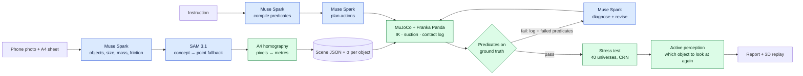

# Rehearsal

**Models propose, physics decides.**

Take one phone photo of your desk. Rehearsal turns it into a MuJoCo physics twin with a Franka Panda arm,
lets Meta's Muse Spark plan the task you ask for, and makes the plan prove itself in simulation before
you would ever trust a robot with your real objects.


**Live demo:** {{TODO-USER: Hugging Face Spaces URL}} · **Video (3 min):** {{TODO-USER: video URL}} ·
Meta Global AI Developer Hackathon 2026, Indie track, theme *Push the Frontier*.

---

## What it does

1. **Photo → twin.** Muse Spark lists the objects on the table and estimates each one's size, mass range
   and friction range. SAM 3.1 segments each object from a short noun phrase (with a point-prompt fallback
   for anything the concept prompt misses). An A4 sheet in the photo fixes metric scale through a
   homography. The result is a MuJoCo scene with a Franka Panda.
2. **Instruction → checkable goals.** "Put the mug in the bowl, then stack the books" becomes
   `inside(mug, bowl) ∧ upright(mug) ∧ stacked(large, medium, small) ∧ stable(small)`, plus an implicit
   `undisturbed(everything else)`. The predicates are evaluated by code on simulator ground truth.
   The model never grades itself.
3. **Plan → physics → revise.** Muse Spark plans transport actions. The arm executes them in MuJoCo. If a
   predicate fails, Muse Spark gets the simulation log (timestamped contact events, IK errors, failed
   predicates with measurements) and writes a diagnosis and a new plan. Up to three attempts.
4. **40 parallel universes.** The final plan is replayed 40 times with perception noise (σ = 1.2 cm per
   object), friction ×0.6–1.4 and mass ×0.7–1.3, using common random numbers so variants are comparable.
5. **"Look again" (active perception).** For each object, Rehearsal asks: if I re-observed only this one
   (σ 1.2 cm → 0.4 cm), how many universes would succeed? It tells you which object is worth a second photo.
6. **Report.** What was verified by physics, what was estimated under uncertainty, and what was assumed.

A real run on the bundled `desk_01` scene (regenerate with the command in Quickstart; `out/` is not committed
{{CONFIRM: or commit a precomputed demo report and link it here}}):

| Step | Result |
|---|---|
| Reachability | 6/7 objects reachable; `plant_pot` is outside the arm's workspace |
| Attempt 1 | failed: at t = 3.026 s the carried mug hit `bottle_1` (0.26 m tall); bottle knocked over, `inside(mug, bowl)` and `undisturbed(bottle)` fail |
| Diagnosis | "The mug hangs 0.10 m below the suction cup, so transit height must exceed 0.26 + 0.10 m; use 0.42 m." |
| Attempt 2 | all 5 predicates pass |
| Stress test | 35/40 universes succeed; failures are suction misses on the mug (3.5–3.7 cm off) and tipped mugs |
| Look again | re-observing the mug: **35/40 → 40/40**; any other object: ≤ 38/40 |

> Note: the `desk_01` failure above was produced by the rule-based `OfflineAgent`, which is naive on its
> first plan by design. On the same scene Muse Spark planned a correct transit height on its first try.
> The hard scenes below exist so that Muse Spark's *own* first plan meets physics it cannot reason out.
> {{CONFIRM: replace with the hard-scene Muse Spark failure → fix once robotics/agent land it}}

## Why it matters

Home robots are judged in labs and deployed in homes, and every home is different. Today, bringing a real
room into simulation takes scanners, CAD and a robotics engineer. Rehearsal gets a usable twin from one
photo and a sheet of paper, so anyone can rehearse a task on *their* desk before trusting a robot with it.

The sim-to-real gap is the frontier, and we treat it as a quantity, not a footnote: perception error is
modelled per object, physics parameters are ranges, and the report says how robust the plan is and which
measurement would improve it most. Language models are good at proposing plans and bad at knowing whether
they are physically valid. A simulator is the opposite. Rehearsal puts each where it is strong.

## How Meta models are used

| Model | Role | Where in code |
|---|---|---|
| **Muse Spark 1.3** (`muse-spark-1.3`) | Perception: list movable objects, pick a SAM noun phrase per object, estimate dimensions, mass range, friction range, fragility | `rehearsal/perception.py` → `list_objects()` |
| **SAM 3.1** (`sam-3.1`) | Concept segmentation per noun phrase; point-prompt fallback for unmatched objects (marked low confidence) | `rehearsal/perception.py` → `sam_boxes()`, `sam_points()`, `segment_objects()` |
| **Muse Spark 1.3** | Compile the instruction into predicates (structured output, fixed predicate vocabulary) | `rehearsal/agents.py` → `MuseAgent.compile_goals()` |
| **Muse Spark 1.3** | Plan `transport(obj, dest, in/on, transit_height[, via])` actions | `rehearsal/agents.py` → `MuseAgent.plan()` |
| **Muse Spark 1.3** | Read the simulator log, diagnose, revise the plan | `rehearsal/agents.py` → `MuseAgent.revise()` |

All calls go through one client, `rehearsal/meta_client.py` (`chat_json`, `sam`), which caches identical
requests on disk, enforces a hard budget, and logs every call's real token usage. Synthetic renders and
public Wikimedia photos use Muse Spark's Contributor mode; user uploads always use Standard mode.

What the models are **not** asked to do: decide success (predicates on simulator state do that), output
joint trajectories (IK does that), or invent the scale of the scene (the A4 homography does that).

## Architecture



Blue boxes propose; green boxes decide. A fuller diagram is in [submission/architecture.mmd](submission/architecture.mmd).

| File | Role |
|---|---|
| `rehearsal/perception.py` | Photo → scene JSON (Muse Spark + SAM 3.1 + A4 homography) |
| `rehearsal/scene.py` | Scene JSON → MuJoCo model (MjSpec), Panda from MuJoCo Menagerie, one suction weld per object |
| `rehearsal/sim.py` | Damped-least-squares IK, Cartesian moves, suction grasp, contact event log, rendering |
| `rehearsal/executor.py` | `transport` action, perception error as belief-vs-reality offset, run a plan |
| `rehearsal/predicates.py` | `inside / on / stacked / upright / stable / undisturbed` on simulator ground truth |
| `rehearsal/agents.py` | `MuseAgent` (Muse Spark, structured output) and `OfflineAgent` (rule-based stand-in) |
| `rehearsal/rehearse.py` | Attempt loop, parallel stress test, active perception, report |
| `rehearsal/meta_client.py` | The only path to the Meta API: cache, budget cap, ledger |
| `rehearsal/server.py`, `web/` | Local web app; three.js replay of recorded 50 Hz body poses, collision highlights, stress-test trails |

{{CONFIRM: add rows for pipeline.py, calib.py, synth.py, eval/ after merge}}

## Quickstart

Requires Python 3.11+ and [uv](https://docs.astral.sh/uv/) (plain `pip` also works).

```bash
git clone {{TODO-USER: GitHub URL}} rehearsal && cd rehearsal
uv venv .venv && uv pip install --python .venv/bin/python mujoco numpy pillow imageio openai
{{CONFIRM: or `uv pip install -r requirements.txt` if backend adds one}}

# Franka Panda model (Apache-2.0) from MuJoCo Menagerie
git clone --depth 1 --filter=blob:none --sparse https://github.com/google-deepmind/mujoco_menagerie.git third_party/mujoco_menagerie
(cd third_party/mujoco_menagerie && git sparse-checkout set franka_emika_panda)

# Meta Model API key (https://dev.meta.ai)
echo 'MODEL_API_KEY=your-key-here' > .env

# Web app
.venv/bin/python -m rehearsal.server          # http://localhost:8765  (REHEARSAL_PORT to change)

# Or the command line
.venv/bin/python -m rehearsal.rehearse scenes/desk_01.json \
  "Put the mug in the bowl, then stack the books neatly" --stress 40 --look 2
```

Output goes to `out/<scene>/`: `report.md`, `report.json`, a GIF and a trajectory per attempt, and the
stress-test trails used by the 3D replay.

### Photo → scene

```bash
.venv/bin/python -m rehearsal.perception my_desk.jpg \
  --paper-corners "u1,v1 u2,v2 u3,v3 u4,v4" -o scenes/my_desk.json
```

Corners are the A4 sheet's pixel corners: near-left, near-right, far-right, far-left as seen from the robot.
{{CONFIRM: describe the upload flow in the web UI once backend/ui land it}}

### Offline mode (no API key, zero cost)

```bash
REHEARSAL_OFFLINE=1 .venv/bin/python -m rehearsal.server
```

Without `MODEL_API_KEY`, or with `REHEARSAL_OFFLINE=1`, Rehearsal uses `OfflineAgent`, a deterministic
rule-based stand-in with the same interface. It only understands the bundled demo instructions, and its
first plan is deliberately naive so the physics → diagnose → revise loop can be seen without the API.
Precomputed scenes and cached Muse Spark responses replay for free.

## Evaluation

Full tables, scripts and raw logs: [EVAL.md](EVAL.md). {{CONFIRM: EVAL.md lands from the eval branch}}

| Metric | Value | How measured |
|---|---|---|
| Perception position error, median | {{EVAL: synthetic-render median position error (cm)}} | MuJoCo renders from a known camera → Muse Spark + SAM 3.1 + homography → compare with ground truth |
| Perception position error, P90 | {{EVAL: synthetic-render P90 position error (cm)}} | same, vs. the ~2 cm tolerance of a suction grasp |
| Object recall | {{EVAL: objects found / objects present}} | concept prompt alone vs. with point fallback |
| First-try success (Muse Spark) | {{EVAL: first-try success rate}} | scenes × tasks, predicates on ground truth |
| Success after revision | {{EVAL: success rate after ≤3 attempts}} | same tasks |
| Mean attempts to success | {{EVAL: mean attempts}} | |
| Log ablation | full log {{EVAL: x/N}} · predicates only {{EVAL: x/N}} · no feedback {{EVAL: x/N}} | does the contact log actually help the model fix the plan? |
| Stress-test robustness | `desk_01`: 35/40 → 40/40 after looking again at the mug | 40 universes, σ = 1.2 cm, CRN |
| Wall time | {{EVAL: photo → twin (s)}} · {{EVAL: rehearse + stress (s)}} | |
| Meta API cost | {{EVAL: total $ for the evaluation}} | from `budget/ledger.jsonl` |

## Honest limitations

- **Simulation only.** No real robot was used. Rehearsal says what a plan would do in a twin built from
  your photo, not what a real arm will do.
- **Suction gripper.** Grasping is a weld that succeeds once the cup is on the object's top face. Real grasp
  physics (slip, compliance, finger contact) is out of scope.
- **Primitive shapes.** Objects are boxes, cylinders and bowls with Muse Spark's estimated dimensions.
  No meshes, no articulated objects (drawers, doors), no deformables (cloth, cables).
- **Perception error is modelled, not eliminated.** The stress test assumes Gaussian position error per object;
  "look again" simulates a better second observation by shrinking σ. In the product it is a prompt to take
  another photo of that object.
- **Single view, flat table.** The homography assumes object footprints lie on the table plane. Tall or
  overhanging objects and strong perspective increase error. Transparent and reflective objects segment poorly.
- **Mass and friction are guesses.** That is why they are ranges, and why the result is a success count over
  universes rather than a single yes/no.

## Built during the hackathon

The hackathon ran Oct 26 – Nov 4, 2026. {{CONFIRM: commander — confirm what, if anything, predates Oct 26. Git history: commit `0bc9996` "Baseline: Rehearsal MVP before overnight sprint" (Oct 30) is a mid-hackathon snapshot, not pre-hackathon work.}}

| Before Oct 26 | Oct 26 – Nov 4 |
|---|---|
| {{CONFIRM: e.g. "nothing — idea and plan only"}} | {{CONFIRM: e.g. everything in this repo: perception pipeline, MuJoCo scene builder, predicates, agent loop, stress test, active perception, web app, hard scenes, evaluation}} |

## Licenses and third-party assets

Rehearsal's own code: {{CONFIRM: license for this repo, e.g. MIT or Apache-2.0}}.

| Asset | Source | License |
|---|---|---|
| MuJoCo | [google-deepmind/mujoco](https://github.com/google-deepmind/mujoco) | Apache-2.0 |
| Franka Emika Panda model | [MuJoCo Menagerie](https://github.com/google-deepmind/mujoco_menagerie/tree/main/franka_emika_panda) | Apache-2.0 |
| three.js r160 (vendored in `web/vendor/`) | [threejs.org](https://threejs.org) | MIT |
| NumPy, Pillow, imageio, openai-python | PyPI | BSD-3-Clause, MIT-CMU (HPND), BSD-2-Clause, Apache-2.0 |
| Test photos in `photos/` | Wikimedia Commons | CC BY-SA 2.0 and public domain; see [photos/SOURCES.md](photos/SOURCES.md) |
| Muse Spark 1.3, SAM 3.1 | [Meta Model API](https://dev.meta.ai) | used via API under Meta's terms |

## Inspiration and prior art

- **Active perception.** Z. Fang, A. Jain, G. Sarch, A. W. Harley, K. Fragkiadaki.
  [*Move to See Better: Self-Improving Embodied Object Detection*](https://arxiv.org/abs/2012.00057). BMVC 2021.
  The idea that an agent should choose where to look to perceive better is the seed of our "look again" step;
  we score viewpoints by their effect on task success in simulation rather than on detection quality.
- **Rearrangement with commonsense.** G. Sarch, Z. Fang, A. W. Harley, P. Schydlo, M. J. Tarr, S. Gupta,
  K. Fragkiadaki. [*TIDEE: Tidying Up Novel Rooms using Visuo-Semantic Commonsense Priors*](https://arxiv.org/abs/2207.10761). ECCV 2022.
- **Real-to-sim from images.** T. Dai, J. Wong, Y. Jiang, C. Wang, C. Gokmen, R. Zhang, J. Wu, L. Fei-Fei.
  [*ACDC: Automated Creation of Digital Cousins for Robust Policy Learning*](https://arxiv.org/abs/2410.07408). CoRL 2024.
- **Real-to-sim-to-real.** M. Torne, A. Simeonov, Z. Li, A. Chan, T. Chen, A. Gupta, P. Agrawal.
  [*Reconciling Reality through Simulation: A Real-to-Sim-to-Real Approach for Robust Manipulation*](https://arxiv.org/abs/2403.03949) (RialTo). RSS 2024.
- **Simulation as an evaluator of real policies.** X. Li et al.
  [*Evaluating Real-World Robot Manipulation Policies in Simulation*](https://arxiv.org/abs/2405.05941) (SIMPLER). CoRL 2024.

Where Rehearsal differs: ACDC also starts from one image but retrieves similar assets to train policies;
RialTo scans scenes to fine-tune policies; SIMPLER hand-builds environments to evaluate them. Rehearsal checks
one plain-language task in one specific space: metric layout from a sheet of paper, goals compiled into
predicates the simulator checks, a language agent that fails and revises against physics, perception and
physical parameters treated as uncertain, and an explicit value-of-information step that tells the user what
to observe next.

## Team

{{TODO-USER: names, roles, contact / X handles}}
