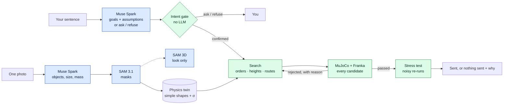

# Rehearsal

**Every action, rehearsed many times before it happens once.**

Before a home robot touches your things, Rehearsal lives that moment first in simulation. It takes one photo of your
table and one sentence in your own words. It then plays out many possible futures in physics, rules out the ones that
collide, tip or miss, and sends only a plan that passed. If none passes, it sends nothing and tells you why. If it
isn't sure what you meant, it asks. If it shouldn't do it, it refuses.

<sub>"Many" is literal. On test table 06 ("Put the onions into the steel bowl."), Rehearsal ran **11 physics rollouts,
1,646 motion checks and 13 action orders** before one plan was sent. Across the 50-table test set it ran **2,605
physics rollouts and 28,000 motion checks**. Every number in this README is measured in simulation, and every one of
them links to its source.</sub>

**Live demo:** TODO(user): live URL · **Video:** TODO(user): video URL · **Code:** TODO(user): GitHub URL ·
Meta Global AI Developer Hackathon 2026, Indie track.


<sub>Left: a real Franka arm, filmed. Right: Rehearsal replaying the same recorded joints in MuJoCo. This episode
matched, but most of the newer ones did not; see [Limits](#limitations). Robot footage: DROID (Khazatsky et al.,
RSS 2024), CC BY 4.0.</sub>

## Why rehearse

A robot that arrives in a real home faces questions no lab answers for it:

- **What did you mean?** Take "clean this up": stacked, grouped, put away or thrown out?
- **What must not move?** The phone next to the bowl, the glass at the edge.
- **Will it work here,** on this table, with this clutter, and not in a lab?
- **What if it's wrong?** Words are ambiguous, and the physical world is unforgiving.

A language model is good with words and poor with geometry. A physics check is good with geometry but cannot tell
whether the goal it checks is the goal you meant. Rehearsal splits the work so that each part does the job it is good at:

1. **Intent (Meta Muse Spark).** It turns your sentence into goals a simulator can check, and says what it assumed.
   It may ask one question, or refuse with a reason, instead of guessing.
2. **Geometry (search, no model calls).** It tries action orders, carry heights and detours.
3. **Physics (MuJoCo, simulated Franka Panda).** It plays out every candidate and decides. Only a plan that passes is
   sent.

## The product: `/app`

Rehearsal is a working app. Run it locally (see [Reproduce](#reproduce)), then open
`http://localhost:8765/app`. It has five steps, and each step shows the Meta model it used, with time and cost.

| Step | What you see | What runs |
|---|---|---|
| **01 Photo** | Pick one of the 49 AI-generated test tables, a real or authored scene, or upload a photo (uploads need an API key, local server only) | `rehearsal/server.py` → `rehearsal/app_api.py` |
| **02 Perceive** | Every object named and outlined | Muse Spark lists the objects; SAM 3.1 masks each one (`perceive_raw`) |
| **03 Twin** | The physics twin in 3D. **Physics** view: the simple shapes MuJoCo simulates. **Visual** view: photo colours, the tabletop texture, and SAM 3D meshes where available | `app_api.twin`; SAM 3D runs locally (`app_api.sam3d_start`) |
| **04 Instruct** | Your sentence becomes goals + assumptions, or a question, or a refusal | Muse Spark + the deterministic intent gate (`rehearse.compile_step`) |
| **05 Rehearse** | Live counters for futures simulated and rejected, the wall of attempts with a reason for each rejection, a replay of the sent plan, and a short held-out stress test. If nothing passes, it shows what a direct attempt would have done, and sends nothing | `search_planner.search` + `executor.run_plan` (MuJoCo) |

Without a key, the app runs **offline for $0**. An instruction that already has a recorded Muse Spark answer is
replayed from the on-disk cache, or from the shipped replay file `bench/goals/results/muse_intent_replay.json`. Any
other instruction, and every upload, needs a key in `.env` and then calls the Meta API live. Uploaded photos use the Meta API's public-data mode by default (`REHEARSAL_UPLOAD_DATA=private`
switches it off). The public demo (`REHEARSAL_PUBLIC_DEMO=1`) refuses uploads and never makes model calls.

## How each Meta model is used

| Meta model | What it does in Rehearsal | Where in code |
|---|---|---|
| **Muse Spark 1.3**: *scene* | Lists the movable objects in the photo, gives one noun phrase per object for SAM, and estimates size, mass and friction ranges. On the AI-generated tables it also estimates the tabletop size and the camera pitch | `rehearsal/perception.py` (`list_objects`, `perceive_raw`), `scripts/batch_tables.py` |
| **Muse Spark 1.3**: *intent* | Compiles the instruction into predicates a simulator checks (`on`, `inside`, `stacked`, `upright`, `stable`, `undisturbed`, `near`, `clear`), using structured output, and **must list its assumptions** | `rehearsal/agents.py` (`compile_goals`, `COMPILE_PROMPT`, `INTENT_SCHEMA`) |
| **Muse Spark 1.3**: *ask* / *refuse* | The same call may return one clarifying question ("Which water bottle should I move, the left one or the right one?") or a refusal with a reason. Either one stops the rehearsal before any motion | same; `rehearsal/intent_gate.py` adds a no-LLM safety net |
| **Muse Spark 1.3**: *critic* | **An unexpected use: it graded our own renders.** It compared each twin render with its source photo and flagged **827 fidelity issues across 50 tables**, which we fixed or disclosed | `scripts/render_qa.py` → `out/tables_v6/qa/QA_SUMMARY.md` |
| Muse Spark 1.3: *plan hint* / *revise* | Optional. It gives an action-order hint for the search, and rewrites a plan from the physics log only if the search fails. The legacy `--planner llm` and `--agent-loop` modes use it with function tools | `rehearsal/agents.py` (`plan`, `revise`), `rehearsal/agent_loop.py` |
| **SAM 3.1** | Concept segmentation per noun phrase, with a point-prompt fallback. Each mask is fitted by the silhouette of a simple 3D shape | `rehearsal/perception.py`, `rehearsal/calib.py`, `scripts/masks_hi.py` |
| **SAM 3.1 video** | Reality check: it tracks every object through real DROID robot clips to measure where each one really ended up | `rehearsal/reality.py` |
| **SAM 3D Objects** | Real-looking meshes per object, **for display only**: physics stays on the simple shapes. It runs on-device (community MLX port, 8-bit weights), for $0 in API costs | `scripts/sam3d_assets.py`, `scripts/sam3d_tables.py`, `rehearsal/export3d.py` |

**What the models are not asked to do:** choose carry heights or detours (the search does that), decide success
(predicates on the simulator state do), output joint trajectories (IK does), or set the scale.

**Cost.** Every call goes through `rehearsal/meta_client.py`, which caches identical requests on disk, enforces a hard
budget, and logs real token usage to `budget/ledger.jsonl` (kept local). As of 2026-11-04 02:05 ET, the whole project
had spent **$8.61** across 4,877 ledger entries: SAM 3.1 $3.97, Muse Spark $3.64, and a conservative $1.00 placeholder
for a short window when the ledger was lost. Single-call prices from the ledger (medians): $0.00063 for a Muse Spark
object list, $0.0025 for SAM 3.1, and $0.00088 for a Muse Spark goal compile.

## How it works



Blue boxes propose; green boxes decide. A fuller diagram is in [submission/architecture.mmd](submission/architecture.mmd).

1. **Photo → physics twin.** Muse Spark names the objects and SAM 3.1 outlines them. Each mask is fitted by a box,
   a cylinder or an open container, and every object gets a position uncertainty σ. Metric scale comes from an A4
   sheet on real photos; on the AI-generated tables it comes from Muse Spark's typical object sizes, which is
   approximate by construction. Placement error is 0.41 cm (median) on synthetic renders and 1.71 cm on real photos
   with ground truth (83 objects; [docs/perception.md](docs/perception.md)).
2. **Sentence → checkable goals.** Muse Spark compiles predicates and lists its assumptions. Code then adds
   `undisturbed` for every object the goals do not move (`with_implicit_goals`). A deterministic gate refuses empty
   goals and unknown objects, and it asks when the goals already hold. An empty or refused goal set is never reported
   as success.
3. **Search → many futures.** `rehearsal/search_planner.py` tries action orders (Muse's hint first), carry heights and
   detours. An IK and collision dry run prunes candidates before any physics. Every candidate that survives the dry
   run is simulated in MuJoCo and checked against the goals.
4. **Stress test.** A passing plan is re-run under friction ×0.6–1.4, mass ×0.7–1.3 and per-object position error.
5. **Verdict.** Either a sent plan, with what physics checked, what was estimated and what was assumed, or *nothing
   sent* and the reason why.

## Evaluation

All planning is evaluated **in simulation** (MuJoCo, simple shapes, idealised suction grasp, simulated Franka
Panda). Brackets are Wilson 95% intervals.

### 50 test tables, one everyday instruction each (v6, shipped)

The tables are 50 AI-generated photos of everyday tables (kitchens, desks, workbenches), each with its own
instruction. Every photo went through the full pipeline, from photo to twin to intent to rehearsal
([docs/aigen_photos.md](docs/aigen_photos.md)). One table (34) is empty and has no task.

| Outcome | Tables |
|---|---|
| Rehearsed, plan sent, goals held | **9** |
| Goals already held, nothing to do | 4 |
| **No safe plan found: nothing sent**, with a reason | **23** |
| It asked a question (ambiguous instruction) | 5 |
| It refused, with a reason | 4 |
| **We got it wrong** (3 "no motion" plans whose goals did not hold; 1 reconstruction error) | **4** |
| Empty table, no task | 1 |

- **Effort:** 40 tasks reached the search: **2,605 physics rollouts and 28,000 motion checks** in total
  (`footage/tables_sim/hero/exec/exec_log.json`, via `scripts/eval_v7/aggregate.py`).
- **The hardest table, 09** ("Put the eggs into the mixing bowl."): 172 rollouts, none passed, so the search budget
  ran out and nothing was sent. A direct attempt would press the gripper into a bowl with 52 N of force.
- **How to read it:** on these tables the planner verified a plan for 14 of 40 tasks (9 sent + 5 already done, one of
  which we count as a miss). Most of the rest are correctly *not sent*, not solved. The usual causes are a top-down
  suction tool next to tall rims (bowls, buckets) and objects near the edge of the robot's reach. On 22 of the 23 "not
  sent" tables, the direct attempt we replay to show *why* fails in simulation: 10 collisions, 4 suction misses, 2 out
  of reach, 6 wrong placements. On one (38) it succeeds by luck, and we do not count it.

### eval_v7: re-run with a wider search (results land later)

> The double-brace V7 slots below are filled by `scripts/fill_v7_slots.py` from `footage/tables_sim/eval_v7/` (outside the
> repo, next to the film footage). Until then they are placeholders, and the v6 table above is the result to quote.
> eval_v7 replaces the empty table 34 with a new table (51).

| Outcome (v7) | Tables |
|---|---|
| Rehearsed, plan sent, goals held | {{V7_DONE}} ({{V7_DONE_DELTA}} vs v6) |
| Goals already held | {{V7_ALREADY}} |
| No safe plan, nothing sent | {{V7_NOSAFE}} |
| Asked | {{V7_ASKED}} |
| Refused | {{V7_REFUSED}} |
| We got it wrong | {{V7_MISSED}} |
| Not finished (must be 0 before quoting) | {{V7_PENDING}} |

- {{V7_TASKS_REHEARSED}} tasks rehearsed: **{{V7_ROLLOUTS}} futures simulated** and {{V7_KIN_CHECKS}} candidates
  screened kinematically. {{V7_REJECTED_REACH}} candidates were rejected in the dry run as out of reach, and
  {{V7_REJECTED}} physics rollouts were rejected.
- {{V7_SEARCH_HOURS}} h of search wall time, simulating {{V7_SIM_MINUTES}} minutes of robot motion.
- Why the rejected futures were rejected (the most common reason was {{V7_TOP_REASON}}):

| Reason | Rollouts rejected |
|---|---|
{{V7_REASON_ROWS}}

### Intent: physics can certify the wrong goal

A simulator checks whether a goal holds. It cannot tell whether that is the goal you meant. **GoalBench** has 60
instructions in English and Chinese over 10 tables, hand-labelled with what the user meant, and each run 3 times
([docs/goalbench.md](docs/goalbench.md)).

- "Put the tomato soup next to the mouse" compiled to `upright(soup) ∧ stable(soup)`. The robot did nothing, and
  physics reported success. The soup was still 22 cm away.
- Of 55 distinct wrong compilations replayed in simulation, **17 were reported as success** [20, 44%]. All 17 came
  from ambiguous instructions where the model picked one reading instead of asking. The old prompt refused **0 of
  24** infeasible trials [0, 14%].

| Compile step (60 dev cases, majority of 3 repeats) | Cases matching intent |
|---|---|
| A. Old product prompt | 40/60 = 67% [54, 77] |
| B. A + 3 predicates (`undisturbed`, `near`, `clear`) | 46/60 = 77% [65, 86] |
| C. B + list assumptions; may ask or refuse | 60/60 = 100% [94, 100], **a dev-set upper bound** |

**Blind hold-out:** 30 cases, written by someone who never saw the dev cases, the prompts or any results. Prompts were
frozen and scoring rules committed beforehand ([bench/holdout/README.md](bench/holdout/README.md),
[docs/intent.md](docs/intent.md)).
- In the blind run, old prompt A scored 21/30 and prompt C scored 28/30.
- C was then revised once (on 2026-11-02, prompted by the 50 new tables). The **shipped revision scores 27/30** (90%
  [74, 97]). Paired against A it fixed 8 cases and broke 2 (p = 0.11). **27/30 is the number to quote.**
- A no-LLM gate flags 0 of the 55 wrong compilations. It is a safety net under the model, not a replacement for it.

### Geometry: don't let a language model guess carry heights

Five hand-designed hard tables, each with one instruction run 20 times through Muse Spark
([docs/hybrid.md](docs/hybrid.md)):

| Arm | Solved | Held-out robustness | Muse $ per solved task |
|---|---|---|---|
| Muse Spark's first plan | 14/100 [9, 22%] | 72% | $0.0110 |
| Muse + physics-log revise (≤ 2), the old product | 99/100 | 79% | $0.0028 |
| **Muse states the goal, search finds the motion, + stress gate** (shipped) | **100/100** [96, 100%] | **80%** | **$0.0015** |

- The search is deterministic given the goals, so read 100/100 as "all 5 tasks, every time Muse stated the goal".
- Robustness is a tie with the old loop once runs are clustered by task (p = 0.12–0.57). We lose on windowsill_01,
  76% against 82%.
- **Why keep the model at all?** Physics can't choose intent: 74 of 132 ordered "put X on Y" pairs on those tables are
  physically achievable. Muse Spark picked the right object and destination in **150 of 150** runs.

### Reality: one photo is not yet precise enough for a real grasp

We rebuilt the table of **23 real Franka episodes from 7 labs** (DROID) from the first camera frame with Muse Spark and
SAM 3.1. We then replayed the recorded joint motion in MuJoCo and compared the outcome with SAM 3.1 video tracking of
the real clip. The rules were committed before any result ([docs/real_robot.md](docs/real_robot.md)).

- **The replay does not beat trivial baselines.** On 17 episodes where an object really moved (51 objects), it agreed
  on moved/not-moved for 37/51. The rule "the object ends where the gripper let go" got 46/51 and was 5.0 cm more
  accurate [+0.9, +9.7], p = 0.007.
- **The diagnosis:** in 16 of 17 episodes, the simulated gripper closed on air. The twin's object sat a median
  **5.5 cm** from the real grasp, and the gripper can absorb only about 4.25 cm. The bottleneck is how precisely one
  photo places each object, not the contact physics.
- **What this means:** Rehearsal reports a per-object uncertainty and stress-tests under position error. **We do not
  claim real-arm readiness.**

### What we got wrong, and changed

1. **The old headline was real but taught the wrong lesson.** Muse Spark repaired 85 of 86 failed plans from the
   physics log. Then a zero-LLM search solved the same tables in seconds, because most of what the log fixed were
   carry heights the model had guessed. Geometry moved to search ([EVAL.md](EVAL.md)).
2. **Physics certified the wrong goal.** We fixed it with three predicates, assumptions plus ask/refuse, and a
   deterministic gate.
3. **Being explicit weakened the check.** "Without knocking over the vase" lost the vase's automatic `undisturbed`.
   Every object the goals do not move is now protected.
4. **The search's first plan was brittle** (20% robust on storage_01). A stress gate now keeps searching.
5. **The real-robot check did not hold up** beyond its first 6 episodes. It is now a limitation with a target.
6. **60/60 was tuned on its own test set.** So we had a blind hold-out written and ran it once.

## Reproduce

You need git, Python 3.12 and [uv](https://docs.astral.sh/uv/). Without uv, `scripts/setup.sh` falls back to
`python3.12 -m venv` + `pip`. Tested on macOS (arm64) and in the Linux Docker image.

```bash
git clone <TODO(user): GitHub URL> rehearsal && cd rehearsal
scripts/setup.sh        # .venv (Python 3.12) + pinned deps, Franka Panda from MuJoCo Menagerie (pinned), .env from .env.example
.venv/bin/python -m rehearsal.server      # http://localhost:8765   (REHEARSAL_PORT changes the port)
# then open http://localhost:8765/app     (the product)   ·   http://localhost:8765/  (project site + scene reports)
```

- **Offline by default.** With no `MODEL_API_KEY` (or with `REHEARSAL_OFFLINE=1`), the app makes no model calls. It
  replays recorded Muse Spark answers for $0, and any instruction without one needs a key.
- **Live mode.** For new instructions and photo uploads, put a Meta Model API key ([dev.meta.ai](https://dev.meta.ai))
  in `.env` as `MODEL_API_KEY=...`. Every live call is logged, and spending hard-stops at `REHEARSAL_BUDGET_CAP`
  (default $15).
- **SAM 3D meshes** are optional and run locally on Apple silicon. They need the `mlx-spatial` environment and the
  8-bit weights; neither is in git ([docs/aigen_photos.md](docs/aigen_photos.md), "SAM 3D hero tables").
- **Headless Linux:** set `MUJOCO_GL=egl` (or `osmesa`). `scripts/gl_check.sh` finds a backend that works.

The site's scene gallery (`out/`) is gitignored. `scripts/precompute.sh` fills it with 7 scenes offline (~15 min on a
14-core Mac). Without a key it cannot rehearse `real_ycbv59`, `aigen_kitchen` or `aigen_desk_lamp_mug`, so it reports
those and exits 1, as expected.

```bash
# One rehearsal from the command line (hybrid: Muse states the goal, search finds the motion, physics gates it)
.venv/bin/python -m rehearsal.rehearse scenes/lamp_01.json "Put the tea tin on the place mat"
.venv/bin/python -m rehearsal.rehearse scenes/lamp_01.json "Put the tea tin on the place mat" --planner search  # no plan hint
.venv/bin/python -m rehearsal.rehearse scenes/lamp_01.json "Put the tea tin on the place mat" --planner llm     # legacy loop

# Photo -> scene (A4 corners near-left, near-right, far-right, far-left as seen from the robot; auto-detected if omitted)
.venv/bin/python -m rehearsal.perception my_desk.jpg --paper-corners "u1,v1 u2,v2 u3,v3 u4,v4" -o scenes/my_desk.json

# Tests (offline). The full suite is CPU-heavy: run it alone.
REHEARSAL_OFFLINE=1 .venv/bin/python -m pytest -q
# Headless browser smoke test of /app (Playwright; starts its own server)
.venv/bin/python scripts/app_smoke.py --runs 1
```

**Re-running the evaluations.** Cached Muse responses are free on re-run.

```bash
.venv/bin/python -m bench.goals.run --arms A B C --reps 3 --budget 0.55     # GoalBench dev set
.venv/bin/python -m bench.goals.consequence --auto                            # "physics certified the wrong goal"
.venv/bin/python eval/hybrid_eval.py                                          # hybrid vs LLM planning
.venv/bin/python eval/droid_v2.py run && .venv/bin/python eval/droid_v2.py score   # DROID v2 (SAM video cached)
.venv/bin/python scripts/eval_v7/aggregate.py && .venv/bin/python scripts/fill_v7_slots.py   # 50-table tally + effort
```

The 50-table batch scripts (`scripts/batch_tables.py`, `scripts/exec_tables.py`, `scripts/eval_v7/`) write their logs
and clips next to the film footage, outside the repo (`../footage/tables_sim/`).

**Docker / Hugging Face Space.** The `Dockerfile` builds the app for a Docker Space on port 7860, offline and in
public-demo mode by default. See [deploy/DEPLOY.md](deploy/DEPLOY.md).

## Limitations

- **Everything that plans runs in simulation only.** No robot has executed our plans.
- **The twin does not yet predict real outcomes.** On 23 DROID episodes, single-photo position error (a median of
  5.5 cm at the grasp) exceeds the gripper's 4.25 cm margin.
- **The 50 test tables are AI-generated photos**, not real captures, and they have no ground truth. Their scale comes
  from typical object sizes, so it is approximate.
- **Narrow action space.** There is one parameterised `transport` action with an idealised suction grasp. There is no
  pouring, wiping, articulated or deformable manipulation. `near` goals compile and are checked, but `transport`
  cannot yet execute them.
- **Physics uses simple shapes:** boxes, cylinders and open containers. SAM 3D meshes and textures are display only.
- **Small n.** The intent results rest on 60 dev cases with our own labels and a 30-case hold-out written by one
  person. There are 5 hard geometry tables and 23 DROID episodes.
- **One model, one setting:** Muse Spark 1.3, default effort.
- **The search is slow.** It takes minutes per hard task, which suits rehearsal before a robot moves, but not a live
  control loop.

## Vision (not a result)

Every rehearsal, passed or rejected, is a labelled physical episode: intent → goals → candidate motions → physics
outcome, with a reason for every rejection. Labs collect robot data on a few setups arranged by hand, while homes are
endless. At scale, rehearsals like these **could** become a data foundation for home robots. **No robot policy has
been trained on this data;** this is a direction, not a claim.

## Related work

The split "the model specifies, something sound solves, a checker verifies" is established: LLM-Modulo
([Kambhampati et al., ICML 2024](https://arxiv.org/abs/2402.01817)), [LLM+P](https://arxiv.org/abs/2304.11477),
[AutoTAMP](https://arxiv.org/abs/2306.06531), [VoxPoser](https://arxiv.org/abs/2307.05973),
[ReKep](https://arxiv.org/abs/2409.01652), [Text2Motion](https://arxiv.org/abs/2303.12153),
[PRoC3S](https://arxiv.org/abs/2406.05572). For asking and refusing, see [KnowNo](https://arxiv.org/abs/2307.01928) and
[CLARA](https://arxiv.org/abs/2306.10376). For real-to-sim evaluation, see [SIMPLER](https://arxiv.org/abs/2405.05941)
and [DROID](https://arxiv.org/abs/2403.12945). The closest photo-to-MuJoCo system is
[SIMPACT](https://arxiv.org/abs/2512.05955). We do not claim a new planner.

What we add, narrowly:
- A measured verifier blind spot: physics certified 17 of 55 wrong goals.
- Evidence for "model for intent, search for geometry" in a photo-to-physics pipeline.
- A pre-registered negative real-footage result, with a diagnosis.

There is more in [docs/related-work.md](docs/related-work.md) and [docs/litscout.md](docs/litscout.md).

## Built during the hackathon

The hackathon ran Oct 26 – Nov 4, 2026. Commit `0bc9996` "Baseline: Rehearsal MVP before overnight sprint" (Oct 30)
is a mid-hackathon snapshot.
TODO(user): confirm what, if anything, predates Oct 26.

## Licenses and credits

Rehearsal's own code is **MIT**; see [LICENSE](LICENSE). Third-party data keeps its own license.

| Asset | Source | License |
|---|---|---|
| **DROID robot episodes** (23 exterior clips without people, frames and trajectories in `datasets/droid/`; derived media in `docs/media/droid/`, `web/media/droid/`) | [DROID 1.0.1](https://droid-dataset.github.io), 7 labs; extrinsics from `KarlP/droid` | **CC BY 4.0**. Modified: frame extraction, re-encoding, JSON repackaging, side-by-side renders |
| 50 test tables (`photos/ai_gen/`) | AI-generated by the project owner with a text-to-image model ([photos/ai_gen/SOURCES.md](photos/ai_gen/SOURCES.md)) | Not real places; no people |
| MuJoCo | [google-deepmind/mujoco](https://github.com/google-deepmind/mujoco) | Apache-2.0 |
| Franka Emika Panda model | [MuJoCo Menagerie](https://github.com/google-deepmind/mujoco_menagerie/tree/main/franka_emika_panda) | Apache-2.0 |
| three.js (vendored in `web/vendor/`) | [threejs.org](https://threejs.org) | MIT |
| Muse Spark 1.3, SAM 3.1 | [Meta Model API](https://dev.meta.ai) | Used via the API under Meta's terms |
| SAM 3D Objects, via the community MLX port [mlx-spatial](https://github.com/appautomaton/mlx-spatial) with third-party 8-bit weights | Meta AI / community port | SAM License (`assets/sam3d/SAM_LICENSE.txt`); the port is MIT. Neither is Meta's official code nor its checkpoints. The generated meshes in `assets/sam3d/` fall under the SAM License |
| YCB-Video frame `photos/real/real_ycbv59.png` | YCB-Video (BOP'19), UW RSE Lab | MIT; cite PoseCNN (Xiang et al., RSS 2018) |
| HOPE-Image frames in `datasets/tierA_hope/` | HOPE (BOP) | **CC BY-NC-SA 4.0: non-commercial, outside the MIT grant** |
| Test photos in `photos/` | Wikimedia Commons | CC BY-SA 2.0 and public domain; see [photos/SOURCES.md](photos/SOURCES.md) |

Python dependencies and their licenses are listed in [THIRD_PARTY_NOTICES.md](THIRD_PARTY_NOTICES.md).

**DROID citation.** Robot footage: DROID (Khazatsky et al., RSS 2024), CC BY 4.0.

```bibtex
@inproceedings{khazatsky2024droid,
  title     = {DROID: A Large-Scale In-The-Wild Robot Manipulation Dataset},
  author    = {Alexander Khazatsky and Karl Pertsch and Suraj Nair and others},
  booktitle = {Robotics: Science and Systems (RSS)},
  year      = {2024},
  note      = {arXiv:2403.12945}
}
```

The raw DROID videos are not face-blurred. Only exterior views without people are included
([datasets/droid/SOURCES.md](datasets/droid/SOURCES.md)).

**Privacy.** The author's own desk (the photo, the phone video, its twin and its meshes) appears in the film. It is
**never in this repository**, and the public demo has no access to it.

## Team

TODO(user): names, roles, contact / X handles.
