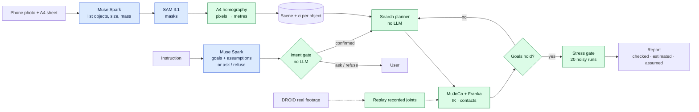

# Rehearsal

**Words don't collide. The real world does.**

Before a robot touches your things, Rehearsal tries the plan on a physics copy of your table. It tells you what it
assumed, what it checked, and what it can't promise.


<sub>Left: a real Franka arm, filmed. Right: Rehearsal replaying the same recorded joints in MuJoCo, through the same
calibrated camera. Robot footage: DROID (Khazatsky et al., RSS 2024), CC BY 4.0.</sub>

**Live demo:** TODO(user): live URL · **Video (3 min):** TODO(user): video URL · **Code:** TODO(user): GitHub URL ·
Meta Global AI Developer Hackathon 2026, Indie track, theme *Push the Frontier*.

## The problem

A home robot gets a sentence ("make some room on the desk") and a table it has never seen. Two things can go wrong.
It can do the wrong thing well. Or it can do the right thing badly and knock something over. Today the usual answer
is to ask a large language model for a plan. Language models are good with words. They are not good with geometry,
and nobody checks whether the goal they wrote down is the goal you meant.

## The thesis: models propose, physics decides

We started this project with a different headline, and our own data took it apart (see
[What we got wrong](#what-we-got-wrong-and-fixed)). What survived is a division of labour:

1. **Intent.** The language model (Meta Muse Spark) turns your words into goals a simulator can check. It must list
   its assumptions. It may ask one question, or refuse with a reason, instead of guessing.
2. **Geometry.** A plain search planner, with no model calls, finds the order, carry heights and detours.
3. **Physics.** MuJoCo checks every candidate, then stress-tests the winner under randomized friction, mass and
   position error. Only plans that survive are kept.
4. **Reality.** Recorded footage of a real Franka arm (DROID) checks the physics against what actually happened.

This split is not new as an idea (LLM-Modulo, LLM+P, AutoTAMP; see [Related work](#related-work)). What we add is
evidence for it in a photo-to-simulation pipeline, and one measured blind spot: **physics can certify the wrong
goal.**

## Three findings

### 1. Intent: physics can certify the wrong goal

A simulator checks whether the goal holds. It cannot tell whether it is the goal you meant. So we built GoalBench:
60 instructions in English and Chinese over 10 tables, hand-labelled with what the user meant, 3 repeats each
([docs/goalbench.md](docs/goalbench.md)).

- **"Put the tomato soup next to the mouse."** Muse Spark compiled `upright(soup) ∧ stable(soup)`, 3 of 3 repeats.
  Nothing about the mouse. The robot did nothing, and physics reported success. The soup was still 22 cm away.
- **"Make some room on the desk."** It moved the mug to the coaster, then stacked the book on the laptop. Physics:
  success.
- **"Put the cup in the fridge."** There is no fridge. The old schema had no way to say no, so an empty goal list
  became "nothing may move", which an empty plan passes. Physics: success.

Of 55 distinct wrong compilations replayed in simulation, **17 were reported as success** (Wilson 95% CI 20–44%).
The old product prompt refused **0 of 24** infeasible trials (CI 0–14%).

| compile step (60 dev cases, majority of 3 repeats) | cases matching intent |
|---|---|
| A. old product prompt | 40/60 = 67% [54, 77] |
| B. + 3 predicates (`undisturbed`, `near`, `clear`) | 46/60 = 77% [65, 86] |
| C. B + list assumptions, may clarify or refuse | 60/60 = 100% [94, 100], **dev-set upper bound** |

We wrote both the labels and prompt C, so 60/60 is an upper bound. A **blind hold-out** of 30 cases, written by
someone who never saw the dev cases, the prompts or any results ([bench/holdout/README.md](bench/holdout/README.md)),
was run once with prompts frozen and scoring rules committed in advance ([docs/intent.md](docs/intent.md)):
old prompt A **21/30** (70%, CI 52–83%), shipped prompt C **28/30** (93%, CI 79–98%). Paired at case level, C fixed 9
cases and broke 2 (exact sign test p = 0.065). **28/30 is the number to quote.** Caveats: n = 30, written by one
person. C's two misses are both refusals of objects the product's own reach check marks unreachable, so they look
like label errors, but they were scored as misses under the rules fixed beforehand (adjudicated, C would be 30/30;
we do not use that number).
A deterministic no-LLM gate (refuse empty goals and unknown objects, ask when the goal already holds before the robot
moves) was scored as the dumb baseline. It flags **0 of the 55** stored wrong compilations, including 0 of the 17
that physics certified: those are real but wrong changes (book onto the laptop) that no structural check can tell
from the right answer. It does turn the 6 "robot does nothing" trials (soup, mug next to the vase) into questions,
and it raises 0 false flags on 173 distinct correct compilations. We ship it as a safety net under the model, not
instead of it ([docs/intent.md](docs/intent.md)).

### 2. Geometry: don't let a language model guess carry heights

Five hand-designed hard tables (desk_02, kitchen_01, lamp_01, storage_01, windowsill_01), 20 tasks each, in
simulation ([docs/hybrid.md](docs/hybrid.md)).

| arm | solved (95% CI) | held-out robustness | Muse $ per solved task |
|---|---|---|---|
| Muse Spark first plan | 14/100 (9–22%) | 72% | $0.0110 |
| Muse + physics-log revise (≤ 2), the old product | 99/100 (95–100%) | 79% (1556/1980 runs) | $0.0028 |
| **Hybrid: Muse states the goal, search finds the motion** | **100/100 (96–100%)** | 72% | **$0.0015** |
| **Hybrid + 20-seed stress gate** (shipped) | **100/100 (96–100%)** | **80%** (1595/2000 runs) | **$0.0015** |

- The search uses about 7 simulations per task (6.9) and about 9 s, with no revisions and no extra model calls.
- **Robustness is a tie, slightly in the hybrid's favour.** Paired on the same task and seed (1,980 pairs), hybrid +
  gate won 66 and lost 40, exact McNemar p = 0.015. Pooled: 79.7% vs 78.6%. Runs share plans, so the pooled rate is
  less certain than its run count suggests.
- **The first plan search finds is brittle.** Cheapest-first search picks the lowest height that works once. On
  storage_01 it survives 20% of noisy runs against 95% for the reference plan. The stress gate keeps searching until
  a plan survives, which lifts search-only from 52% to 80%.
- **Where we still lose:** on windowsill_01 the hybrid + gate reaches 76% against 82% for the log-revised LLM plans.
  The gate also costs about 111 s per task on average, so it suits rehearsal before the robot moves, not a live loop.
- On five more tables (one real photo, one designed desk, three AI-generated test photos), Muse's first plan solved
  33/50 and the hybrid 50/50 (93–100%).

**Why keep the language model at all?** Because physics can't pick intent. On the five hard tables, **74 of 132**
ordered "put X on Y" pairs are physically achievable (CI 48–64%). Many goals would "succeed". Only the instruction
says which one you meant, and Muse Spark chose the right object and destination in **150 of 150** tasks (CI 98–100%).

### 3. Reality: we checked the physics against a real robot

Six recorded episodes of a real Franka arm from the public DROID dataset (one lab, two tables). Rehearsal rebuilt
each table from the first camera frame with Muse Spark and SAM 3.1, replayed the recorded joint motion in MuJoCo,
and predicted what would happen. SAM 3.1 video then tracked where each object really ended up
([docs/real_robot.md](docs/real_robot.md)).

- **5 of 6** outcomes agreed with the real one (Wilson CI 44–97%). **0 false successes:** it never said "this works"
  when the real arm failed.
- **Median 2.5 cm** error in where each object ended up, over 14 measurable objects. Moved/not-moved agreed on 11 of
  14.
- **The honest miss.** In `cup_success` the gripper went inside a tapered cup and lifted it by wedging. Our gripper
  model has no wedge contact and the cup became a plain cylinder, so the replay said failure. A false alarm with a
  cause we can name.
- **A trivial baseline matters here.** A rule that reads only the gripper trajectory ("fingers stopped short of
  closed, then the hand rose") also scores **5 of 6, with identical predictions**, including the same miss. A rule that
  reads only the gripper command scores 3 of 6; the replay also reads only the command. So the yes/no verdict alone is not evidence for the physics
  copy. Where objects end up (2.5 cm, 11/14) is.
- **Replay is not planning.** The motion is given, so this tests perception, geometry, contact and the gripper model,
  not our planner. n = 6. It supports "we found no contradiction", not "Rehearsal predicts real outcomes".

## How it works



Blue boxes propose; green boxes decide. A fuller diagram is in [submission/architecture.mmd](submission/architecture.mmd).

1. **Photo → physics copy.** Muse Spark lists the objects and estimates size, mass range and friction range. SAM 3.1
   segments each one. An A4 sheet in the photo fixes metric scale. Each mask is fitted by a simple 3D shape. Every
   object gets a position uncertainty σ. Median placement error is 0.41 cm on synthetic renders (76 objects) and
   1.71 cm on real photos with ground truth (83 objects, YCB-Video and HOPE) ([docs/perception.md](docs/perception.md)).
   This is a simulation-ready approximation, not a scan.
2. **Instruction → checkable goals.** Muse Spark compiles predicates (`on`, `inside`, `stacked`, `upright`, `stable`,
   `undisturbed`, `near`, `clear`), lists its assumptions, and may ask or refuse. Code then adds `undisturbed` for
   every object the goals do not move. A deterministic gate refuses empty goals and unknown objects, and asks when the
   goals already hold before the robot moves (`rehearsal/intent_gate.py`). A refusal or question stops the
   rehearsal before any planning; an empty or refused goal set is never reported as success.
3. **Search → motion.** `rehearsal/search_planner.py` tries action orders (Muse's hint first), carry heights and
   detours, cheapest first. An IK and collision dry run prunes candidates before any physics. Each partial plan is
   simulated and checked.
4. **Stress gate.** Each passing plan is re-run under friction ×0.6–1.4, mass ×0.7–1.3 and per-object position error.
   The search keeps going until a plan survives 90% of 20 selection runs, or it has tried 10, and keeps the best.
   Reported robustness uses separate held-out seeds.
5. **Report.** What physics checked, what was estimated under uncertainty, and what was assumed. Optionally, which
   object is worth a second look: on held-out seeds, re-observing the mug on `desk_01` lifts success from 178/200 to
   191/200 (+13 fixed, 0 broken, p = 0.0002; [EVAL.md](EVAL.md) §C). A "second look" is modelled as a smaller σ; a
   real second photo is future work.
6. **Bench.** Each table can be exported as a scored test case with every plan that failed on it
   ([bench/README.md](bench/README.md)). v0 has 10 tables and 84 recorded failures, all ours. Sharing is opt-in.

**What the shipped demo shows.** All 10 shipped scenes in `out/` were regenerated live with the shipped intent step,
the hybrid planner and the 20-seed stress gate. Each one succeeded on its first attempt; there is no "the model fails,
then fixes itself" beat in them any more. Stress-test successes out of 40 (simulation): desk_01 34, desk_02 26,
kitchen_01 37, lamp_01 34, storage_01 36, windowsill_01 26, aigen_desk_lamp_mug 8, aigen_desk_walnut 9, aigen_kitchen 7,
real_ycbv59 7. The low counts on the photo scenes come from perception uncertainty, not the plan. The old LLM-only
reports, where Muse Spark's own first plan fails and it repairs it from the physics log, are kept as history in
`out_llm_v3/`. That is where the lamp-sweep footage comes from.

## Meta models and their roles

| Model | Role | Where in code |
|---|---|---|
| **Muse Spark 1.3** (`muse-spark-1.3`) | **Intent:** compile the instruction into predicates, list assumptions, ask one question or refuse with a reason (structured output) | `rehearsal/agents.py` (`compile_goals`, `COMPILE_PROMPT`, `INTENT_SCHEMA`; byte-identical to GoalBench arm C) |
| **Muse Spark 1.3** | **Plan hint:** the action order and a first geometry guess for the search. Optional (`--planner search` skips it) | `rehearsal/agents.py` → `MuseAgent.plan()`; `rehearsal/rehearse.py` → `plan_with_search()` |
| **Muse Spark 1.3** | **Revise, only if the search fails:** reads the physics log and rewrites the plan. Also the whole legacy `--planner llm` loop and the `--agent-loop` mode, where Muse drives `simulate` / `stress_test` / `look_again` / `submit` as function tools | `rehearsal/agents.py` → `revise()`; `rehearsal/agent_loop.py` |
| **Muse Spark 1.3** | **Perception:** list movable objects, a noun phrase per object for SAM, size, mass and friction ranges. Also on the DROID first frames | `rehearsal/perception.py` → `list_objects()`; `scripts/droid_scene.py` |
| **SAM 3.1** (`sam-3.1`) | Concept segmentation per noun phrase, point-prompt fallback. Lossless masks fitted by a 3D shape's silhouette | `rehearsal/perception.py`, `rehearsal/calib.py` |
| **SAM 3.1 video** | **Reality check:** tracks every object through each real DROID clip, seeded with the twin's boxes, to measure where it ended up | `rehearsal/reality.py`; `python -m rehearsal.replay all --reality` |
| **SAM 3D Objects** (local, community MLX port `mlx-spatial`, 8-bit SAM-License weights) | Look-alike mesh per object, for display only; physics uses the simple shapes (7 of 8 objects on `real_ycbv59`) | `scripts/sam3d_assets.py`, `rehearsal/export3d.py` |

What the models are **not** asked to do: choose carry heights or detours (search), decide success (predicates on
simulator state), output joint trajectories (IK), or set the scene's scale (the A4 homography).

All calls go through `rehearsal/meta_client.py`, which caches identical requests on disk, enforces a hard budget and
logs real token usage to `budget/ledger.jsonl`. Public scenes use Contributor mode; user uploads always use Standard
mode. Spend for the studies above: GoalBench $0.36 (540 calls), hybrid $0.0993 (111 calls), DROID $0.18 (43 calls),
Evaluation v3 $1.12. Whole project: under $6 total Meta API spend for the whole project ($4.43 in `budget/ledger.jsonl` on Nov 2, which includes a conservative $1.00 placeholder for a short window where the ledger was lost).

## Evaluation summary

Everything that plans is evaluated in simulation (MuJoCo, simple shapes, suction grasp). Brackets are Wilson 95%
intervals.

| question | result | n | source |
|---|---|---|---|
| Does the old product prompt compile what the user meant? | 40/60 cases [54, 77%] | 60 dev cases × 3 repeats | docs/goalbench.md |
| ... with 3 more predicates | 46/60 [65, 86%] | same, paired | docs/goalbench.md |
| ... with assumptions + clarify / refuse | 60/60 [94, 100%], dev-set upper bound | same, paired | docs/goalbench.md |
| Same, on the blind hold-out | A 21/30 [52, 83%] · C 28/30 [79, 98%], paired p = 0.065 | 30 cases × 3 repeats, one author | docs/intent.md |
| Infeasible requests refused by the old prompt | 0/24 trials [0, 14%] | 8 cases × 3 | docs/goalbench.md |
| Wrong compilations that physics certified as success | 17/55 [20, 44%] | distinct wrong compilations, arms A+B | docs/goalbench.md |
| No-LLM intent gate as a baseline | flags 0/55 wrong compilations; turns 6 do-nothing trials into questions; 0/173 false flags | 55 wrong + 173 correct compilations | docs/intent.md |
| Hard scenes solved, Muse first plan | 14/100 [9, 22%] | 5 scenes × 20 | docs/hybrid.md, EVAL.md v3 |
| Hard scenes solved, hybrid | 100/100 [96, 100%] | 5 scenes × 20 | docs/hybrid.md |
| Held-out robustness, hybrid + gate vs log-revise | 80% vs 79%, paired McNemar p = 0.015 | 1,980 paired seed runs | docs/hybrid.md |
| Robustness where we lose | windowsill_01: 76% vs 82% | 400 runs per arm | docs/hybrid.md |
| Muse $ per solved task, hybrid vs log-revise | $0.0015 vs $0.0028 | 100 tasks | docs/hybrid.md |
| Feasible "put X on Y" pairs | 74/132 [48, 64%] | all ordered pairs, 5 scenes | docs/hybrid.md |
| Muse picked the right object → destination | 150/150 [98, 100%] | 10 scenes | docs/hybrid.md |
| DROID: outcome agreement with the real robot | 5/6 [44, 97%], 0 false successes | 6 episodes, 1 lab | docs/real_robot.md |
| DROID: trivial rules | finger-position rule 5/6, identical predictions; command-only rule 3/6 | same 6 | docs/real_robot.md |
| DROID: final-position error | median 2.5 cm; moved/not-moved 11/14 | 14 objects | docs/real_robot.md |
| Perception placement error | median 0.41 cm synthetic; 1.71 cm real photos | 76 / 83 objects | docs/perception.md |
| Look again, held-out | desk_01 178/200 → 191/200, p = 0.0002 | 200 seeds | EVAL.md §C |

## What we got wrong and fixed

We publish what disproved our own earlier claims. In order:

1. **Our old headline was a real measurement with the wrong lesson.** Evaluation v3 found Muse Spark's first plan
   failed 86 of 100 times on five hard scenes, and that with the physics log it repaired 85 of the 86 within two
   revisions ([EVAL.md](EVAL.md)). We pitched that as "seeing physics fixes the plan". Then a zero-LLM grid search
   solved all five scenes in seconds. Most of what the log was fixing was carry heights the model had guessed. So we
   moved geometry to search and kept the model on intent. The 85/86 result is history now, not our headline.
2. **Smaller earlier numbers were superseded.** "17/17 vs 7/17" (n too small), kitchen "0/5 without the log" (true
   only for the English instruction), "35/40 → 40/40" after a second look (chosen and scored on the same seeds; held
   out it is 89% → 95.5%). All are listed in [EVAL.md](EVAL.md) §4 with their replacements.
3. **Physics certified the wrong goal.** An empty goal list passed as "nothing moved". "Next to" had no predicate, so
   it compiled to goals that already held. Fixed with three predicates, an assumptions / ask / refuse step, and a
   deterministic gate that refuses empty goals and asks on goals that hold before the robot moves. Shipped.
4. **Being explicit made the check weaker.** "Without knocking over the vase" compiled to `upright(vase)`, and because
   the vase was now mentioned, it lost its automatic `undisturbed`. Fixed in `with_implicit_goals`: every object the
   goals do not move stays protected. Shipped.
5. **Search's first plan was brittle.** Robust only 20% of the time on storage_01. Fixed with the stress gate. The gate
   itself was strengthened twice; all three versions are reported in [docs/hybrid.md](docs/hybrid.md) §2.
6. **Our one correct real success is fragile.** The DROID duck success flips in 2 of 4 runs when the table or
   fingertip height moves by 1 cm. A trivial rule that reads the measured finger position ties the yes/no verdict: 5 of 6, identical predictions.
7. **60/60 was tuned on its own test set.** So we had someone write a blind hold-out and ran it once
   (28/30, CI 79–98%; two of the misses look like label errors, scored as misses anyway).

## Related work

The split "the model specifies, something sound solves, a checker verifies" is established, and we cite it first:
LLM-Modulo ([Kambhampati et al., ICML 2024](https://arxiv.org/abs/2402.01817)), [Valmeekam et al.](https://arxiv.org/abs/2305.15771),
[PlanBench](https://arxiv.org/abs/2206.10498), [LLM+P](https://arxiv.org/abs/2304.11477),
[AutoTAMP](https://arxiv.org/abs/2306.06531) (ICRA 2024), [ViLaIn](https://arxiv.org/abs/2311.00967),
[VoxPoser](https://arxiv.org/abs/2307.05973) and [ReKep](https://arxiv.org/abs/2409.01652). [LLM^3](https://arxiv.org/abs/2403.11552),
[Text2Motion](https://arxiv.org/abs/2303.12153) and [PRoC3S](https://arxiv.org/abs/2406.05572) keep the model in the
planning loop. Our planner is a small member of the TAMP family ([PDDLStream](https://arxiv.org/abs/1802.08705),
[Garrett et al. 2021](https://arxiv.org/abs/2010.01083)); we do not claim a new planner.

Wrong goals: [Inverse Reward Design](https://arxiv.org/abs/1711.02827), [Pan et al., ICLR 2022](https://arxiv.org/abs/2201.03544).
The closest benchmark for the intent step is [Embodied Agent Interface](https://arxiv.org/abs/2410.07166), which scores
goal interpretation against references. See also [REI-Bench](https://arxiv.org/abs/2505.10872),
[SafeAgentBench](https://arxiv.org/abs/2412.13178), [LoTa-Bench](https://arxiv.org/abs/2402.08178),
[ALFRED](https://arxiv.org/abs/1912.01734). Asking and refusing: [KnowNo](https://arxiv.org/abs/2307.01928) (with a
conformal guarantee we do not have), [Introspective Planning](https://arxiv.org/abs/2402.06529),
[CLARA](https://arxiv.org/abs/2306.10376). Real-to-sim evaluation: [SIMPLER](https://arxiv.org/abs/2405.05941) (about
1,500 paired episodes; the bar we do not reach), [Real-is-Sim](https://arxiv.org/abs/2504.03597),
[RobotArena infinity](https://arxiv.org/abs/2510.23571), [DROID](https://arxiv.org/abs/2403.12945). Closest
photo-to-MuJoCo system: [SIMPACT](https://arxiv.org/abs/2512.05955) (CVPR 2026), which also runs on a real Franka.

**What is new, narrowly (three claims, each measured on our own scenes):**

1. **A measured verifier blind spot.** A physics verifier certified 17 of 55 wrong goal compilations. The old prompt
   refused 0 of 24 infeasible trials. An assumptions / ask / refuse step fixes most of it: 60/60 on the dev set (an
   upper bound), 28/30 on a 30-case blind hold-out (CI 79–98%).
2. **Search for geometry, model for intent, in a photo-to-simulation pipeline.** A no-LLM search solved 100/100 where
   the model's first plan solved 14/100, and a stress gate made its plans as robust as log-revised LLM plans. One
   parameterised action, suction grasp, tabletop: evidence for an established idea, not a general result.
3. **A small real-footage check.** 5 of 6 DROID replays agreed with the filmed outcome, with 2.5 cm median object
   error. n = 6, one lab, replay not planning.

Full verified table, GitHub scan and reviewer questions: [docs/litscout.md](docs/litscout.md),
[docs/related-work.md](docs/related-work.md).

## Reproduce

Requires git, Python 3.12 and [uv](https://docs.astral.sh/uv/) (or plain `python3.12 -m venv` + `pip`; the script
falls back to it). Tested on macOS (arm64) and in the Linux Docker image.

```bash
git clone <TODO(user): GitHub URL> rehearsal && cd rehearsal
scripts/setup.sh        # .venv (Python 3.12) + pinned deps, Franka Panda from MuJoCo Menagerie (pinned commit), .env from .env.example
scripts/precompute.sh   # (optional) regenerate the 6 designed scenes offline with the rule-based agent: no API key, $0
.venv/bin/python -m rehearsal.server          # http://localhost:8765  (REHEARSAL_PORT to change)
```

The app opens with the shipped runs and the DROID replays, and needs no API key to browse them. For new live runs and
photo upload, put your Meta Model API key ([dev.meta.ai](https://dev.meta.ai)) in `.env` as `MODEL_API_KEY=...`.
Every live call is logged to `budget/ledger.jsonl` and hard-stops at `REHEARSAL_BUDGET_CAP` (default $15).

```bash
# One rehearsal (hybrid is the default): Muse states the goal, search finds the motion, physics gates it
.venv/bin/python -m rehearsal.rehearse scenes/lamp_01.json "Put the tea tin on the place mat"
# Search from Muse's goals without the plan hint; or the legacy loop where Muse plans and revises from the physics log
.venv/bin/python -m rehearsal.rehearse scenes/lamp_01.json "Put the tea tin on the place mat" --planner search
.venv/bin/python -m rehearsal.rehearse scenes/lamp_01.json "Put the tea tin on the place mat" --planner llm

# Photo -> scene (A4 corners: near-left, near-right, far-right, far-left as seen from the robot; auto-detected if omitted)
.venv/bin/python -m rehearsal.perception my_desk.jpg --paper-corners "u1,v1 u2,v2 u3,v3 u4,v4" -o scenes/my_desk.json

# Tests (offline)
REHEARSAL_OFFLINE=1 .venv/bin/python -m pytest -q
```

Re-running the evaluations (cached Muse responses are free on re-run):

```bash
.venv/bin/python -m bench.goals.run --arms A B C --reps 3 --budget 0.55     # GoalBench dev set
.venv/bin/python -m bench.goals.tables > bench/goals/results/tables.md
.venv/bin/python -m bench.goals.consequence --auto                            # "physics certified the wrong goal", MuJoCo only
.venv/bin/python eval/hybrid_eval.py                                          # hybrid vs LLM planning (docs/hybrid.md)
.venv/bin/python -m rehearsal.replay all --reality --media --sensitivity      # DROID replay (physics ~3 s, $0; SAM video cached)
eval/run_all.sh                                                               # Evaluation v3 and earlier (history)
```

Offline mode (`REHEARSAL_OFFLINE=1`, or no `MODEL_API_KEY`) uses `OfflineAgent`, a rule-based stand-in that only knows
the bundled demo instructions. Reports it produces carry `agent: offline-stand-in` and the UI labels them.
Headless Linux: set `MUJOCO_GL=egl` (or `osmesa`); `scripts/gl_check.sh` finds a backend that works.

**Docker / Hugging Face Space.** The `Dockerfile` builds the app for a Docker Space on port 7860, offline by default.
Instructions, including the optional paid live mode: [deploy/DEPLOY.md](deploy/DEPLOY.md).

```bash
docker build -t rehearsal . && docker run --rm -p 7860:7860 rehearsal   # http://localhost:7860
```

## Limitations

- **Everything that plans is simulation only.** No robot ran our plans. The DROID check replays recorded human
  teleoperation; it tests the physics copy, not the planner.
- **Small n.** GoalBench is 60 dev cases with our own labels, plus a 30-case blind hold-out written by one person.
  DROID is 6 episodes from one lab. Five hard scenes, built to be hard for a model's geometry guesses, not for a grid
  search.
- **One model, one setting.** Muse Spark 1.3, Contributor mode, default effort.
- **Narrow action space.** One parameterised `transport` action and an idealised suction grasp. No wedging, slip,
  articulated or deformable objects. `near` goals compile and are checked, but the single `transport` primitive
  places an object in or on another one, so it cannot execute them: such a rehearsal reports a failure.
- **Simple shapes in physics.** Boxes, cylinders and open containers. SAM 3D meshes are for display only.
- **The noise model is an assumption.** σ = 1.2 cm (or per-object from perception), friction ×0.6–1.4, mass
  ×0.7–1.3. Not yet calibrated against real residuals.
- **The stress gate is slow.** About 111 s per task on average, up to 5.5 minutes on storage_01. Fine for rehearsal
  before a robot moves, not for a live loop.
- **Single photo, flat table.** Transparent, reflective, tipped-over and tall objects are the main error sources.

## Built during the hackathon

The hackathon ran Oct 26 – Nov 4, 2026. Commit `0bc9996` "Baseline: Rehearsal MVP before overnight sprint" (Oct 30)
is a mid-hackathon snapshot, not pre-hackathon work.
TODO(user): confirm what, if anything, predates Oct 26.

## Licenses and credits

Rehearsal's own code: **MIT (pending owner confirmation)**, see [LICENSE](LICENSE). The third-party data below keeps its
own license: DROID is CC BY 4.0 (attribution required), Wikimedia photos are CC BY-SA, and the three HOPE-Image frames in
`datasets/tierA_hope/` are **CC BY-NC-SA 4.0 (non-commercial; the MIT license does not apply to them)**.

| Asset | Source | License |
|---|---|---|
| **DROID robot episodes** (6 exterior clips, frames, trajectories in `datasets/droid/`, derived media in `docs/media/droid/`) | [DROID 1.0.1](https://droid-dataset.github.io), AUTOLab, UC Berkeley; extrinsics from `KarlP/droid` | **CC BY 4.0**. Modified: frame extraction, re-encode, JSON repackaging, side-by-side renders |
| MuJoCo | [google-deepmind/mujoco](https://github.com/google-deepmind/mujoco) | Apache-2.0 |
| Franka Emika Panda model | [MuJoCo Menagerie](https://github.com/google-deepmind/mujoco_menagerie/tree/main/franka_emika_panda) | Apache-2.0 |
| three.js r160 (vendored in `web/vendor/`) | [threejs.org](https://threejs.org) | MIT |
| Muse Spark 1.3, SAM 3.1 | [Meta Model API](https://dev.meta.ai) | used via API under Meta's terms |
| SAM 3D Objects, via the community MLX port [mlx-spatial](https://github.com/appautomaton/mlx-spatial), third-party 8-bit weights | Meta AI / community port | SAM License (`assets/sam3d/SAM_LICENSE.txt`); port MIT. Not Meta's official code or checkpoints |
| YCB-Video frame `photos/real/real_ycbv59.png` | YCB-Video (BOP'19 test), UW RSE Lab | MIT; cite PoseCNN (Xiang et al., RSS 2018) and BOP |
| Test photos in `photos/` | Wikimedia Commons | CC BY-SA 2.0 and public domain; see [photos/SOURCES.md](photos/SOURCES.md) |

Python dependencies and their licenses: [THIRD_PARTY_NOTICES.md](THIRD_PARTY_NOTICES.md).

**DROID citation.** Robot footage: DROID (Khazatsky et al., RSS 2024), CC BY 4.0.

```bibtex
@inproceedings{khazatsky2024droid,
  title     = {DROID: A Large-Scale In-The-Wild Robot Manipulation Dataset},
  author    = {Alexander Khazatsky and Karl Pertsch and Suraj Nair and others},
  booktitle = {Robotics: Science and Systems (RSS)},
  year      = {2024},
  note      = {arXiv:2403.12945}
}
```

The raw DROID videos are not face-blurred; only exterior views without people are included
([datasets/droid/SOURCES.md](datasets/droid/SOURCES.md)).

## Team

TODO(user): names, roles, contact / X handles.
