<div align="center">

# Rehearsal

**Every action, rehearsed many times before it happens once.**

A home robot should not learn on your things. Rehearsal takes one photo of your table and one sentence from you.
The photo becomes a physics twin. The sentence becomes goals a simulator can check. Then it plays out many
possible futures and sends only a plan that physics verified. If none passes, it sends nothing and says why.
If your sentence is ambiguous, it asks. If it should not do it, it refuses.

[](LICENSE)


**[▶ 3-minute video](VIDEO_URL)** · **[Live demo](https://sstsstsst-rehearsal.hf.space/app)** · Meta AI Developer Hackathon 2026, Indie track

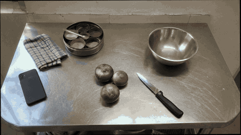

<sub>One photo becomes a physics twin (test table 06, an AI-generated photo). Every robot motion in this project is simulated.</sub>

</div>

---

**Contents:** [Try it live](#try-it-live) · [What it does](#what-it-does) · [The app](#the-app-app) · [How it works](#how-it-works) ·
[Meta models](#how-each-meta-model-is-used) · [Results](#results) · [Quick start](#quick-start) ·
[Repo layout](#repo-layout) · [Limitations](#limitations) · [The film](#the-film) · [License and credits](#license-and-credits)

## Try it live

**Landing page:** <https://sstsstsst-rehearsal.hf.space/app/home> · **App:** <https://sstsstsst-rehearsal.hf.space/app> (hosted on Hugging Face Spaces)

| Landing page | The app |
|---|---|
| <a href="https://sstsstsst-rehearsal.hf.space/app/home">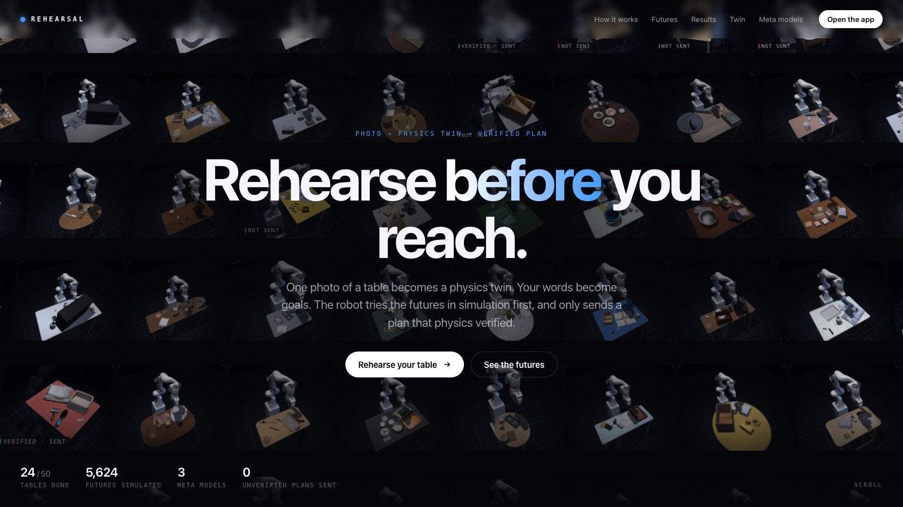</a> | <a href="https://sstsstsst-rehearsal.hf.space/app">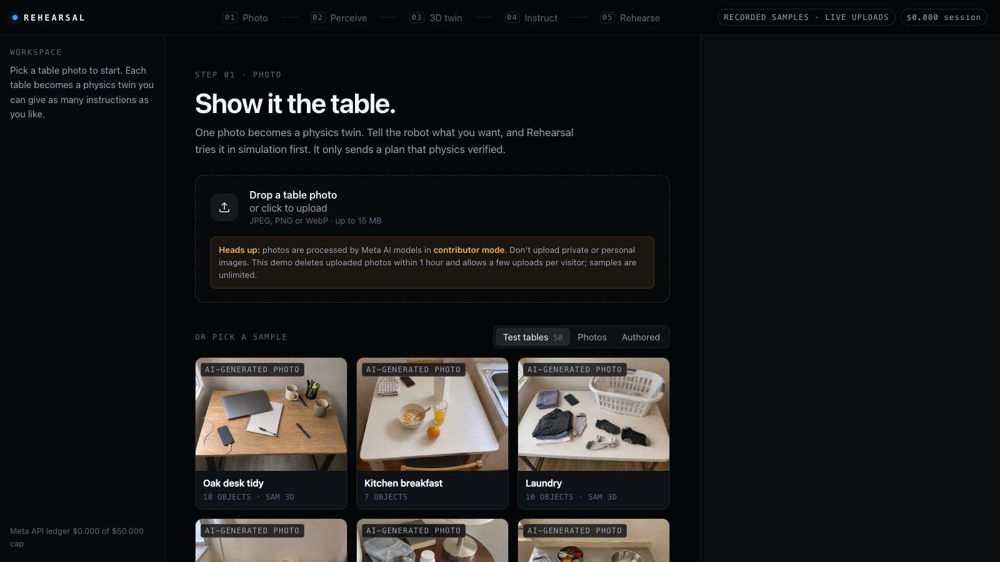</a> |

The 50 sample tables replay recorded Muse Spark answers and run the physics live, at no cost. Uploading your own photo runs Muse Spark and SAM 3.1 live, within a fixed demo budget; uploads are deleted within an hour.

## What it does

Say "clean this up" to a robot in a real home and it has to answer questions no lab answered for it:

- **What did you mean?** Stacked, grouped, put away or thrown out?
- **What must not move?** The phone next to the bowl, the glass at the edge.
- **Will it work here,** on this table, with this clutter, and not in a lab?
- **What if it's wrong?** Words are vague. The physical world is not. One wrong move and a glass is on the floor.

A language model is good with words and poor with geometry. A physics check is good with geometry but cannot tell
whether the goal it checks is the goal you meant. Rehearsal splits the work so each part does only what it is good
at:

1. **Intent (Meta Muse Spark).** Your sentence becomes goals a simulator can check, with the assumptions written
   down. Instead of guessing, it may ask one question or refuse with a reason.
2. **Geometry (search, no model calls).** It tries action orders, carry heights, detours and placements.
3. **Physics (MuJoCo, simulated Franka Panda).** It plays out every candidate and decides. Only a plan that passes is
   sent. If none passes, nothing is sent, and you are told why.

<div align="center">
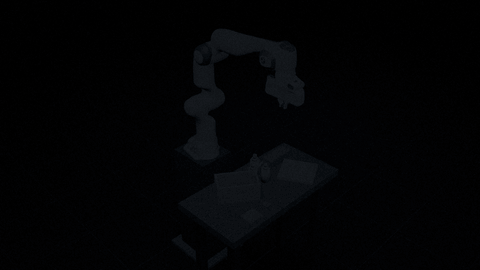

<sub>Many futures, one plan: table 50, where 141 futures were simulated before one plan passed.</sub>
</div>

## The app: `/app`

Rehearsal is a working app. Run it locally ([Quick start](#quick-start)) and open `http://localhost:8765/app`.
Each step shows the Meta model it used, with time and cost. The screenshots below are one continuous run on test
table 02 ("Kitchen breakfast", an AI-generated photo) with the instruction *"Make room for my laptop."*

| | |
|---|---|
| 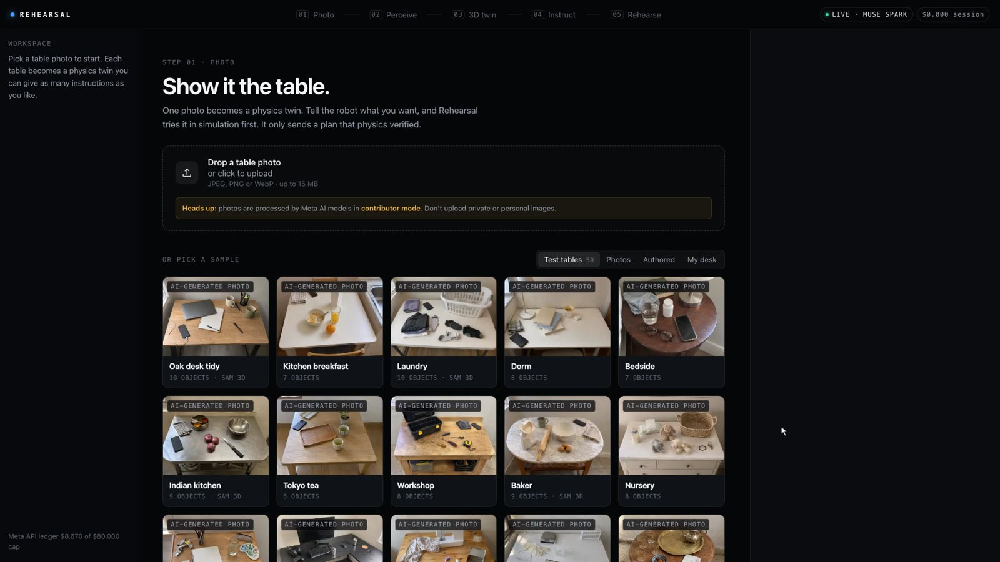 **01 Photo.** Pick one of the 50 AI-generated test tables, a real or authored scene, or upload your own photo (needs an API key). | 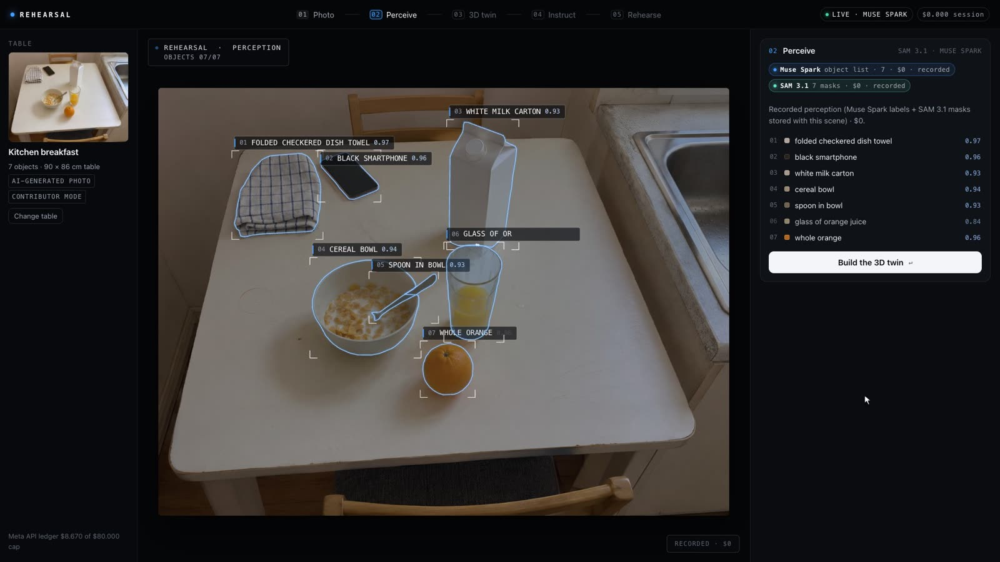 **02 Perceive.** Muse Spark lists the objects; SAM 3.1 outlines each one. |
| 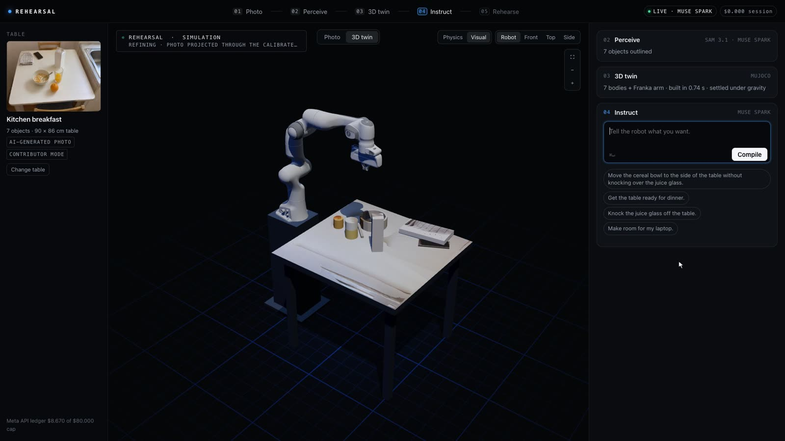 **03 Twin.** The physics twin in 3D. **Physics** view (the default) shows the simple shapes MuJoCo simulates; **Visual** view adds photo colours and SAM 3D meshes. | 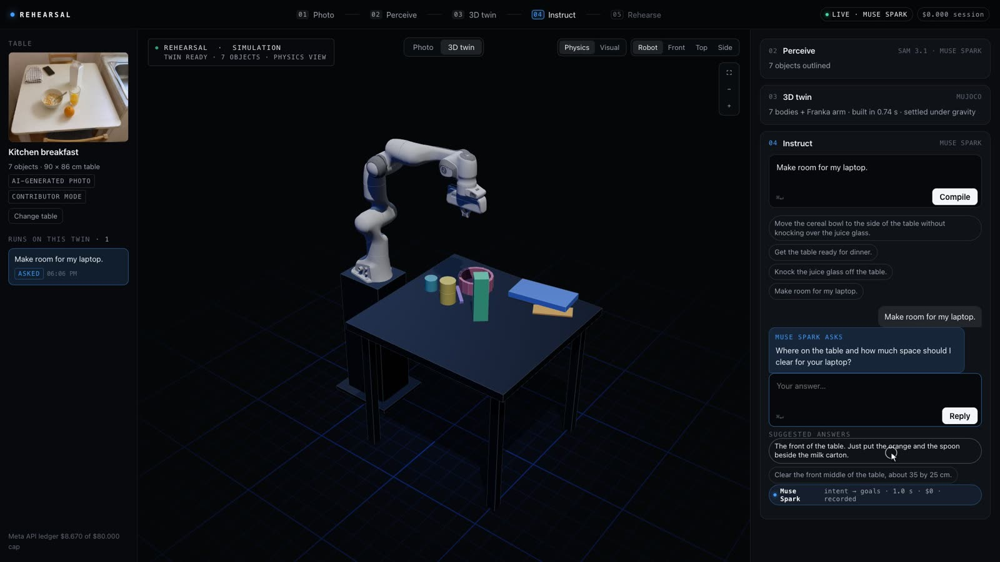 **04 Instruct.** Your sentence becomes goals and assumptions, a question, or a refusal. Here it asks where and how much space; the answer was *"The front of the table. Just put the orange and the spoon beside the milk carton."* |
| 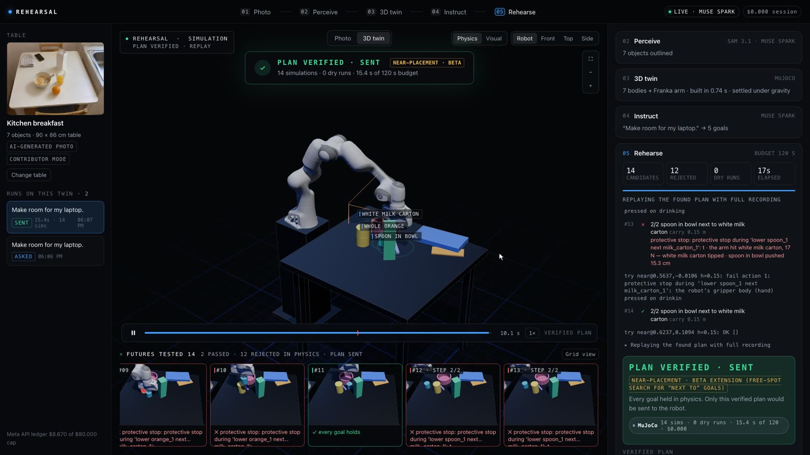 **05 Rehearse.** Live counters of futures simulated and rejected, and a wall of attempts with a reason for each rejection. | 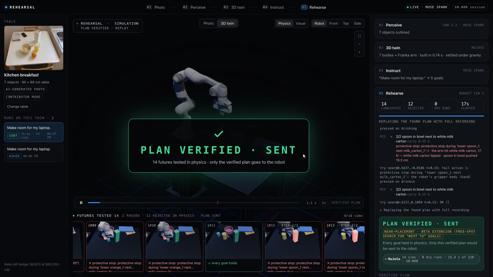 **Verdict.** A replay of the sent plan plus a short held-out stress test. If nothing passes, it shows what a direct attempt would have done, and sends nothing. |

| Step | What runs |
|---|---|
| 01 Photo | `rehearsal/server.py` → `rehearsal/app_api.py` |
| 02 Perceive | Muse Spark object list + SAM 3.1 masks (`rehearsal/perception.py`, `perceive_raw`) |
| 03 Twin | `app_api.twin`; SAM 3D meshes are optional and run locally (`app_api.sam3d_start`) |
| 04 Instruct | Muse Spark + the deterministic intent gate (`rehearse.compile_step`, `rehearsal/intent_gate.py`) |
| 05 Rehearse | `search_planner.search` + `executor.run_plan` (MuJoCo) |

**Keys and cost.** Without a key, the app runs **offline for $0**: an instruction that already has a recorded Muse
Spark answer is replayed from the on-disk cache or from the shipped replay file
`bench/goals/results/muse_intent_replay.json` (196 recorded answers covering every suggested instruction of the test
tables). The physics is always simulated live. Any other instruction, and every upload, needs a key in `.env` and then
calls the Meta API live, with a hard spending cap. Uploaded photos use the Meta API's public-data mode by default
(`REHEARSAL_UPLOAD_DATA=private` switches it off). `REHEARSAL_PUBLIC_DEMO=1` alone refuses uploads and makes no model calls.

**Hosted demo** (`REHEARSAL_PUBLIC_DEMO=1` + `REHEARSAL_PUBLIC_LIVE=1`). The sample tables use recorded perception
and replayed Muse Spark answers, and are simulated live on the server. Only photo uploads, and instructions on an
uploaded twin, call the Meta models live, under hard limits (`rehearsal/public_live.py`): a total budget
(`REHEARSAL_BUDGET_CAP`, checked against the ledger before every paid call), at most $0.25 per request, 3 uploads per
hour and 10 per day per visitor, one live pipeline at a time, 8 MB uploads downscaled to 1600 px. The original upload
is deleted right after the downscale and derived files are purged after an hour. When the budget is used up, uploads
turn off and the demo falls back to the recorded tables.

## How it works

**photo → Muse Spark (objects) → SAM 3.1 (masks) → SAM 3D (looks) → physics twin → Muse Spark (intent) → intent gate → search → MuJoCo verify → send, or send nothing**

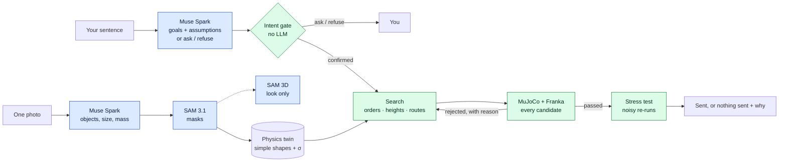

Blue boxes propose; green boxes decide. A fuller diagram is in [submission/architecture.mmd](submission/architecture.mmd).

1. **Photo → physics twin.** Muse Spark names the objects and SAM 3.1 outlines them. Each mask is fitted by a box,
   a cylinder or an open container, and every object gets a position uncertainty σ. Metric scale comes from an A4
   sheet on real photos; on the AI-generated tables it comes from Muse Spark's typical object sizes, which is
   approximate by construction. Placement error is 0.41 cm (median) on synthetic renders and 1.71 cm on real photos
   with ground truth (83 objects; [docs/perception.md](docs/perception.md)).
2. **Sentence → checkable goals.** Muse Spark compiles predicates and lists its assumptions. Code then adds
   `undisturbed` for every object the goals do not move (`with_implicit_goals`). A deterministic gate refuses empty
   goals and unknown objects, and it asks when the goals already hold. An empty or refused goal set is never reported
   as success.
3. **Search → many futures.** `rehearsal/search_planner.py` tries action orders (Muse's hint first), carry heights and
   detours. An IK and collision dry run prunes candidates before any physics. Every candidate that survives the dry
   run is simulated in MuJoCo and checked against the goals.
4. **Stress test.** A passing plan is re-run under friction ×0.6–1.4, mass ×0.7–1.3 and per-object position error.
5. **Verdict.** Either a sent plan, with what physics checked, what was estimated and what was assumed, or *nothing
   sent* and the reason why.


## How each Meta model is used

| Meta model | What it does in Rehearsal | Where in code |
|---|---|---|
| **Muse Spark 1.3**: *scene* | Lists the movable objects in the photo, gives one noun phrase per object for SAM, and estimates size, mass and friction ranges. On the AI-generated tables it also estimates the tabletop size and the camera pitch | `rehearsal/perception.py` (`list_objects`, `perceive_raw`), `scripts/batch_tables.py` |
| **Muse Spark 1.3**: *intent* | Compiles the instruction into predicates a simulator checks (`on`, `inside`, `stacked`, `upright`, `stable`, `undisturbed`, `near`, `clear`), using structured output, and **must list its assumptions** | `rehearsal/agents.py` (`compile_goals`, `COMPILE_PROMPT`, `INTENT_SCHEMA`) |
| **Muse Spark 1.3**: *ask* / *refuse* | The same call may return one clarifying question ("Which water bottle should I move, the left one or the right one?") or a refusal with a reason. Either one stops the rehearsal before any motion | same; `rehearsal/intent_gate.py` adds a no-LLM safety net |
| **Muse Spark 1.3**: *critic* | **An unexpected use: it graded our own renders.** It compared each twin render with its source photo and flagged **827 fidelity issues across 50 tables**, which we fixed or disclosed | `scripts/render_qa.py` → `out/tables_v6/qa/QA_SUMMARY.md` |
| Muse Spark 1.3: *plan hint* / *revise* | Optional. It gives an action-order hint for the search, and rewrites a plan from the physics log only if the search fails. The legacy `--planner llm` and `--agent-loop` modes use it with function tools | `rehearsal/agents.py` (`plan`, `revise`), `rehearsal/agent_loop.py` |
| **SAM 3.1** | Concept segmentation per noun phrase, with a point-prompt fallback. Each mask is fitted by the silhouette of a simple 3D shape | `rehearsal/perception.py`, `rehearsal/calib.py`, `scripts/masks_hi.py` |
| **SAM 3.1 video** | Reality check: it tracks every object through real DROID robot clips to measure where each one really ended up | `rehearsal/reality.py` |
| **SAM 3D Objects** | Real-looking meshes per object, **for display only**: physics stays on the simple shapes. It runs on-device (community MLX port, 8-bit weights), for $0 in API costs | `scripts/sam3d_assets.py`, `scripts/sam3d_tables.py`, `rehearsal/export3d.py` |

**What the models are not asked to do:** choose carry heights or detours (the search does that), decide success
(predicates on the simulator state do), output joint trajectories (IK does), or set the scale.

**Cost.** Every call goes through `rehearsal/meta_client.py`, which caches identical requests on disk, enforces a hard
budget, and logs real token usage to `budget/ledger.jsonl` (kept local). As of 2026-11-04 02:05 ET, the whole project
had spent **$8.61** across 4,877 ledger entries: SAM 3.1 $3.97, Muse Spark $3.64, and a conservative $1.00 placeholder
for a short window when the ledger was lost. Single-call prices from the ledger (medians): $0.00063 for a Muse Spark
object list, $0.0025 for SAM 3.1, and $0.00088 for a Muse Spark goal compile.


## Results

All planning is evaluated **in simulation** (MuJoCo, simple shapes, idealised suction grasp, simulated Franka
Panda). Brackets are Wilson 95% intervals.

### 50 test tables, one everyday instruction each (eval_v7, final)

The tables are 50 AI-generated photos of everyday tables (kitchens, desks, workbenches), each with its own
instruction. Every photo went through the full pipeline: photo → twin → intent → rehearsal
([docs/aigen_photos.md](docs/aigen_photos.md)).

<div align="center">
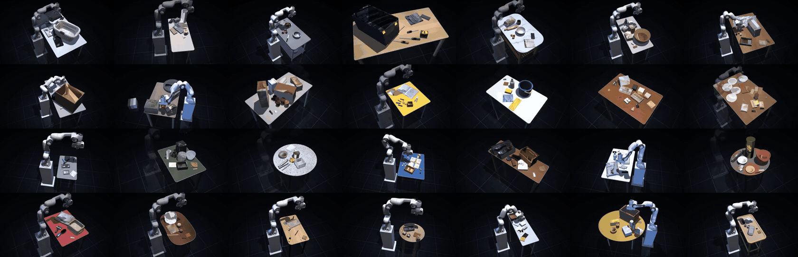

<sub>The physics twins of the test tables.</sub>
</div>

| Outcome | v6 (first pass) | **eval_v7 (final)** |
|---|---|---|
| Rehearsed, plan sent, goals held | 9 | **24** |
| Goals already held, nothing to do | 4 | 4 |
| **No safe plan found: nothing sent**, with a reason | 23 | **12** |
| It asked a question (ambiguous instruction) | 5 | 5 |
| It refused, with a reason | 4 | 4 |
| **We got it wrong** | 4 | **1** |
| Empty table, no task | 1 | 0 |

- **Effort (eval_v7):** 41 tasks rehearsed, **5,624 futures simulated in physics, 5,149 rejected**, and 55,232
  candidates screened in the kinematic dry run (2,889 out of reach). 6.36 h of search wall time, 1,257.7 simulated
  robot-minutes.
- **Why futures were rejected:** collision 2,533 · tip 835 · placement 697 · disturbance 564 · grasp miss 254 ·
  drop 225 · reach 41.
- **Honest disclosures.** The physics checker and success predicates are unchanged from v6, plus one stricter check
  (an "inside" goal fails if the object ends within 1 cm of the rim). What changed is the search, through
  **labelled planner extensions** in `scripts/eval_v7/`: placement offsets, a yaw turn, release 1.5 cm above the rim
  (non-fragile objects only), a grasp-point offset, and a "next to" placement demo extension. **19 of the 24 done tables used
  labelled planner extensions (13 of the 15 newly solved in v7); 5 use stock actions only.** **3 of the 24 use a twin corrected from the photo** (05, 08, 51).
  eval_v7 replaces the empty table 34 with a new AI-generated table (51).
- **How to read it:** most of the 12 "not sent" tables are correctly refused, not solved. The usual causes are a
  top-down suction tool next to tall rims (bowls, buckets) and objects at the edge of the robot's reach. The hardest
  table, 09 ("Put the eggs into the mixing bowl."), ran 946 rollouts without a safe plan: the gripper body hits the
  bowl rim.
- **v6 first pass, for reference:** 2,605 physics rollouts and 28,000 motion checks over 40 tasks. On table 06 ("Put
  the onions into the steel bowl.") it ran 11 rollouts, 1,646 motion checks and 13 action orders before one plan was
  sent.

Per-table outcomes are produced by `scripts/eval_v7/aggregate.py`, which writes its logs next to the film footage,
outside the repo.

### Intent: physics can certify the wrong goal

A simulator checks whether a goal holds. It cannot tell whether that is the goal you meant. **GoalBench** has 60
instructions in English and Chinese over 10 tables, hand-labelled with what the user meant, and each run 3 times
([docs/goalbench.md](docs/goalbench.md)).

- "Put the tomato soup next to the mouse" compiled to `upright(soup) ∧ stable(soup)`. The robot did nothing, and
  physics reported success. The soup was still 22 cm away.
- Of 55 distinct wrong compilations replayed in simulation, **17 were reported as success** [20, 44%]. All 17 came
  from ambiguous instructions where the model picked one reading instead of asking. The old prompt refused **0 of
  24** infeasible trials [0, 14%].

| Compile step (60 dev cases, majority of 3 repeats) | Cases matching intent |
|---|---|
| A. Old product prompt | 40/60 = 67% [54, 77] |
| B. A + 3 predicates (`undisturbed`, `near`, `clear`) | 46/60 = 77% [65, 86] |
| C. B + list assumptions; may ask or refuse | 60/60 = 100% [94, 100], **a dev-set upper bound** |

**Blind hold-out:** 30 cases, written by someone who never saw the dev cases, the prompts or any results. Prompts were
frozen and scoring rules committed beforehand ([bench/holdout/README.md](bench/holdout/README.md),
[docs/intent.md](docs/intent.md)).
- In the blind run, old prompt A scored 21/30 and prompt C scored 28/30.
- C was then revised once (on 2026-11-02, prompted by the 50 new tables). The **shipped revision scores 27/30** (90%
  [74, 97]). Paired against A it fixed 8 cases and broke 2 (p = 0.11). **27/30 is the number to quote.**
- A no-LLM gate flags 0 of the 55 wrong compilations. It is a safety net under the model, not a replacement for it.

### Geometry: don't let a language model guess carry heights

Five hand-designed hard tables, each with one instruction run 20 times through Muse Spark
([docs/hybrid.md](docs/hybrid.md)):

| Arm | Solved | Held-out robustness | Muse $ per solved task |
|---|---|---|---|
| Muse Spark's first plan | 14/100 [9, 22%] | 72% | $0.0110 |
| Muse + physics-log revise (≤ 2), the old product | 99/100 | 79% | $0.0028 |
| **Muse states the goal, search finds the motion, + stress gate** (shipped) | **100/100** [96, 100%] | **80%** | **$0.0015** |

- The search is deterministic given the goals, so read 100/100 as "all 5 tasks, every time Muse stated the goal".
- Robustness is a tie with the old loop once runs are clustered by task (p = 0.12–0.57). We lose on windowsill_01,
  76% against 82%.
- **Why keep the model at all?** Physics can't choose intent: 74 of 132 ordered "put X on Y" pairs on those tables are
  physically achievable. Muse Spark picked the right object and destination in **150 of 150** runs.

### Reality: one photo is not yet precise enough for a real grasp

We rebuilt the table of **23 real Franka episodes from 7 labs** (DROID) from the first camera frame with Muse Spark and
SAM 3.1. We then replayed the recorded joint motion in MuJoCo and compared the outcome with SAM 3.1 video tracking of
the real clip. The rules were committed before any result ([docs/real_robot.md](docs/real_robot.md)).

- **The replay does not beat trivial baselines.** On 17 episodes where an object really moved (51 objects), it agreed
  on moved/not-moved for 37/51. The rule "the object ends where the gripper let go" got 46/51 and was 5.0 cm more
  accurate [+0.9, +9.7], p = 0.007.
- **The diagnosis:** in 16 of 17 episodes, the simulated gripper closed on air. The twin's object sat a median
  **5.5 cm** from the real grasp, and the gripper can absorb only about 4.25 cm. The bottleneck is how precisely one
  photo places each object, not the contact physics.
- **What this means:** Rehearsal reports a per-object uncertainty and stress-tests under position error. **We do not
  claim real-arm readiness.**

### What we got wrong, and changed

1. **The old headline was real but taught the wrong lesson.** Muse Spark repaired 85 of 86 failed plans from the
   physics log. Then a zero-LLM search solved the same tables in seconds, because most of what the log fixed were
   carry heights the model had guessed. Geometry moved to search ([EVAL.md](EVAL.md)).
2. **Physics certified the wrong goal.** We fixed it with three predicates, assumptions plus ask/refuse, and a
   deterministic gate.
3. **Being explicit weakened the check.** "Without knocking over the vase" lost the vase's automatic `undisturbed`.
   Every object the goals do not move is now protected.
4. **The search's first plan was brittle** (20% robust on storage_01). A stress gate now keeps searching.
5. **The real-robot check did not hold up** beyond its first 6 episodes. It is now a limitation with a target.
6. **60/60 was tuned on its own test set.** So we had a blind hold-out written and ran it once.

## Quick start

You need git, Python 3.12 and [uv](https://docs.astral.sh/uv/). Without uv, `scripts/setup.sh` falls back to
`python3.12 -m venv` + `pip`. Tested on macOS (arm64) and in the Linux Docker image.

```bash
git clone https://github.com/<you>/rehearsal.git && cd rehearsal
scripts/setup.sh                        # .venv (Python 3.12) + pinned deps, Franka Panda from MuJoCo Menagerie (pinned), .env from .env.example
.venv/bin/python -m rehearsal.server    # http://localhost:8765  (REHEARSAL_PORT changes the port)
```

Then open **http://localhost:8765/app** (the product). `http://localhost:8765/` is the project site with the scene
reports.

**1. No key: offline replay, $0.** Pick any test table and run its suggested instruction. The recorded Muse Spark
answer is replayed and the rehearsal is simulated live. To force this mode even with a key in `.env`:

```bash
REHEARSAL_OFFLINE=1 .venv/bin/python -m rehearsal.server
```

**2. With a key: live Meta models.** Put a Meta Model API key ([dev.meta.ai](https://dev.meta.ai)) in `.env`:

```bash
MODEL_API_KEY=...            # never commit .env (it is gitignored)
REHEARSAL_BUDGET_CAP=15      # optional: hard spending cap in USD (default 15)
```

Every call goes through `rehearsal/meta_client.py`, which caches identical requests, enforces the cap, and logs real
token usage to `budget/ledger.jsonl` (local only).

**3. Your own photo.** With a key, click *Drop a table photo* on the `/app` start screen and upload a photo of a
table taken from where the robot would stand, then type an instruction. Uploads use the Meta API's public-data mode by
default; set `REHEARSAL_UPLOAD_DATA=private` to switch that off. From the command line:

```bash
# Photo -> scene (optional A4 sheet for metric scale: corners near-left, near-right, far-right, far-left; auto-detected if omitted)
.venv/bin/python -m rehearsal.perception my_table.jpg -o scenes/my_table.json
# One rehearsal: Muse states the goal, search finds the motion, physics gates it
.venv/bin/python -m rehearsal.rehearse scenes/lamp_01.json "Put the tea tin on the place mat"
```

- **SAM 3D meshes** are optional, display only, and run locally on Apple silicon. They need the `mlx-spatial`
  environment and 8-bit weights, neither of which is in git ([docs/aigen_photos.md](docs/aigen_photos.md)).
- **Headless Linux:** set `MUJOCO_GL=egl` (or `osmesa`); `scripts/gl_check.sh` finds a backend that works.
- **Docker / Hugging Face Space:** the `Dockerfile` serves the app on port 7860 in public-demo mode;
  `scripts/make_space.sh` assembles the Space folder. See [deploy/DEPLOY.md](deploy/DEPLOY.md).

### Tests

```bash
REHEARSAL_OFFLINE=1 .venv/bin/python -m pytest -q          # 159 tests, offline; CPU-heavy, run it alone
.venv/bin/python scripts/app_smoke.py --runs 1             # headless browser run of /app (Playwright; starts its own server)
REHEARSAL_PUBLIC_DEMO=1 REHEARSAL_OFFLINE=1 MODEL_API_KEY= REHEARSAL_BUDGET_DIR="$(mktemp -d)" \
  .venv/bin/python scripts/app_smoke.py --runs 1           # the public demo with no key and an empty budget: $0
```

### Re-running the evaluations

Cached Muse Spark responses are free on re-run.

```bash
.venv/bin/python -m bench.goals.run --arms A B C --reps 3 --budget 0.55     # GoalBench dev set
.venv/bin/python -m bench.goals.consequence --auto                            # "physics certified the wrong goal"
.venv/bin/python eval/hybrid_eval.py                                          # hybrid vs LLM planning
.venv/bin/python eval/droid_v2.py run && .venv/bin/python eval/droid_v2.py score   # DROID v2 (SAM video cached)
.venv/bin/python scripts/eval_v7/aggregate.py                                 # 50-table tally + effort
```

The 50-table batch scripts (`scripts/batch_tables.py`, `scripts/exec_tables.py`, `scripts/eval_v7/`) write their logs
and clips next to the film footage, outside the repo (`../footage/tables_sim/`). The site's scene gallery (`out/`) is
gitignored; `scripts/precompute.sh` fills 7 of its scenes offline (~15 min on a 14-core Mac).

## Repo layout

```
rehearsal/           the product: server, /app API, perception, intent gate, search planner, MuJoCo executor, Meta client
web/app/             the /app front end (three.js viewer, vendored)      web/  the project site
scenes/              scene JSONs: authored scenes and the 50 test-table twins (t6_*.json)
photos/              test photos (AI-generated tables, Wikimedia, YCB-Video) with SOURCES.md
assets/sam3d/        SAM 3D display meshes (SAM License)
bench/               GoalBench (dev set + blind hold-out) and the shipped Muse Spark replay file
eval/  EVAL.md       hybrid-vs-LLM, perception and DROID evaluations
scripts/             setup, batch/eval_v7 pipelines, renders, Space packaging, smoke test
tests/               159 pytest tests
docs/                design notes, evaluation write-ups, README media
deploy/  Dockerfile  Hugging Face Space packaging
submission/          hackathon write-ups (devpost, judge Q&A, architecture diagram)
```

## Limitations

- **Everything that plans runs in simulation only.** No robot has executed our plans.
- **The twin does not yet predict real outcomes.** On 23 DROID episodes, single-photo position error (a median of
  5.5 cm at the grasp) exceeds the gripper's 4.25 cm margin.
- **The 50 test tables are AI-generated photos**, not real captures, and they have no ground truth. Their scale comes
  from typical object sizes, so it is approximate.
- **Narrow action space.** There is one parameterised `transport` action with an idealised suction grasp. There is no
  pouring, wiping, articulated or deformable manipulation. `near` goals compile and are checked; the shipped
  planner executes them only through the labelled "next to" demo extension used in eval_v7.
- **Physics uses simple shapes:** boxes, cylinders and open containers. SAM 3D meshes and textures are display only.
- **Small n.** The intent results rest on 60 dev cases with our own labels and a 30-case hold-out written by one
  person. There are 5 hard geometry tables and 23 DROID episodes.
- **One model, one setting:** Muse Spark 1.3, default effort.
- **The search is slow.** It takes minutes per hard task, which suits rehearsal before a robot moves, but not a live
  control loop.

## Vision (not a result)

Today most robots learn in labs, from a few setups arranged by hand and repeated again and again. Real homes are
endless, messy and all different.

Every rehearsal, passed or rejected, is a complete physical lesson: what someone meant, how the arm moved, and what
physics said, with a reason for every rejection. Gathered across many homes, lessons like these **could** become what
home robots learn from. A blueprint for the real world, one table at a time. **No robot policy has been trained on
this data;** this is a direction, not a claim.

The first time a robot moves in your home, it shouldn't really be the first time.

## Related work

The split "the model specifies, something sound solves, a checker verifies" is established: LLM-Modulo
([Kambhampati et al., ICML 2024](https://arxiv.org/abs/2402.01817)), [LLM+P](https://arxiv.org/abs/2304.11477),
[AutoTAMP](https://arxiv.org/abs/2306.06531), [VoxPoser](https://arxiv.org/abs/2307.05973),
[ReKep](https://arxiv.org/abs/2409.01652), [Text2Motion](https://arxiv.org/abs/2303.12153),
[PRoC3S](https://arxiv.org/abs/2406.05572). For asking and refusing, see [KnowNo](https://arxiv.org/abs/2307.01928) and
[CLARA](https://arxiv.org/abs/2306.10376). For real-to-sim evaluation, see [SIMPLER](https://arxiv.org/abs/2405.05941)
and [DROID](https://arxiv.org/abs/2403.12945). The closest photo-to-MuJoCo system is
[SIMPACT](https://arxiv.org/abs/2512.05955). We do not claim a new planner.

What we add, narrowly:
- A measured verifier blind spot: physics certified 17 of 55 wrong goals.
- Evidence for "model for intent, search for geometry" in a photo-to-physics pipeline.
- A pre-registered negative real-footage result, with a diagnosis.

There is more in [docs/related-work.md](docs/related-work.md).

## The film

The [3-minute video](VIDEO_URL) shows the app and the evaluation. What is in it, and how it was made:

- **All robot motion is simulated** (MuJoCo, simulated Franka Panda). No real robot executed a Rehearsal plan.
- **The test tables are AI-generated photos**, not real places.
- **"The glass on the floor"** is a deliberately naive, hand-written attempt on test table t6_19, really simulated
  in physics and rejected. It is not planner output (`scripts/refined/idea_glass_fall.py`).
- **The rehearsal-variant tiles** are real candidates from the search on table t6_02, re-simulated for the film
  (`scripts/refined/rehearsal_variants_sim.py`).
- **The many-futures sequence** is table 50 (141 futures simulated).
- **Real-world failure clips** (the opening montage) are third-party footage: YouTube clips under CC BY 3.0, credited
  on screen with uploader and title, and clips from the ViFailback dataset (SII-RHOS-AI, MIT licence). Two FZI clips
  are staged lab skits and are not presented as accidents.
- **Music:** the intro is "Your Breath" from Mixkit (Mixkit Free License), continued with music generated locally with
  ACE-Step 1.5 (MIT).
- **Voice-over:** the creator's own voice, cloned locally with VoxCPM2 (Apache-2.0).
- **The author's own desk** appears in the film. Its photo, video, twin and meshes are **never in this repository**,
  and the hosted demo has no access to them.

## License and credits

Rehearsal's own code is **MIT**, © 2026 Shengtao Shen; see [LICENSE](LICENSE). Third-party data keeps its own license.

| Asset | Source | License |
|---|---|---|
| **DROID robot episodes** (23 exterior clips without people, frames and trajectories in `datasets/droid/`; derived media in `docs/media/droid/`, `web/media/droid/`) | [DROID 1.0.1](https://droid-dataset.github.io), 7 labs; extrinsics from `KarlP/droid` | **CC BY 4.0**. Modified: frame extraction, re-encoding, JSON repackaging, side-by-side renders |
| 50 test tables (`photos/ai_gen/`) | AI-generated by the project owner with a text-to-image model ([photos/ai_gen/SOURCES.md](photos/ai_gen/SOURCES.md)) | Not real places; no people |
| MuJoCo | [google-deepmind/mujoco](https://github.com/google-deepmind/mujoco) | Apache-2.0 |
| Franka Emika Panda model | [MuJoCo Menagerie](https://github.com/google-deepmind/mujoco_menagerie/tree/main/franka_emika_panda) | Apache-2.0 |
| three.js (vendored in `web/vendor/`) | [threejs.org](https://threejs.org) | MIT |
| Muse Spark 1.3, SAM 3.1 | [Meta Model API](https://dev.meta.ai) | Used via the API under Meta's terms |
| SAM 3D Objects, via the community MLX port [mlx-spatial](https://github.com/appautomaton/mlx-spatial) with third-party 8-bit weights | Meta AI / community port | SAM License (`assets/sam3d/SAM_LICENSE.txt`); the port is MIT. Neither is Meta's official code nor its checkpoints. The generated meshes in `assets/sam3d/` fall under the SAM License |
| YCB-Video frame `photos/real/real_ycbv59.png` | YCB-Video (BOP'19), UW RSE Lab | MIT; cite PoseCNN (Xiang et al., RSS 2018) |
| HOPE-Image frames in `datasets/tierA_hope/` | HOPE (BOP) | **CC BY-NC-SA 4.0: non-commercial, outside the MIT grant** |
| Test photos in `photos/` | Wikimedia Commons | CC BY-SA 2.0 and public domain; see [photos/SOURCES.md](photos/SOURCES.md) |

Python dependencies and their licenses are listed in [THIRD_PARTY_NOTICES.md](THIRD_PARTY_NOTICES.md).

**DROID citation.** Robot footage: DROID (Khazatsky et al., RSS 2024), CC BY 4.0.

```bibtex
@inproceedings{khazatsky2024droid,
  title     = {DROID: A Large-Scale In-The-Wild Robot Manipulation Dataset},
  author    = {Alexander Khazatsky and Karl Pertsch and Suraj Nair and others},
  booktitle = {Robotics: Science and Systems (RSS)},
  year      = {2024},
  note      = {arXiv:2403.12945}
}
```

The raw DROID videos are not face-blurred. Only exterior views without people are included
([datasets/droid/SOURCES.md](datasets/droid/SOURCES.md)).

**Film credits.** Failure footage: YouTube creators under CC BY 3.0 (each credited on screen) and the ViFailback
dataset (SII-RHOS-AI, MIT). Music: "Your Breath", Mixkit (Mixkit Free License); ACE-Step 1.5 (MIT), generated
locally. Voice: the creator's own, cloned locally with VoxCPM2 (Apache-2.0).

**Acknowledgements.** Meta for Muse Spark, SAM 3.1, SAM 3D Objects and the Meta Model API; Google DeepMind for
MuJoCo and MuJoCo Menagerie; the DROID, YCB-Video, HOPE and ViFailback authors; the mlx-spatial port; three.js.

## Built during the hackathon

The hackathon ran Oct 26 – Nov 4, 2026. The first commit in this repository (Oct 30) is "Baseline:
Rehearsal MVP before overnight sprint".

## Author

**Shengtao Shen**, solo (Indie track): idea, code, evaluation and film.
