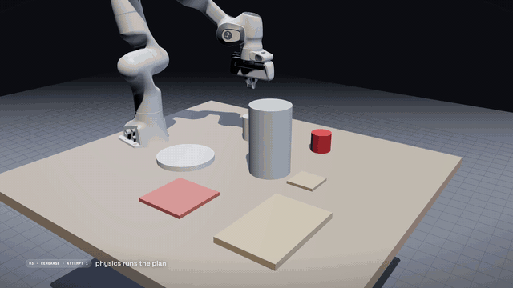
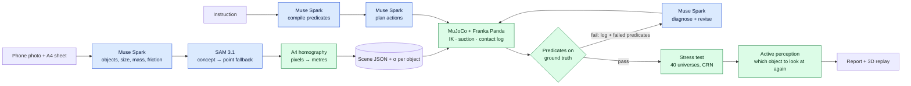

# Rehearsal

**Models propose, physics decides.**

Take one phone photo of your desk. Rehearsal turns it into a physics twin: a simulation-ready approximation
of your table (primitive shapes at measured positions) in MuJoCo with a Franka Panda arm. Meta's Muse Spark
plans the task you ask for, and the plan has to prove itself in simulation before you would ever trust a
robot with your real objects.

**The number we would defend first.** Given the simulator's evidence (which link hit what, when; how far the
arm can reach there; which goal failed by how much), Muse Spark repaired **17 of 17** failed first plans on
four hard scenes within two revisions. Told only the names of the failed predicates: 8/17. Told only
"it failed, try again": 7/17. On the kitchen scene, where the fix is to *reorder* the actions, it was
5/5 with the log and 0/5 without ([docs/agent.md](docs/agent.md), ablation run 2, 5 repeats per scene).
An independent two-scene eval agrees: windowsill 15/15 vs 5/15, Fisher p = 0.0002 ([EVAL.md](EVAL.md)).

<!-- TODO(user): hero GIF. Export an 8–10 s loop (kitchen fail → fix → 40 trails) from submission/footage to docs/demo.gif, ≤ 8 MB, then restore:
 -->

**Live demo:** TODO(user): Hugging Face Spaces URL · **Video (3 min):** TODO(user): video URL ·
Meta Global AI Developer Hackathon 2026, Indie track, theme *Push the Frontier*.

---

## What it does

1. **Photo → twin.** Muse Spark lists the objects on the table and estimates each one's size, mass range
   and friction range. SAM 3.1 segments each object from a short noun phrase (with a point-prompt fallback
   for anything the concept prompt misses). An A4 sheet in the photo fixes metric scale through a
   homography; SAM's mask is then fitted by a 3D primitive's silhouette. The result is a MuJoCo scene with
   a Franka Panda and a per-object position uncertainty `sigma_m`.
2. **Instruction → checkable goals.** "Put the mug in the bowl, then stack the books" becomes
   `inside(mug, bowl) ∧ upright(mug) ∧ stacked(large, medium, small) ∧ stable(small)`. Rehearsal's code
   (`predicates.with_implicit_goals`) then adds `undisturbed(...)` for every object the instruction did not
   mention, so the model cannot forget it. All predicates are evaluated by code on simulator ground truth.
   The model never grades itself.
3. **Plan → physics → revise.** Muse Spark plans transport actions. The arm executes them in MuJoCo. If a
   predicate fails, Muse Spark gets the simulation log (timestamped contact events with link roles, IK reach
   limits found by bisection, protective stops with forces, failed predicates with measurements) and writes
   a diagnosis and a new plan. Up to three attempts.
4. **Or let the model drive (agent loop).** With `--agent-loop`, Muse Spark gets four function tools,
   `simulate`, `stress_test`, `look_again` and `submit`, and decides the next step itself. `submit`
   re-simulates the plan and *rejects* a failing one, so the only way out is through physics.
5. **40 parallel universes.** The final plan is replayed 40 times with perception noise (σ = 1.2 cm per
   object, or the photo pipeline's per-object `sigma_m`), friction ×0.6–1.4 and mass ×0.7–1.3, using common
   random numbers so variants are comparable.
6. **"Look again" (active perception).** For each object, Rehearsal asks: if I re-observed only this one
   (σ 1.2 cm → 0.4 cm), how many universes would succeed? It tells you which object is worth a second photo.
7. **Report.** What was verified by physics, what was estimated under uncertainty, and what was assumed.

### What a real Muse Spark repair looks like

`kitchen_01`, "Put the cup on the coaster, then put the kettle on the trivet." Muse Spark's first plan carries
the cup straight to the coaster. In MuJoCo the gripper body presses on the kettle while lowering the cup
(62 N, protective stop at t = 6.138 s). With the log, Muse Spark 1.3 wrote (verbatim, ablation run 2,
`experiments/agent/partial_r2_kitchen_01.jsonl`):

> "Coaster_1 at [0.72,0.06] is only 15.5cm in xy from kettle_1 at [0.565,0.06]. Kettle is tall (0.25m) with
> radius 0.075m, so its edge is at x~0.64m, very close to the coaster center. To place cup_1 on the coaster the
> tool must descend vertically onto [0.716,0.06]. Evidence shows tool tip at z=0.21m, below kettle top 0.25m,
> and the gripper body above the tip hit the kettle top-edge at [0.64,0.06,0.25] with 62N. This is a
> lowering-phase collision, not a transit collision, so higher transit_height or via waypoints cannot avoid
> it because the final vertical descent is the same. The obstruction must be removed first. Move kettle_1 to
> trivet_1 first to clear the coaster area, then place cup_1 on coaster_1."

The revised plan passes every predicate. Without the log, the same model never found this reordering (0/5).

### What the agent loop looks like

`windowsill_01`, "Put the mug on the tray" (the tray sits at the edge of reach; a 0.32 m vase blocks the
straight path). One run, Muse Spark 1.3 driving the tools, $0.0028, 7 tool calls, 79% of prompt tokens served
from cache (`experiments/agent/loop_windowsill_01.json`; the model's own narration in brackets):

```
[model] Trying a southern detour to avoid the tall vase, will simulate it first.
simulate(mug_1->tray_1@0.45 via [[0.5,-0.1]]) -> FAILED (aborted) | IK failed during 'carry mug_1 to tray_1':
    at xy [0.748,-0.082] the tool tip can reach at most z=0.40 m ...
[model] That height can't reach the far tray, so I'm lowering the carry and routing around the vase.
simulate(mug_1->tray_1@0.24 via [[0.5,-0.15]]) -> SUCCESS
simulate(mug_1->tray_1@0.2  via [[0.5,-0.15]]) -> SUCCESS
stress_test(mug_1->tray_1@0.2 via [[0.5,-0.15]], n=20) -> 18/20
simulate(mug_1->tray_1@0.16 via [[0.5,-0.15]]) -> SUCCESS
stress_test(mug_1->tray_1@0.16 via [[0.5,-0.15]], n=20) -> 17/20
submit(mug_1->tray_1@0.2 via [[0.5,-0.15]]) -> ACCEPTED
```

### What the bundled replays are

The six scenes precomputed into `out/` by `scripts/precompute.sh` (and shown by the web app without an API
key) are **offline reference replays**: the rule-based `OfflineAgent` replays each scene's verified
naive → fixed plan so the fail → diagnose → fix loop can be seen at $0. Every report carries
`agent: offline-stand-in`, and the UI labels it. Their diagnoses are written by us, not by Muse Spark.
On `kitchen_01` the replay fails the same way as Muse Spark's first plan above (protective stop on the
kettle) and fixes it the same way (kettle first). Stress and look-again numbers in those reports are scored
on held-out seeds 1000–1039, for example `kitchen_01` 37/40 → 40/40 after re-observing the cup.

## Why it matters

Home robots are judged in labs and deployed in homes, and every home is different. Today, bringing a real
room into simulation takes scanners, CAD and a robotics engineer. Rehearsal gets a usable approximation from
one photo and a sheet of paper, so anyone can rehearse a task on *their* desk before trusting a robot with it.

The sim-to-real gap is the frontier, and we treat it as a quantity, not a footnote: perception error is
modelled per object, physics parameters are ranges, and the report says how robust the plan is and which
measurement would improve it most. Language models are good at proposing plans and bad at knowing whether
they are physically valid. A simulator is the opposite. Rehearsal puts each where it is strong.

## How Meta models are used

| Model | Role | Where in code |
|---|---|---|
| **Muse Spark 1.3** (`muse-spark-1.3`) | Perception: list movable objects, pick a SAM noun phrase per object, estimate dimensions, mass range, friction range | `rehearsal/perception.py` → `list_objects()` |
| **SAM 3.1** (`sam-3.1`) | Concept segmentation per noun phrase; point-prompt fallback for unmatched objects (marked low confidence). Lossless masks (decoded with `meta_sam_parser`) are fitted by the silhouette of a 3D primitive, which cuts median placement error on renders from 0.54 to 0.41 cm vs a box fit | `rehearsal/perception.py` → `sam_boxes()`, `sam_points()`, `segment_objects()`; `rehearsal/calib.py` |
| **Muse Spark 1.3** | Compile the instruction into predicates (structured output, fixed predicate vocabulary) | `rehearsal/agents.py` → `MuseAgent.compile_goals()` |
| **Muse Spark 1.3** | Plan `transport(obj, dest, in/on, transit_height, via)` actions | `rehearsal/agents.py` → `MuseAgent.plan()` |
| **Muse Spark 1.3** | Read the simulator log, diagnose, revise the plan | `rehearsal/agents.py` → `MuseAgent.revise()` |
| **Muse Spark 1.3**, function tools | **Agent loop:** the model drives `simulate` / `stress_test` / `look_again` / `submit` (strict JSON schemas, `tool_choice=auto`); `submit` is physically gated. Caps: 8 tool calls, $0.10. Measured: $0.0014–0.0028 per run, 70–80% of prompt tokens served from the prompt cache (`prompt_cache_key` per scene) | `rehearsal/agent_loop.py`; `rehearsal.rehearse --agent-loop` |
| **SAM 3.1 video** | Reality check: after the plan is executed for real, a short phone clip is tracked from the twin's boxes and each object's final position is compared with the simulation's prediction (synthetic test: median 0.87 cm, a 5 cm nudge is flagged) | `rehearsal/reality.py` |

All calls go through one client, `rehearsal/meta_client.py` (`chat_json`, `chat_tools`, `sam`, `sam_video`),
which caches identical requests on disk, enforces a hard budget, and logs every call's real token usage.
Synthetic renders and public Wikimedia photos use Muse Spark's Contributor mode; user uploads always use
Standard mode. The whole project, all roles and all experiments, spent $2.41 on the Meta API
(`budget/ledger.jsonl`).

What the models are **not** asked to do: decide success (predicates on simulator state do that), output
joint trajectories (IK does that), or invent the scale of the scene (the A4 homography does that).

## Architecture



Blue boxes propose; green boxes decide. A fuller diagram is in [submission/architecture.mmd](submission/architecture.mmd).

| File | Role |
|---|---|
| `rehearsal/perception.py` | Photo → scene JSON (Muse Spark + SAM 3.1 + A4 homography) |
| `rehearsal/scene.py` | Scene JSON → MuJoCo model (MjSpec), Panda from MuJoCo Menagerie, one suction weld per object |
| `rehearsal/sim.py` | Damped-least-squares IK, Cartesian moves, suction grasp, contact event log, rendering |
| `rehearsal/executor.py` | `transport` action, perception error as belief-vs-reality offset, run a plan |
| `rehearsal/predicates.py` | `inside / on / stacked / upright / stable / undisturbed` on simulator ground truth |
| `rehearsal/agents.py` | `MuseAgent` (Muse Spark, structured output) and `OfflineAgent` (rule-based stand-in) |
| `rehearsal/rehearse.py` | Attempt loop, parallel stress test, active perception, report |
| `rehearsal/agent_loop.py` | Muse Spark drives `simulate` / `stress_test` / `look_again` / `submit` as function tools; `agent_trace` in the report |
| `rehearsal/calib.py` | A4 sheet detection, corner ordering, pixel → table homography and full pinhole camera recovery |
| `rehearsal/synth.py` | Synthetic renders with known ground truth, and the real-photo (YCB-Video, HOPE) evaluation of perception |
| `rehearsal/reality.py` | SAM 3.1 video reality check: tracked final positions vs the simulation's prediction |
| `rehearsal/pipeline.py` | Photo → scene → rehearse jobs for the web app |
| `rehearsal/meta_client.py` | The only path to the Meta API: cache, budget cap, ledger |
| `rehearsal/server.py`, `web/` | Local web app; photo upload, three.js replay of recorded 50 Hz body poses, collision highlights, stress-test trails |
| `eval/`, `experiments/agent/` | Evaluation harness, raw results and figures ([EVAL.md](EVAL.md)); log-feedback ablation and agent-loop traces ([docs/agent.md](docs/agent.md)) |

## Quickstart

Requires git, Python 3.12 and [uv](https://docs.astral.sh/uv/) (or plain `python3.12 -m venv` + `pip`; the
script falls back to it). Tested on macOS (arm64) and in the Linux Docker image.

```bash
git clone <TODO(user): GitHub URL> rehearsal && cd rehearsal
scripts/setup.sh        # .venv (Python 3.12) + pinned deps, Franka Panda from MuJoCo Menagerie (pinned commit), .env from .env.example
scripts/precompute.sh   # rehearse all 6 bundled scenes offline: deterministic, no API key, $0 (~4 min on 14 cores)
.venv/bin/python -m rehearsal.server          # http://localhost:8765  (REHEARSAL_PORT to change)
```

The app opens with the precomputed scenes and needs no API key. For live Muse Spark and photo
upload, put your Meta Model API key ([dev.meta.ai](https://dev.meta.ai)) in `.env` as `MODEL_API_KEY=...`;
every live call is logged to `budget/ledger.jsonl` and hard-stops at `REHEARSAL_BUDGET_CAP` (default $15).

```bash
# Command line, with a key (offline, use scripts/precompute.sh: the offline stand-in only knows the demo instructions)
.venv/bin/python -m rehearsal.rehearse scenes/desk_01.json \
  "Put the mug in the bowl, then stack the books neatly" --stress 40 --look 2

# Tests (offline, ~45 s)
REHEARSAL_OFFLINE=1 .venv/bin/python -m pytest -q
```

Output goes to `out/<scene>/`: `report.md`, `report.json`, a GIF and a trajectory per attempt, and the
stress-test trails used by the 3D replay. Headless Linux: set `MUJOCO_GL=egl` (or `osmesa`) and install
Mesa (`libegl1 libgl1-mesa-dri` or `libosmesa6`); `scripts/gl_check.sh` finds a backend that works.
Manual setup, if you prefer: `uv venv -p 3.12 .venv && uv pip install --python .venv/bin/python -r requirements-dev.txt`,
then the Menagerie commands in `scripts/setup.sh`.

### Photo → scene

```bash
.venv/bin/python -m rehearsal.perception my_desk.jpg \
  --paper-corners "u1,v1 u2,v2 u3,v3 u4,v4" -o scenes/my_desk.json
```

Corners are the A4 sheet's pixel corners: near-left, near-right, far-right, far-left as seen from the robot.
Without `--paper-corners` the sheet is detected automatically. The web app's upload panel does the same
(`POST /api/perceive`): it shows SAM's boxes on the photo, the resulting scene can be edited, and then
rehearsed. How to take the photo (height, angle, where the sheet goes): [docs/perception.md](docs/perception.md).

```bash
# Let Muse Spark drive the tools instead of the fixed pipeline (one run ≈ $0.002 in Contributor mode)
.venv/bin/python -m rehearsal.rehearse scenes/windowsill_01.json "Put the mug on the tray" --agent-loop
```

### Offline mode (no API key, zero cost)

```bash
REHEARSAL_OFFLINE=1 .venv/bin/python -m rehearsal.server
```

Without `MODEL_API_KEY`, or with `REHEARSAL_OFFLINE=1`, Rehearsal uses `OfflineAgent`, a deterministic
rule-based stand-in with the same interface. It only understands the bundled demo instructions, and its
first plan is deliberately naive so the physics → diagnose → revise loop can be seen without the API.
Precomputed scenes and cached Muse Spark responses replay for free.

### Deploy (Docker / Hugging Face Space)

The `Dockerfile` builds the app for a Hugging Face Docker Space (port 7860): it fetches the Panda model,
picks a headless GL backend, and runs the offline precompute during the build, so the Space shows every
demo scene immediately with no API key. It defaults to `REHEARSAL_OFFLINE=1`. Step-by-step instructions,
including the optional (paid) live mode: [deploy/DEPLOY.md](deploy/DEPLOY.md).

```bash
docker build -t rehearsal . && docker run --rm -p 7860:7860 rehearsal   # http://localhost:7860
```

## Evaluation

Everything below is simulated; no real robot. Full tables, scripts, raw logs and caveats: [EVAL.md](EVAL.md)
(closed loop, σ-curve, active perception), [docs/agent.md](docs/agent.md) (ablation, agent loop),
[docs/perception.md](docs/perception.md) (perception accuracy).

| Metric | Value | How measured |
|---|---|---|
| Perception position error, synthetic | median **0.41 cm**, P90 1.05 cm (exact A4 corners); 0.66 / 2.70 cm with auto-detected corners | 12 MuJoCo renders from known cameras, 76 objects → Muse Spark + SAM 3.1 + homography + mask fit → vs ground truth; the suction grasp tolerates ~2 cm |
| Perception position error, real photos | median **1.71 cm**, P90 6.18 cm | 9 YCB-Video + HOPE frames, 83 objects with 6-DoF ground truth, known camera (no A4 sheet), low grazing viewpoints |
| Object recall | synthetic 76/76; real 83/84 on-table objects | concept prompt, then point-prompt fallback (flagged low confidence) |
| First-try success (Muse Spark) | desk_01 20/20 · kitchen_01 8/20 · windowsill_01 0/15 · lamp_01 3/5 · storage_01 0/5 | EVAL §A (n = 5–10 per task) and ablation run 2 (n = 5); predicates on ground truth |
| Success after ≤ 2 revisions, full log | **17/17** failed first plans repaired (4 hard scenes, run 2); windowsill 15/15, kitchen 20/20 (EVAL §A) | same simulations, revise step sees the compact log |
| Mean attempts to success (full log) | desk 1.0 · kitchen 1.6–1.7 · windowsill 2.0–2.2 | EVAL §A |
| Log ablation | full log **17/17** · failed-predicate names only 8/17 · "it failed" only 7/17; kitchen_01 5/5 vs 0/5 vs 0/5 | paired: same failed first plan, only the revise input differs (docs/agent.md run 2) |
| Agent loop (Muse Spark drives the tools) | windowsill: first `simulate` fails on reach, 3 simulates + 2 stress tests, `submit` accepted; $0.0028, 7 calls, 79% cached prompt tokens; kitchen: moved the kettle first unprompted, `look_again(cup_1)` 17/20 → 20/20, $0.0018 | `experiments/agent/loop_*.json` |
| Robustness vs perception error | 100% at σ ≤ 0.4 cm → 87–93% at σ = 1.2 cm → 20–40% at σ = 2.4 cm | held-out seeds, n = 60, common random numbers (EVAL §B) |
| Look again (headline) | `desk_01`: **178/200 → 191/200** after re-observing the mug (+13 fixed, −0 broken, p = 0.0002); kitchen 192 → 200, windowsill 191 → 199 | object chosen on seeds 0–39, **scored on held-out seeds 1000–1199** (EVAL §C). Same-seed selection scores (e.g. 35/40 → 40/40) are inflated and not used |
| Wall time | agent loop 74–106 s per run incl. stress tests; full rehearse + 40 universes + look-again over every object 12–21 min per scene on a loaded laptop (`report.json wall_time_s`); all six scenes 250 s on an idle 14-core Mac | `deploy/DEPLOY.md`, `docs/agent.md` |
| Meta API cost | eval matrix **$0.23** (226 paid calls) · ablation run 1 $0.097 · whole project $2.41 | `budget/ledger.jsonl`, Contributor mode for public scenes |

## Honest limitations

- **Simulation only.** No real robot was used. Rehearsal says what a plan would do in an approximation built
  from your photo, not what a real arm will do. Whether sim robustness predicts real success is not measured.
- **The log ablation is small.** 17 failed first plans over four scenes, five repeats each; the kitchen
  0/5 vs 5/5 split is the clearest signal. The agent loop is shown on single runs, not evaluated at scale.
- **Suction gripper.** Grasping is a weld that succeeds once the cup is on the object's top face. Real grasp
  physics (slip, compliance, finger contact) is out of scope.
- **Primitive shapes.** Objects are boxes, cylinders and bowls with Muse Spark's estimated dimensions.
  No meshes, no articulated objects (drawers, doors), no deformables (cloth, cables).
- **Perception error is modelled, not eliminated.** The stress test assumes Gaussian position error per object;
  "look again" simulates a better second observation by shrinking σ. In the product it is a prompt to take
  another photo of that object.
- **Single view, flat table.** The homography assumes object footprints lie on the table plane. Tall or
  overhanging objects and strong perspective increase error. Transparent and reflective objects segment poorly.
- **Mass and friction are guesses.** That is why they are ranges, and why the result is a success count over
  universes rather than a single yes/no.

## Built during the hackathon

The hackathon ran Oct 26 – Nov 4, 2026. Commit `0bc9996` "Baseline: Rehearsal MVP before overnight sprint"
(Oct 30) is a mid-hackathon snapshot, not pre-hackathon work.
TODO(user): confirm the line below (what, if anything, predates Oct 26).

| Before Oct 26 | Oct 26 – Nov 4 |
|---|---|
| TODO(user) | Everything in this repo: perception pipeline, A4 calibration, MuJoCo scene builder, predicates, revise loop, agent loop, stress test, active perception, web app, hard scenes, evaluation |

## Licenses and third-party assets

Rehearsal's own code: TODO(user): pick MIT or Apache-2.0 and add a LICENSE file.

| Asset | Source | License |
|---|---|---|
| MuJoCo | [google-deepmind/mujoco](https://github.com/google-deepmind/mujoco) | Apache-2.0 |
| Franka Emika Panda model | [MuJoCo Menagerie](https://github.com/google-deepmind/mujoco_menagerie/tree/main/franka_emika_panda) | Apache-2.0 |
| three.js r160 (vendored in `web/vendor/`) | [threejs.org](https://threejs.org) | MIT |
| NumPy, Pillow, imageio, openai-python | PyPI | BSD-3-Clause, MIT-CMU (HPND), BSD-2-Clause, Apache-2.0 |
| Test photos in `photos/` | Wikimedia Commons | CC BY-SA 2.0 and public domain; see [photos/SOURCES.md](photos/SOURCES.md) |
| Muse Spark 1.3, SAM 3.1 | [Meta Model API](https://dev.meta.ai) | used via API under Meta's terms |

## Inspiration and prior art

- **Active perception.** Z. Fang, A. Jain, G. Sarch, A. W. Harley, K. Fragkiadaki.
  [*Move to See Better: Self-Improving Embodied Object Detection*](https://arxiv.org/abs/2012.00057). BMVC 2021.
  The idea that an agent should choose where to look to perceive better is the seed of our "look again" step;
  we score viewpoints by their effect on task success in simulation rather than on detection quality.
- **Rearrangement with commonsense.** G. Sarch, Z. Fang, A. W. Harley, P. Schydlo, M. J. Tarr, S. Gupta,
  K. Fragkiadaki. [*TIDEE: Tidying Up Novel Rooms using Visuo-Semantic Commonsense Priors*](https://arxiv.org/abs/2207.10761). ECCV 2022.
- **Real-to-sim from images.** T. Dai, J. Wong, Y. Jiang, C. Wang, C. Gokmen, R. Zhang, J. Wu, L. Fei-Fei.
  [*ACDC: Automated Creation of Digital Cousins for Robust Policy Learning*](https://arxiv.org/abs/2410.07408). CoRL 2024.
- **Real-to-sim-to-real.** M. Torne, A. Simeonov, Z. Li, A. Chan, T. Chen, A. Gupta, P. Agrawal.
  [*Reconciling Reality through Simulation: A Real-to-Sim-to-Real Approach for Robust Manipulation*](https://arxiv.org/abs/2403.03949) (RialTo). RSS 2024.
- **Simulation as an evaluator of real policies.** X. Li et al.
  [*Evaluating Real-World Robot Manipulation Policies in Simulation*](https://arxiv.org/abs/2405.05941) (SIMPLER). CoRL 2024.
- **Closest prior work.** Liu et al. [*SIMPACT: Simulation-Enabled Action Planning using Vision-Language
  Models*](https://arxiv.org/abs/2512.05955). CVPR 2026. One RGB-D image → meshes and poses → MuJoCo; a VLM
  proposes primitive sequences, reads rollout results, refines them, and a VLM judge decides success; executed
  on a real Franka. More in [docs/related-work.md](docs/related-work.md).

Where Rehearsal differs: ACDC also starts from one image but retrieves similar assets to train policies;
RialTo scans scenes to fine-tune policies; SIMPLER hand-builds environments to evaluate them. SIMPACT is the
closest: against it, Rehearsal decides success with checkable predicates on simulator state (plus the
automatic "nothing else moved" constraint) rather than a VLM judge, feeds back a structured contact/IK log
rather than renders, quantifies robustness with paired rollouts under perception and physics uncertainty,
and ranks which object to re-observe; it needs no depth sensor, only a sheet of paper. Where it is weaker:
no real-robot validation, primitive geometry, an idealised suction grasp, a narrower action space.

## Team

TODO(user): names, roles, contact / X handles.
