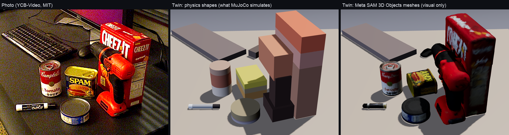

# Real photo, end to end: YCB-Video frame → SAM 3.1 → twin → Muse Spark rehearsal

Until now every demo scene in `out/` was hand-authored, and perception was only measured on its own. This is one run
of the whole chain on a **real photo**: a cluttered office desk from YCB-Video. The objects come from Muse Spark and
SAM 3.1, nobody placed them by hand, and Muse Spark then rehearsed a task in the resulting twin. Every number here is
from that run. Nothing was re-run to pick a better outcome.

## Photo and camera

- **Photo:** YCB-Video, BOP'19 test split, scene 000059, frame 001152 (640×480, PrimeSense/Xtion). Copied unmodified to
  `photos/real/real_ycbv59.png`. **License: MIT**, (c) 2017 Robotics and State Estimation Lab, University of
  Washington. Cite PoseCNN (Xiang et al., RSS 2018) and BOP. Source and credit are recorded in `photos/SOURCES.md`.
- **Camera:** this frame has no A4 sheet, so the dataset's own camera is used: K has fx = 1066.8 px, and the table
  plane comes from `datasets/tierA_ycbv/*.json`, the same setup as the real-photo eval in `docs/perception.md`. The
  camera sits 0.52 m above the desk, about 0.7 m back from the objects, at a grazing tilt.
- **Robot frame:** the robot stands on the camera's side of the desk and faces away from it. Robot +x is the dataset
  table's +y, robot +y is its −x, and everything is shifted 0.62 m in x. That one rigid transform is stored in
  `scene.photo.camera_info.robot_from_dataset_table`.
- **Privacy:** `"public"` (Contributor mode), because this is a public, MIT-licensed dataset photo.
- **Reproduce:** `.venv/bin/python scripts/real_photo_scene.py datasets/tierA_ycbv/ycbv_test_000059_001152.json --name
  real_ycbv59 --title ... --instruction ...`. The Meta calls are cached on disk, so a rerun is free.

## Perception: what SAM 3.1 found

Muse Spark listed 8 objects. SAM 3.1 segmented all 8 with concept prompts, so `not_segmented` is empty. All 6
ground-truth objects were found. The keyboard and mouse were also found, but the dataset does not annotate them, so
they count as extras, not errors. Placement uses `estimate_scene(camera=<dataset camera>, method="guarded")`.

The error is the xy distance between each estimated position and the footprint of the ground-truth 3D bounding-box
centre, in the robot frame:

| object | SAM | fit | σ used by stress | placement error (guarded fit) | error in final scene |
|---|---|---|---|---|---|
| tomato soup can | concept, mask IoU 0.98 | mask_fit | 1.2 cm | **0.30 cm** | 0.30 cm |
| tuna can | concept, 0.97 | mask_fit | 1.2 cm | **0.48 cm** | 0.48 cm |
| Spam (potted meat) | concept, 0.86 | mask_fit | 2.8 cm | 1.73 cm | 1.73 cm |
| power drill | concept, 0.84 (low) | box_fit | 3.8 cm | 1.78 cm | 1.86 cm |
| Cheez-It box | concept, 0.94 | box_fit | 2.8 cm | 4.61 cm | 3.76 cm |
| dry-erase marker | concept, 0.38 (low) | box_fit | 3.8 cm | 4.91 cm | 1.24 cm (re-fitted lying) |

The final-scene column includes the fidelity pass (orientation refinement, which re-fits the position only when
the pose changes, as for the marker) and the exact-footprint de-overlap described below.

Median error is **1.8 cm raw and 1.5 cm in the final scene** (was 1.9 cm before the fidelity pass below), with a
max of 3.8 cm (was 5.0). That matches the 83-object real-photo eval: YCB-V `guarded` gave a median of 2.50 cm. The
per-object σ ranked the objects correctly. The two worst objects carry the largest σ or the "low" label, and the two
best carry the smallest σ.

**De-overlap (one deviation from the default path):** `perception.tidy` pushes overlapping objects apart. It treats
every footprint as its circumscribed circle. On this desk the drill stands against the Cheez-It box and the Spam can
touches the soup can, so tidy moved them 4–10 cm and roughly doubled the median error to 4.9 cm. The script instead
calls `estimate_scene(clamp=False)` and then separates footprints with exact rotated-rectangle and circle shapes
(SAT, in `scripts/real_photo_scene.py`). A compound's footprint is only the parts that touch the table (the drill
stands on its battery, not on its full 18 cm length; `scene.contact_extent`). That moved the cracker box 0.4 cm and
the drill 0.6 cm. **No position was hand-edited.** Interface request for perception: make `tidy` use exact footprints.

## Twin fidelity: does the twin look like the photo?

The first twin was recognisable only by arrangement: one flat-coloured primitive per object, the marker standing up,
the Cheez-It box at yaw 0, the drill a red slab against the box. `scripts/fidelity_eval.py` is the yardstick. It
renders the twin with MuJoCo from the photo's own camera (K, R, t, exact principal point) and measures, per object:

- **silhouette IoU** between the rendered visible silhouette and the SAM 3.1 mask,
- **ΔE** (CIE76, Lab) between the mean colour of the rendered object pixels and the mean photo colour inside its mask,
- the **position error** vs the dataset ground truth (measured only, never used to build the twin).

`rehearsal/perception.py::apply_fidelity` then changes only orientation, shape and colour, from the photo and the mask:

1. **Colour from the mask.** Robust Lab median of the mask pixels (eroded 2 px), lightness at the 60th percentile
   because shading pulls the median below the lit albedo. Labelled cans and boxes get **2–3 colour bands** (per-row
   median colours, best split by weighted Lab variance, kept only if adjacent bands differ by ΔE ≥ 14): the soup can
   is now lid / red / white, the Spam can blue / yellow, the marker black / white / black.
2. **Orientation by silhouette IoU, position held.** Yaw (and standing vs lying for elongated cylinders, which side
   is up for boxes) is chosen by projecting the candidate silhouette into the photo and maximising IoU with the mask.
   The baseline yaw is kept unless the gain is ≥ 0.02; a pose change (standing → lying) must gain ≥ 0.08 and then
   re-fits the position. Masks of objects *nearer* the camera are don't-care (they may hide this one); masks of
   *farther* objects count against the silhouette, so a shape cannot grow over its neighbours.
3. **Category templates.** A power drill becomes a compound of body + chuck + handle + battery, scaled to the fitted
   box, dominant colour on the body and the darker cluster on the handle and battery. Mug (body + handle) and bottle
   (body + neck + cap) templates exist but do not occur in this photo. Compound parts are all collidable in MuJoCo;
   the scene schema gained `{"type": "compound", "parts": [...]}`, `"axis": "x"|"y"` for lying cylinders and
   `"bands"` for colour bands (`rehearsal/scene.py`, validated in `pipeline.validate_scene`, rendered in `web/`).

Before (`photos/real/real_ycbv59.before.*`) and after (`photos/real/real_ycbv59.*`), same camera, same masks:

| object | IoU before | IoU after | ΔE before | ΔE after | pos err before | pos err after | what changed |
|---|---|---|---|---|---|---|---|
| keyboard | 0.741 | 0.741 | 15.3 | 9.3 | – | – | colour |
| mouse | 0.414 | 0.574 | 6.6 | 7.0 | – | – | no longer hidden by the drill |
| tomato soup can | 0.678 | 0.678 | 35.8 | 24.3 | 0.30 | 0.30 | 3 bands (lid / red / white) |
| Spam can | 0.815 | 0.732 | 18.6 | 10.6 | 2.04 | 1.73 | 3 bands; drill handle still clips its edge |
| Cheez-It box | 0.413 | 0.451 | 22.7 | 24.7 | 4.97 | 3.76 | yaw 0 → 0.28 rad, 3 bands |
| power drill | 0.547 | 0.650 | 32.8 | 38.6 | 1.76 | 1.86 | compound (body, chuck, handle, battery), yaw 0.29 |
| dry-erase marker | 0.084 | 0.525 | 29.8 | 7.0 | 4.91 | 1.24 | **lying** (axis x, yaw 1.54), 3 bands |
| tuna can | 0.731 | 0.731 | 11.9 | 9.0 | 0.48 | 0.48 | 3 bands |
| **mean / median** | **0.553** | **0.635** | **21.7** | **16.3** | median 1.9, max 5.0 | median 1.5, max 3.8 | |

The twin is now recognisable as the photo: `photos/real/real_ycbv59.twin_compare.png` (SAM overlay next to the
render from the dataset camera) and `photos/real/real_ycbv59.twin_overlay.png` (50 % blend).

**What is still wrong, honestly:**

- **The Cheez-It box is the weakest object** (IoU 0.45). Its centre is 3.8 cm too close to the camera, so it renders
  taller and deeper than in the photo. The guarded fit chose the 2D-box fallback for it (`mask_vs_box_cm` 4.3), and
  the fidelity pass does not move positions for standing objects.
- **The drill's ΔE got worse** (32.8 → 38.6) although it looks far more like a drill: the compound exposes more dark
  handle/battery area to the camera than the photo shows, and the rendered orange body is lit from above.
- **Bands are rows, not labels.** The soup can's white band renders brownish because the photo's white is in shadow;
  the 60th-percentile lightness correction is a single global choice, not an exposure model.
- **The Spam can lost 0.08 IoU** because the drill's handle now stands where the photo shows a gap.
- **Textures are not projected.** The photo is not mapped onto the faces; everything is still flat shaded colour.

## Rehearsal (live Muse Spark, `--agent-loop`)

```
.venv/bin/python -m rehearsal.rehearse scenes/real_ycbv59.json "Put the tomato soup can on top of the Cheez-It box." --agent-loop --out out
```

I picked this task before the first run because the photo forces it to be hard. The Cheez-It box is 25 cm tall with a
6.2 cm-wide top, which is about the soup can's diameter. The 20 cm drill stands right against it, between the soup can
and the box. This section is the run on the **fidelity twin** (compound drill, lying marker, turned box); the first
run on the flat-primitive twin is in the git history of this file and came out the same way: nominal success, a
robustness failure found by the stress test, recovered by looking again at the box and the drill.

**Muse Spark did not fail nominally.** It chose a 0.38 m carry height on its first try, and the simulation passed.
The failure it found was a **robustness** failure, which it uncovered itself with the stress test:

| # | tool call | result |
|---|---|---|
| 1 | `simulate(soup→cracker_box @0.38)` | SUCCESS |
| 2 | `stress_test(same, n=20)` | **2/20** |
| 3 | `look_again(cracker_box_1)` | 2/20 → 13/20 |
| 4 | `simulate(@0.45 via [[0.6, 0.02], [0.6, −0.12]])` | SUCCESS |
| 5 | `look_again(soup_can_1)` | 13/20 → 13/20 |
| 6 | `look_again(spam_can_1)` | 13/20 → 12/20 |
| 7 | `stress_test(via plan, n=20)` | 11/20 |
| 8 | `submit(@0.38, direct)` | ACCEPTED |

Muse Spark's narration while it worked, verbatim:

- "The direct placement is unstable in variation testing, mostly from target position error. I'll take a closer look
  at the box to tighten its localization."
- "The tall narrow box makes this placement tippy. I'll verify the high迂回 carry's robustness before committing."

It submitted the direct 0.38 m plan, not the detour: after looking again, the detour's own stress test (11/20) was no
better than the direct plan's (13/20). All three attempts were nominal successes.

**Held-out check** (seeds 1000+, n = 40, with the submitted plan):

- **Stress test before looking again: 7/40.** The can lands off the narrow top under the box's 2.8 cm σ.
- **The look-again selection** (its own seeds, 0 and up) picked `cracker_box_1` first (5/40 → 20/40), then
  `power_drill_1` (20/40 → 25/40). Muse Spark chose the box first too.
- **Held-out after looking again: 21/40**, up from 7/40.
- **What that means.** The 2/20 and 13/20 above are on the model's own stress-test seeds; 7/40 and 21/40 are on
  held-out seeds 1000–1039 and are the numbers to quote. A closer look is modelled as a sharper position estimate
  (σ → 0.4 cm), not a new photo; a real second photo is future work. And 21/40 is still only about half: the
  product's answer for this table is "not safe yet; take a second photo of the box before the robot moves",
  not a pass.

**Cost and time:**

- **Meta API:** $0.0055 for perception (Muse listing plus SAM 3.1, served from the cache on the rerun) and
  **$0.0057** for this rehearsal (8 tool calls), from ledger deltas. The fidelity pass itself makes no API calls.
- **Wall time:** perception 2 s from the cache (15 s live); rehearsal 296 s, most of it stress tests and look-again
  rollouts in the simulator, not the model.

## Look-alike objects: Meta SAM 3D Objects meshes (visual only)

The twin's objects are primitives fitted to the SAM 3.1 masks, which is what physics needs, but they do not look
like the photo. Each object now also carries a mesh reconstructed from the same photo and mask by **Meta SAM 3D
Objects** (single image + mask → 3D, SAM License). We ran it via the community MLX port
[mlx-spatial](https://github.com/appautomaton/mlx-spatial) (MIT) with the third-party 8-bit weights
`appautomaton/sam-3d-objects-mlx-8bit` (a conversion of Meta's checkpoints, redistributed under the SAM License),
locally on an M3 Max (36 GB). These are not Meta's official CUDA code or gated checkpoints. Credit: SAM 3D Objects,
Meta AI. The licence ships at `assets/sam3d/SAM_LICENSE.txt`.



**Physics is unchanged.** MuJoCo still simulates the fitted boxes, cylinders and the compound drill. `meshes.bin`
and every geom in `scene3d.json` are byte-identical after the re-export, so the recorded trajectories and the live
Muse Spark report stand as they were (no re-run, $0). The meshes are an optional `visual_mesh` per body, attached
to the same animated body, so they follow grasp, carry and fall.

**Pipeline** (`scripts/sam3d_assets.py`, its own venv, never the project `.venv`; resumable, one object at a time):
SAM 3.1 mask polygon → SAM 3D splat only (the port's dense FlexiCubes mesh export needs about 44 GB and stops on
36 GB) → `experiments/sam3d/splat2mesh.py` (marching cubes on the splatted Gaussians, vertex colours, under 1 s)
→ decimate to 18k faces → orient → `assets/sam3d/<scene>/<obj>.glb` + `<obj>.json` (timing, memory, scores).

**Alignment.** SAM 3D's own layout pose is not exported by the port, and we already have a metric pose from the
photo, so the mesh is fitted to the twin. (1) **Orientation:** we try the 24 axis-aligned rotations of SAM 3D's
canonical frame. Each is placed at the twin pose, rendered through the photo's calibrated camera and scored by mask
IoU − 0.5 × colour error − 0.3 × mismatch with the primitive's proportions. (2) **Scale:** uniform, so the mesh
keeps its own proportions: the geometric mean of the size ratios on the primitive's two largest axes (the thin axis
is the least reliable from one photo). (3) **Placement:** bbox centred on the body origin, the bottom on the
primitive's bottom face, yaw from the twin. `rehearsal/export3d.py` writes the transform
(`python -m rehearsal.export3d scenes/real_ycbv59.json out/real_ycbv59` re-exports on its own).

| object | SAM 3D time | peak memory | Gaussians | photo IoU of the oriented mesh | used |
|---|---|---|---|---|---|
| tomato soup can | about 300 s | 11.4 GB | 490k | 0.95 | yes |
| tuna can | 312 s | 10.3 GB | 458k | 0.90 | yes |
| Spam | 266 s | 10.3 GB | 522k | 0.74 | yes |
| Cheez-It box | 250 s | 10.3 GB | 432k | 0.67 | yes |
| power drill | 221 s | 10.3 GB | 361k | 0.63 | yes (partly occluded; colours lean red) |
| mouse | 254 s | 10.3 GB | 277k | 0.54 | yes |
| dry-erase marker | 207 s | 10.3 GB | 111k | 0.44 | yes (the low-confidence placement, not the mesh, limits the IoU) |
| keyboard | 321 s | 10.3 GB | 188k | 0.71 | **no, falls back to the box**: cut by the photo edge, SAM 3D returned a featureless slab 4.8 cm thick |

About 36 min of machine time for 8 objects, run one at a time. Each GLB is 361 KB, 2.5 MB for the 7 shipped.
The soup can and drill splats are reused from the scout run (`docs/sam3d_scout.md`).

**Viewer.** `web/replay.js` loads the GLBs with three.js r160 `GLTFLoader` (vendored in `web/vendor/`). A toolbar
toggle switches between **Meshes (SAM 3D)** (the default when a scene has meshes) and **Physics shapes**, so judges can
see what the simulator actually used. The twin caption shows a "SAM 3D Objects" badge while meshes are on.
Screenshots (1440×900, `/?scene=real_ycbv59`, no console errors): `docs/real_photo_demo_sam3d_twin_meshes.png`,
`docs/real_photo_demo_sam3d_twin_physics.png`, and `docs/real_photo_demo_sam3d_carry_meshes.png` (attempt 1 at
3.6 s, the soup-can mesh in the gripper).

**Limits.** These are vertex colours, not a UV texture, so the labels are legible only up close. The tuna lid comes out
dark. A mesh can be a few millimetres off the primitive it stands for, so contacts in the replay are judged on the
primitives (toggle to see them). Too slow for a live upload (about 4–5 min per object): precompute demo scenes, or
show the primitives first and swap the meshes in later.

## UI check

`REHEARSAL_PORT=8780 REHEARSAL_OFFLINE=1 python -m rehearsal.server` was opened at `/?scene=real_ycbv59`, 1440×900,
with Playwright, after the run above. The screenshot is `docs/real_photo_demo_ui.png`.

- **What showed up:** the photo panel with the SAM 3.1 masks, the top-down twin (the marker as a lying bar, the
  drill's footprint as its battery), the 3D twin with the compound drill, the banded cans and the lying marker
  (`web/replay.js` renders `compound`, `axis` and `bands`), the inventory with per-object σ, all three attempts and
  "21/40, 7/40 before looking again".
- **Console:** no errors. The only warnings were Chrome's "GPU stall due to ReadPixels" WebGL performance warnings.

## Honest limitations

- **The camera is not phone-calibrated.** It is the dataset's known K and table pose, not the A4-sheet calibration.
  The synthetic auto-vs-exact gap adds about 0.25 cm of median error (see `docs/perception.md`).
- **The robot's position relative to the desk is a chosen transform.** It is not measured.
- **One photo and one live run per twin.** Muse Spark's goal compilation dropped `upright(soup_can_1)`: the goals
  were `on` plus the implicit `undisturbed`. The can stayed upright in every simulated success, but that was not
  checked as a predicate.
- **"Look again" is simulated.** It shrinks that object's σ to 0.4 cm. It does not take a second real photo.
- **Fidelity is measured on one photo.** The IoU/ΔE yardstick and the orientation/colour/template pass were tuned
  on this frame; the 83-object placement eval in `docs/perception.md` was not rerun with the fidelity pass. The
  drill template is hand-designed (four boxes and a cylinder), not learned; mug and bottle templates are untested
  on real photos. The Cheez-It box is still 3.8 cm off and renders too tall from this viewpoint.
- **Shape changes feed the physics.** The lying marker rolls if hit (rolling resistance 0.002 keeps it still at
  rest); the compound drill's mass is split by part volume, not measured.
- **Run artifacts are gitignored.** `out/real_ycbv59/` holds the report, GIFs, trajectories and stress trails.
