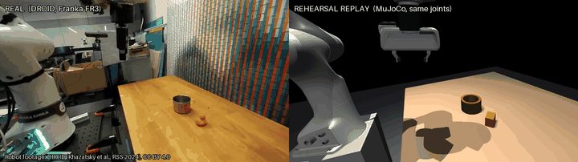

# Real robot: replaying six DROID episodes in the twin

Before this, every Rehearsal result came from simulation or from photos. This document is the first comparison with
a **real robot**. We used six teleoperated episodes of a real Franka arm from the public DROID dataset. For each one,
Rehearsal builds a twin from the episode's **first camera frame** and drives the simulated arm with the **recorded
joint motion**. It then predicts what happens to the objects. We checked that prediction against what the camera
filmed.

Robot footage: DROID (Khazatsky et al., RSS 2024), CC BY 4.0. Sources, episode ids and privacy rules are in
`datasets/droid/SOURCES.md`.



`docs/media/droid/<episode>.side_by_side.mp4` has all six episodes. Each video shows the real clip on the left and the
replay on the right, rendered from the **same calibrated camera**, so the arms overlap when the two halves are blended.
`duck_success` and `cup_fail` are also available as GIFs.

## What was tested (and what was not)

This is **Mode B, replay**. The robot's motion is given: the recorded joint positions at 15 Hz. Rehearsal has to
predict the *consequences* of that motion: whether the gripper catches the object, where each object ends up, which
objects move, and whether the instruction's predicate holds at the end. **Replay is not planning.** It tests the twin
(perception, geometry, contact physics, gripper model). It does not test Rehearsal's planner. A brief Mode A check,
where Rehearsal plans the task itself, is at the end.

The predictor never reads DROID's success label. It reads `label.json` only after the prediction is finished, to
score it. `tests/test_droid_replay.py` enforces this.

## Pipeline

1. **Data** (`datasets/droid/`, `_tools/package_episode.py`). The six episodes come from one lab (AUTOLab), one
   FR3 + Robotiq 2F-85, and two table scenes. Each episode contains:
   - the exterior view without people: `pre.png`, `post.png`, and `clip.mp4` at 960x540, 15 fps
   - the calibrated camera (KarlP/droid extrinsics)
   - the full-rate robot state: joints, finger position, flange pose
   - the operator's gripper **command**

   The finger position is ground truth for "did it catch something". The command is what the replay uses.
2. **Table height** (`_tools/table_sweep.py`, `_tools/table_height.py`, result in `datasets/droid/table_height.json`).
   This replaces the scout's provisional value.
   - **Method.** An object-space plane sweep: at each candidate height, two views are resampled onto a horizontal
     grid in the robot frame, and the wood grain is matched by ZNCC. We used two kinds of view pairs: each ZED's own
     stereo pair, and the ext1+ext2 wide baseline.
   - **The measurements disagree.** Each sweep is precise (RANSAC RMS 3–5 mm, bootstrap 0.4 mm). They still disagree
     across recordings of the *same unchanged* 07-14 scene: −8.9 / −3.3 / −4.9 / −1.3 cm. Phase correlation shows that
     the table and the robot base did not move by even 1 px between those recordings. So the ZED's stereo offset
     changes from one recording to the next, and the ext1 extrinsics are only "predicted".
   - **The robot settles it.** The fingertips can never go below the table. With the 2F-85 tip 0.17–0.19 m below the
     flange, the lowest flange height in each scene bounds the table from above. We kept the measurements that
     satisfy this bound and have at least 20 inliers, and took their median.

   | scene | table z in the robot base frame | kept measurements | spread | robot bound | fingertip clearance at the lowest point (tip 0.17 / 0.19 m) |
   |---|---|---|---|---|---|
   | 2023-07-14 (duck, bowls) | **−8.86 cm** | ext2 stereo, ext1 stereo, ext1+ext2 sweep (all on the 16h44 recording) | 0.36 cm | ≤ −6.1 cm | +2.8 / +0.8 cm |
   | 2023-07-27 (cup) | **−1.23 cm** | ext1 stereo, 2 recordings | 0.0 cm | ≤ −0.9 cm | +0.4 / −1.6 cm |

   **Residual, honestly.**
   - 07-14 rests on three methods that agree within 4 mm, and the bound rules out every other value.
   - 07-27 rests on one camera's stereo pair. With a 0.19 m tip, the fingers would end up 1.6 cm below the table, so
     either the tip is shorter than 0.19 m or the table is ~1 cm lower.
   - We therefore treat the table height as **±1 cm** and test that range below.
3. **Twin** (`scripts/droid_scene.py` → `scenes/droid/<episode>.json`, overlays in `docs/media/droid/*.overlay.jpg`).
   - Objects are found by Muse Spark listing plus SAM 3.1 masks on `pre.png`, then placed by `perception.estimate_scene`
     with the episode's real camera. Nothing was hand-edited.
   - Pots, bowls and cups become open containers (a thin base plus a ring of walls), so `inside` is decided by physics.
   - New `scene.robot.base_z` puts the Franka's link0 8.9 cm / 1.2 cm above the table. The DROID arm stands on its own
     cart. `base_x`, `base_y` and `base_yaw` are supported too.
   - Scenes without `robot` compile to byte-identical MuJoCo models; this was checked on all `scenes/*.json`.
   - Muse Spark compiles the language instruction into predicates. In every episode it produced `inside(object,
     container)`.
4. **Replay** (`rehearsal/replay.py`, `python -m rehearsal.replay all --reality --media --sensitivity`).
   - **Arm.** The recorded joints drive the arm kinematically, linearly interpolated from 15 Hz to the 500 Hz physics
     step.
   - **Calibration checks.**
     - The DROID EE pose equals the Panda flange from forward kinematics, within < 1 mm (a test).
     - The rendered arm overlays the filmed arm. Rendering uses the real K and principal point; the OpenGL frustum is
       overwritten from the calibration.
   - **Tool.** An approximate Robotiq 2F-85:
     - The Panda finger meshes sit on a 7 cm coupling, so the tip is ~0.18 m below the flange.
     - The fingers slide along the flange x axis, with an 85 mm stroke at 0.13 m/s.
   - **Grasp model.** The fingers follow the operator's command. An object is welded to the hand only when **both
     fingers touch it and it holds them apart**, meaning the measured gap stays wider than the command. Closing on air,
     or two closed fingertips brushing one wall, catches nothing. Pushes are left to contact physics. The recorded
     finger position is never used for this decision.
5. **Reality** (`rehearsal/reality.py`, new `camera=` override).
   - One SAM 3.1 video request per clip, seeded with the twin's boxes, tracks every object.
   - Each object's first and last masks are placed on the table with the same calibrated camera and the same fit.
   - Error is reported as the sim-predicted final xy versus the observed final xy.
   - "Moved" means the object moved more than 3 cm (`reality.GAP_TOL_M`). Objects nobody touched drift up to 2.7 cm in
     the clip measurement because the arm partly hides them, so 2 cm would count noise as motion.

## Results

### Success: real vs simulated (6 episodes)

| | sim: success | sim: failure |
|---|---|---|
| **real: success** | 1 (duck_success) | 1 (cup_success) |
| **real: failure** | 0 | 4 (duck_missed_grasp, duck_fail_nudge, bowl_fail, cup_fail) |

The simulation agreed with reality on **5 of 6** episodes. It predicted no false successes.

### Per episode

| episode | real (DROID label) | real fingers per close command (≥ 0.92 = closed on nothing) | replay grasp events | sim predicate |
|---|---|---|---|---|
| duck_success | success | 0.73: holding | duck grasped at step 44, released over the pot at 94 | `inside(duck, pot)` ✅ (1.0 cm from centre) |
| duck_missed_grasp | failure | 0.92: nothing | closed on air at 67 | ❌ |
| duck_fail_nudge | failure | 0.71 (reopened early), then 0.96: nothing | closed on air at 52 and 80 | ❌ |
| bowl_fail | failure | 0.97: nothing | closed on air at 47 | ❌ |
| cup_success | **success** | 0.95: fully closed *inside* the cup; the cup came up wedged on the closed fingers | fingers stopped on the rim → grasp at 35; cup carried 10 cm off-centre, dropped on the bowl rim, fell off | ❌ **wrong** |
| cup_fail | failure | 0.93, then 0.92: fully closed; the cup was briefly lifted wedged and dropped next to the bowl | closed on air at 41, rim pinch at 50, released at 75; closed on air at 99 | ❌ |

**Grasp outcome per close command.** The real finger position is the ground truth here. The replay is right on 5 of
6 clear cases: four closes on nothing and the duck hold. The cup wedge cases are wrong *for the right reason to know
about*. The 2F-85 fingers went inside the tapered cup and lifted it by wedging, and our model has no wedge contact.
The twin's cup is also a cylinder of radius 3.7 cm, while the real rim is wider than the open fingers (8.5 cm). So in
the sim the fingers land on the rim, where in reality they enter the cup.

### Where objects ended up (SAM 3.1 tracking of the real clip vs the replay)

| episode | object | final-position error | sim moved | real moved | agree |
|---|---|---|---|---|---|
| duck_success | pot | 4.0 cm | 3.0 cm | 1.5 cm | ✗ (the rigidly held sim duck pushed the pot while being lowered into it) |
| duck_success | duck | – (hidden inside the pot, SAM lost it at frame 102 of 126) | 16.5 cm | not measurable | – |
| duck_missed_grasp | pot | 0.2 cm | 0.0 | 0.3 | ✓ |
| duck_missed_grasp | duck | 2.5 cm | 0.0 | 2.4 | ✓ (below 3 cm; the real duck may have been nudged) |
| duck_fail_nudge | pot | 2.6 cm | 0.0 | 2.7 | ✓ |
| duck_fail_nudge | duck | 1.9 cm | 0.8 | 1.9 | ✓ |
| duck_fail_nudge | black connector | 0.3 cm | 0.7 | 0.1 | ✓ |
| bowl_fail | black bowl | 2.2 cm | 0.0 | 2.1 | ✓ |
| bowl_fail | pink bowl | 0.3 cm | 0.0 | 0.2 | ✓ |
| cup_success | bowl | 5.0 cm | 0.6 | 4.4 | ✗ (the real cup inside it hides half the bowl, which shifts the mask fit) |
| cup_success | cup | **22.4 cm** | 39.1 | 20.0 | ✓ (moved, but the sim cup fell off the rim) |
| cup_success | mallet | 2.5 cm | 1.7 | 0.1 | ✓ |
| cup_fail | bowl | 0.1 cm | 0.0 | 0.2 | ✓ |
| cup_fail | cup | **13.5 cm** | 6.3 | 7.9 | ✓ (both moved, to different places) |
| cup_fail | mallet | 5.9 cm | 4.8 | 0.1 | ✗ (perception made the mallet a 23.5 cm box; the falling sim cup hit it) |

**Final-position error over 14 measurable objects:** median **2.5 cm**, mean 4.5 cm, max 22.4 cm. For objects the
replay left untouched, the median is 2.0 cm; this is the floor set by perception and tracking. **Moved/not-moved
agreement: 11 of 14.**

Placing the same object from the first frame of the clip and from `pre.png` agrees to 0.03–1.1 cm, so the twin and the
tracker are self-consistent. That number is *not* accuracy against ground truth; DROID has no object poses.

### Sensitivity: does the verdict survive the calibration unknowns?

We re-ran each episode with the robot base ±1 cm (equivalent to a table-height error) and the fingertip length ±1 cm,
which gives 4 variants per episode (`eval/results/droid_replay/summary.json` → `sensitivity`).

- **The four failures stay failures in all 16 variants.**
- **duck_success flips to "closed on air" in 2 of 4 variants**: base +1 cm, and a tip 1 cm shorter. The fingertips
  reach only the upper ~2 cm of the duck. The one correct success prediction is therefore **fragile**: it depends on
  the tip height to within 1 cm.
- cup_success stays wrong in all variants.

## Mode A (brief): Rehearsal plans the task itself

We ran `rehearse(..., look_rounds=0, n_stress=20)` on the two successful scenes with Muse Spark in Contributor mode.
This mode uses Rehearsal's own suction executor, **not** the Robotiq, so it cannot be compared with the teleoperator
action by action. Reports are in `eval/results/droid_replay/modeA_*.report.md`.

| scene | nominal plan | stress test (friction, mass, perception σ from the scene) | dominant failure in stress |
|---|---|---|---|
| duck → pot | success at 0.20 m carry height | 0/20 | 19/20 "suction cup missed duck's top face" |
| cup → bowl | success at 0.25 m | 1/20 | 16/19 "suction cup missed cup's top face" |

Rehearsal's own risk assessment pointed at **the grasp**. In the real data, 4 of the 6 attempts failed at exactly
that step: the gripper closed on nothing or on the wrong part of the object. This is only a qualitative match. The
0/20 comes mostly from the 5 cm σ that perception gives "low-confidence" SAM boxes.

## Failures and caveats (read before quoting any number)

- **One lab, one robot, two table scenes, six episodes.** None of this is a statistic. The 2×2 table could change
  completely with 20 episodes from other labs. The scout chose the episodes (views without people, clear outcome) before any replay was run.
- **Replay ≠ planning.** The arm motion is given. Mode B validates the twin's consequences, not Rehearsal's plans.
- **Gripper approximation.** We used Panda finger meshes on a coupling. There is no Robotiq linkage, no compliance,
  no wedging, and no friction grasp; a hold is a weld once the fingers bracket an object. The cup success, which came
  from a wedge inside a tapered cup, is invisible to this model.
- **Fragile hit.** The one correct predicted success (duck) flips under a 1 cm change in tip or table height.
- **Table height residual: ±1 cm.** It is good on 07-14 (three methods within 4 mm, with a robot bound). It is weaker
  on 07-27, which has one stereo source, and there the fingertip bound is only satisfied with a tip shorter than
  0.19 m.
- **Perception.**
  - Objects are boxes, cylinders and open cylinders, so the tapered cup becomes a straight one with too small a rim.
  - The mallet became a 23.5 cm box and changed one outcome.
  - Most SAM boxes on these frames are tagged low-confidence.
- **Reality measurement.**
  - Positions come from monocular mask fits, so partial occlusion by the arm or by an object inside a container
    shifts them by 2–5 cm.
  - An object inside an opaque pot is not measurable.
  - There is no ground-truth pose in DROID.
- **Timing.** Camera frames and robot states are aligned by index. During fast lifts the filmed arm leads or lags the
  replayed arm by up to ~2 frames, which is visible in the blends.

## Reproduce

```bash
.venv/bin/python scripts/droid_scene.py all              # Muse Spark + SAM 3.1 on pre.png (cached; ~$0.05 first time)
.venv/bin/python -m rehearsal.replay all                 # physics only, ~3 s, $0
.venv/bin/python -m rehearsal.replay all --reality --media --sensitivity   # + SAM 3.1 video (~$0.13 first time), MP4/GIF
.venv/bin/python -m pytest tests/test_droid_replay.py
```

Results: `eval/results/droid_replay/` (`summary.json` and one JSON per episode).

Meta API spend for this whole study: $0.18 (43 calls: Contributor-mode Muse Spark, SAM 3.1 images, 6 SAM 3.1 video requests), recorded in `budget/ledger.jsonl` under the callers
`perception.list_objects`, `perception.sam`, `perception.reality_video` and `agent.*`.
