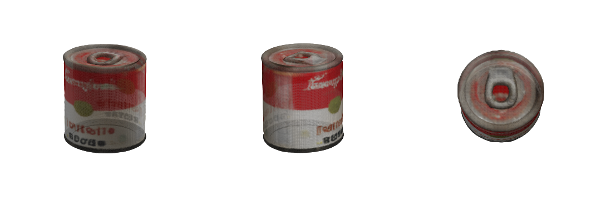

# SAM 3D scout: per-object meshes for the viewer

**Question.** Can Meta's single-image 3D model turn each SAM 3.1-segmented object in a photo into a mesh for the
three.js viewer, while physics keeps simple collision shapes?

**Verdict: GO, with one caveat about the weights (see "Licence and access").** We ran SAM 3D Objects locally on
this M3 Max (36 GB) through an MLX port. With one real SAM 3.1 mask from `real_ycbv59` it reconstructed the
Campbell's soup can: red and white label, lettering, pull-tab lid, correct proportions. The Gaussian splat took
about 5 minutes. A 0.6 s marching-cubes step of ours turned it into a vertex-coloured GLB.
See `experiments/sam3d/soup_can_1.preview.png`.



## 1. What Meta released

| | SAM 3D Objects |
|---|---|
| Release | 19 Nov 2025 (code + checkpoints); encoder weights update 01 Jun 2026 |
| Code | https://github.com/facebookresearch/sam-3d-objects |
| Weights | https://huggingface.co/facebook/sam-3d-objects (**gated**: HF login + form asking for full legal name, date of birth and organisation, and Meta reviews requests; some are rejected) |
| Licence | **SAM License** (same family as SAM 3 / our `meta-sam-parser`). Royalty-free, allows use, modification and redistribution including commercial use. Conditions: ship the licence with any redistribution, credit SAM in publications, no reverse engineering, trade-control and ITAR end-use limits (no military, weapons or nuclear use). Hackathon use is fine. |
| Input | RGB(A) image + binary mask of one object. MoGe estimates a pointmap (depth) internally |
| Output | Gaussian splat (`.ply`), optional textured mesh GLB (FlexiCubes + texture bake), and a layout pose (rotation, translation, scale) in camera space |
| Official hardware | **Linux-64 + NVIDIA GPU with at least 32 GB VRAM**, CUDA 12.1, PyTorch 2.5.1. Hard CUDA dependencies: spconv-cu121, flash-attn, xformers, gsplat, kaolin, nvdiffrast, pytorch3d. No MPS or CPU path |
| Meta Model API | **Not available.** `api.meta.ai/v1` exposes only SAM 3.1 (2D/video). See docs/meta-platform.md: "SAM 3D: Not on the platform". No hosted inference API, only the web demo (aidemos.meta.com) |

Sister model: SAM 3D Body (human mesh), same licence. Not relevant to tabletop objects.

## 2. What runs on this Mac

The official repo cannot run here: it needs CUDA, plus a gate form the user would have to fill in.
What does run:

- **Runtime:** [`mlx-spatial`](https://github.com/appautomaton/mlx-spatial) (MIT, AppAutomaton) is a pure MLX
  port of the SAM 3D Objects inference pipeline, with no Torch and no CUDA.
- **Weights:** [`appautomaton/sam-3d-objects-mlx-8bit`](https://huggingface.co/appautomaton/sam-3d-objects-mlx-8bit)
  (4.6 GB, **not gated**, redistributed under the SAM License, which permits redistribution). It is an unofficial
  8-bit conversion of Meta's checkpoints and includes MoGe ViT-L (Apache-2.0). A full-precision variant is also
  available: `appautomaton/sam-3d-objects-mlx` (13.7 GB).

Setup, all under the scratchpad and never in the project `.venv`:
```bash
uv venv --python 3.13 sam3d_env
uv pip install --python sam3d_env/bin/python "mlx-spatial @ git+https://github.com/appautomaton/mlx-spatial.git@main" \
    huggingface_hub plyfile trimesh scikit-image matplotlib
sam3d_env/bin/hf download appautomaton/sam-3d-objects-mlx-8bit --local-dir weights/sam-3d-objects-mlx-8bit   # ~3.5 min
python experiments/sam3d/make_masks.py scenes/real_ycbv59.json in/          # SAM 3.1 polygons -> mask PNGs, $0
cd run_dir && mlx-spatial-sam3d reconstruct weights/sam-3d-objects-mlx-8bit in/image.png \
    --mask in/mask_soup_can_1.png --output outputs/soup/gaussians.ply --trace-output outputs/soup/trace.json \
    --memory-profile balanced            # the output path must sit under ./outputs
python experiments/sam3d/splat2mesh.py outputs/soup/gaussians.ply soup_can.glb 128
```

### Measured (M3 Max, 36 GB, 8-bit bundle, 640x480 YCB-V photo, one SAM 3.1 mask)

| Object | Splat (stages 1-8) | Peak memory | Splat | Mesh (our splat2mesh) |
|---|---|---|---|---|
| soup_can_1 (mask IoU 0.98) | **about 5 min** (13:27 → 13:32 PLY written) | 11.4 GB footprint, MLX peak 4.1 GB | 489,760 Gaussians, 33 MB PLY, quality gates "nominal" | 0.6 s, 120k faces, watertight; decimated to 18k faces, 361 KB GLB |
| power_drill_1 (mask IoU 0.84, occluded) | DRILL_TIME | DRILL_MEM | DRILL_NOTE | |

**Problem we hit:** the built-in mesh export (`--glb-output`) **does not run on 36 GB**. The MLX port runs FlexiCubes on
a dense 256³ grid and estimates 44.4 GB for its intermediate arrays, then stops at its 6 GB guard. Before stopping,
it spent about 32 minutes in the mesh-decoder stage (total wall time 2,247 s). **Workaround (shipped):**
`experiments/sam3d/splat2mesh.py` splats the opaque Gaussian centres into a 128³ grid, blurs it, runs marching cubes,
keeps the largest component and colours vertices from the 8 nearest Gaussians (SH DC term). It takes under a second,
and the preview shows label and lid detail. It produces vertex colours rather than a UV texture, which is enough at
viewer distances. Always run without `--glb-output`.

Mesh frame: object-centric and normalised (longest side about 1). The +z axis of the PLY is the can's height
(extent 0.72 × 0.71 × 1.04, so diameter/height = 0.69, against 0.66 for a real 63.4 × 96.1 mm can, padding included).
The layout pose from SAM 3D is not needed, because we already have metric pose from the photo (below).

## 3. Integration sketch

The scene already has metric `pos`, `yaw` and `shape` per object (fitted from the SAM 3.1 mask and homography).
Keep that as the source of truth for physics and use the SAM 3D mesh **only for looks**.

1. **Offline asset step** (`scripts/sam3d_assets.py`, separate venv, run on demand). For each object of a photo
   scene: make the mask PNG, run `reconstruct` (splat only), then `splat2mesh` → `web/assets/<scene>/<obj_id>.glb`
   (decimated to about 15-20k faces, about 0.3-0.5 MB). Write `"visual_mesh": "assets/<scene>/<id>.glb"` on the
   object (a new optional field, CONTRACTS-compatible). Runtime is about 5 min per object, so about 40 min for the
   8 objects of real_ycbv59. That is too slow for live uploads, so precompute the demo scenes. For a live upload,
   show primitives first and swap meshes in as they finish.
2. **Alignment.** Rotate the mesh so its up axis is +z (the robot frame is z-up and the PLY is already +z up for the
   can; check per object using the smallest-variance axis). Then scale x, y and z independently so its axis-aligned
   bounding box equals the primitive's box (`size`, or 2r × 2r × h for cylinders). Apply the scene `yaw` and `pos`, and
   set z_min = 0 on the table. The mesh's own yaw around z is ambiguous for symmetric objects. For boxes, pick the
   rotation (0/90/180/270°) whose footprint best matches the SAM mask footprint in the top view.
3. **Viewer.** Vendor `GLTFLoader.js` (from three r160 `examples/jsm/loaders`, matching `web/vendor/three.module.min.js`).
   In `replay.js`, after building a body group from `scene3d.json`, if the object has `visual_mesh`, load the GLB,
   add it as a child of `bodyByName[id]` with the alignment transform, and hide the primitive mesh. Use
   `MeshStandardMaterial({vertexColors: true})`. Trajectory playback moves the group, so the mesh follows physics for free.
   `export3d.py` needs no change, because the viewer can take the GLB path from `scene_spec`.
4. **Physics.** Unchanged: MuJoCo keeps the fitted box or cylinder. Optional later step: replace the primitive with the
   mesh's convex hull (`trimesh.convex_hull`, about 3k faces → a MuJoCo `<mesh>` geom). Only worth it for odd shapes
   like the drill, because hulls change contact behaviour and need re-validating the stress test.

**Effort to ship by Nov 4:** asset script + alignment, 3-4 h; GLTFLoader + replay.js swap, 2-3 h; precompute the
real_ycbv59 and Wikimedia demo photos, about 1 h of machine time; README and pitch, 1 h. **About 1 working day** for
the visual-mesh path. Add 0.5 day for convex-hull collision. Pitch angle for "creative use of Meta AI": SAM 3.1 (API)
masks → SAM 3D (open weights, on device) meshes → Muse Spark plans against a twin that looks like the photo.

## 4. What the user should decide

- **Nothing is required to run the MLX path.** It uses ungated, SAM-License-redistributed weights, and the user
  already relies on the SAM License via meta-sam-parser.
- To use **Meta's own official checkpoints** (for example, to claim "official SAM 3D weights" in the pitch, or to
  convert the full-precision bundle yourself), the user must log in to Hugging Face, open
  https://huggingface.co/facebook/sam-3d-objects, fill in the access form (legal name, date of birth, organisation;
  it cannot be edited afterwards) and wait for Meta's approval. Even then, the official code needs CUDA. We did
  **not** do this, because accepting licences on the user's behalf is out of scope.
- The 8-bit bundle is a **third-party conversion** (AppAutomaton), so state that honestly in THIRD_PARTY_NOTICES if we ship it.

## 5. Fallbacks (Apple Silicon)

| Model | Licence | Mac feasibility | Notes |
|---|---|---|---|
| TRELLIS.2 via the same `mlx-spatial` (Microsoft) | MIT | Ported to MLX, "stable" | Takes an object-centric RGBA crop (use our SAM mask as alpha, which avoids RMBG-2.0 and its NC licence). Gives a textured GLB directly. Not Meta, so weaker for the Meta-tooling score |
| TripoSR (Stability + VAST) | MIT | PyTorch, runs on MPS/CPU in seconds per object | Lower fidelity, vertex colours. The quickest "it just works" fallback |
| SF3D (Stability) | Stability Community License (free under $1M revenue) | PyTorch, community ports | UV-textured mesh, fast |
| Hunyuan3D-2 / 2.1 | Tencent non-commercial | Community MPS port with patches | Not recommended (licence) |

## Sources

- SAM 3D Objects repo + README + `doc/setup.md` (hardware, CUDA, gate): https://github.com/facebookresearch/sam-3d-objects , https://github.com/facebookresearch/sam-3d-objects/blob/main/doc/setup.md
- SAM License text: https://github.com/facebookresearch/sam-3d-objects/blob/main/LICENSE
- Official weights (gated): https://huggingface.co/facebook/sam-3d-objects
- MLX runtime: https://github.com/appautomaton/mlx-spatial (docs/sam3d.md)
- MLX weights: https://huggingface.co/appautomaton/sam-3d-objects-mlx-8bit , https://huggingface.co/appautomaton/sam-3d-objects-mlx
- Meta Model API scope: docs/meta-platform.md (SAM 3D not on the platform)
- Fallbacks: https://huggingface.co/stabilityai/TripoSR , https://huggingface.co/stabilityai/stable-fast-3d , https://huggingface.co/tencent/Hunyuan3D-2/blob/main/LICENSE , https://github.com/microsoft/TRELLIS.2
